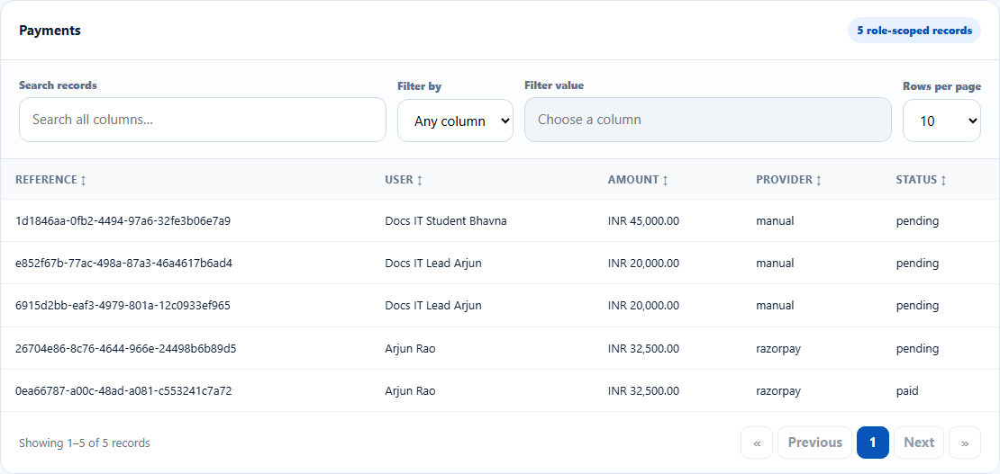
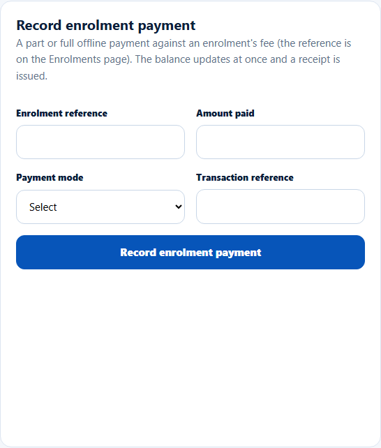
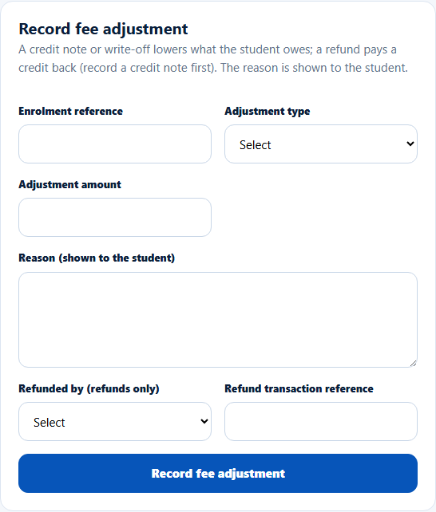
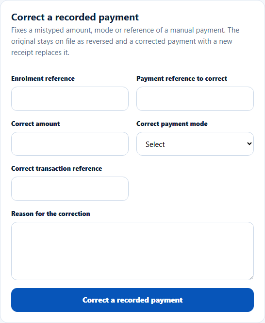
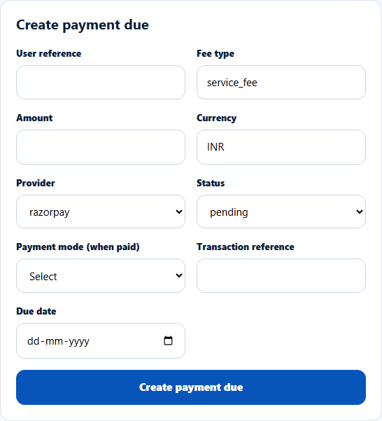
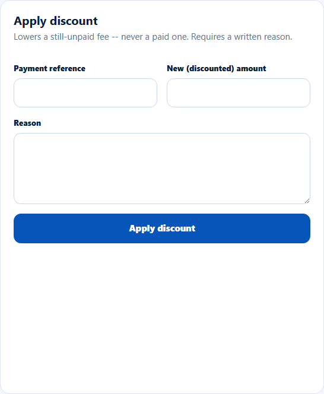
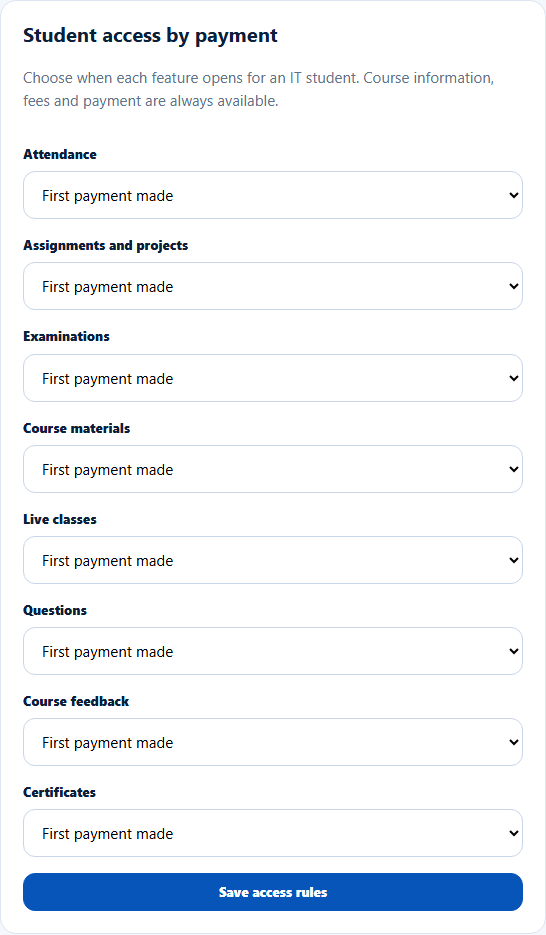

# Payments screens (record payments, refunds and corrections)
> Doc ID: DOC-ITC-ADM-008 · Verified on 2026-11-18 against `main` @ `6b61546c` (screens only) · Roles: IT Admin

## Purpose
Know where the IT Admin records offline payments, adjustments and corrections. This page shows the screens only: **no payment, refund or correction was recorded** while writing this guide (owner decision I3), so success messages below are quoted from the screen text, not captured.

## Who Can Use This Feature
- **IT Admin**. IT counselors cannot record payments.

## Prerequisites
- The student's **Enrolment reference** (for example **EDU-20261118-735504**), from **Enrollments** or the student's **Fees and reminders** card.

## How to Access
IT Admin sidebar **Payments** ("Payment plans, reconciliation, and provider status.").

## Screens
### Payments list
Every payment row: **reference**, **User**, **Amount**, **Provider** (`manual` or `razorpay`) and **Status** (`pending`, `paid`). Converting a lead creates one `pending` row per installment.

### Record enrolment payment
"A part or full offline payment against an enrolment's fee (the reference is on the Enrolments page). The balance updates at once and a receipt is issued." Fields: **Enrolment reference**, **Amount paid**, **Payment mode** (Cash, UPI, Card, Bank transfer, Cheque), **Transaction reference**.

### Record fee adjustment
"A credit note or write-off lowers what the student owes; a refund pays a credit back (record a credit note first). The reason is shown to the student." Fields: **Enrolment reference**, **Adjustment type** (Credit note, Write-off, Refund), **Adjustment amount**, **Reason (shown to the student)**, **Refunded by (refunds only)**, **Refund transaction reference**.

### Correct a recorded payment
"Fixes a mistyped amount, mode or reference of a manual payment. The original stays on file as reversed and a corrected payment with a new receipt replaces it." Fields: **Enrolment reference**, **Payment reference to correct**, **Correct amount**, **Correct payment mode**, **Correct transaction reference**, **Reason for the correction**.

### Create payment due and Apply discount
**Create payment due** adds a single charge (**User reference**, **Fee type**, **Amount**, **Currency**, **Provider**, **Status**, **Payment mode (when paid)**, **Transaction reference**, **Due date**). **Apply discount** "Lowers a still-unpaid fee -- never a paid one. Requires a written reason." For counselor requests, use [Discount approvals](adm-009-discount-approvals.md) instead.

### Student access by payment
"Choose when each feature opens for an IT student. Course information, fees and payment are always available." For **Attendance**, **Assignments and projects**, **Examinations**, **Course materials**, **Live classes**, **Questions**, **Course feedback** and **Certificates**, choose **Registered**, **Enrolled, payment pending**, **First payment made** or **Fully paid**, then **Save access rules**.

## Online payments (Razorpay)
Students pay online from their **Fees** page with **Pay Now** (Razorpay; the demo stack is in test mode: "no real money is charged"). A successful online payment marks the installment paid. Not exercised in this guide.

## Related Features
- [Fee summary](../../user-manual/fees/fee-001-fee-summary.md)
- [Fee reminder schedule](adm-010-fee-reminders.md)
