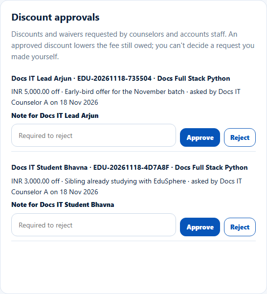
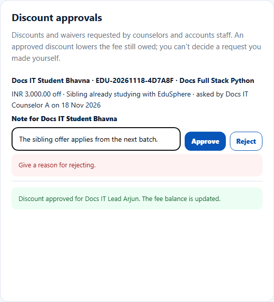
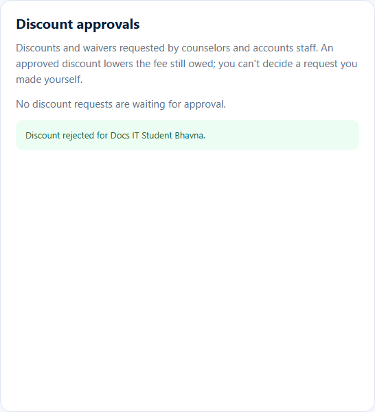

# Approve or reject a discount
> Doc ID: DOC-ITC-ADM-009 · Verified on 2026-11-18 against `main` @ `6b61546c` · Roles: IT Admin

## Purpose
Decide the discount and waiver requests counselors and accounts staff send.

## Who Can Use This Feature
- **IT Admin** (an approver). You can't decide a request you made yourself ("Your request — another approver must decide it.").

## Prerequisites
- A counselor sent a request ([Request a discount](../../user-manual/fees/fee-002-request-discount.md)).

## How to Access
IT Admin sidebar **Payments** → card **Discount approvals**.

## Steps
### Step 1 — Review the request
Each request shows the student, enrolment number, programme, **{amount} off · {reason} · asked by {name} on {date}**, a **Note for {student}** box, **Approve** and **Reject**.

### Step 2 — Approve
Select **Approve**. The message **Discount approved for {student}. The fee balance is updated.** appears.

### Step 3 — Or reject with a note
Write the reason in **Note for {student}** (required to reject) and select **Reject**. The message **Discount rejected for {student}.** appears. The counselor sees the note.

## Validation Messages
| Message | When |
|---|---|
| Discount approved for {student}. The fee balance is updated. | Approved |
| Give a reason for rejecting. | **Reject** with an empty note |
| Discount rejected for {student}. | Rejected |
| No discount requests are waiting for approval. | Queue empty |

## Expected Result
An approved discount lowers **Total payable** and the last installment. Each decision is in the [Audit log](adm-015-lifecycle-audit.md) (`it.fee.discount_approved`, `it.fee.discount_rejected`).

## Related Features
- [Request a discount](../../user-manual/fees/fee-002-request-discount.md)
- [Payments screens](adm-008-payments.md)
