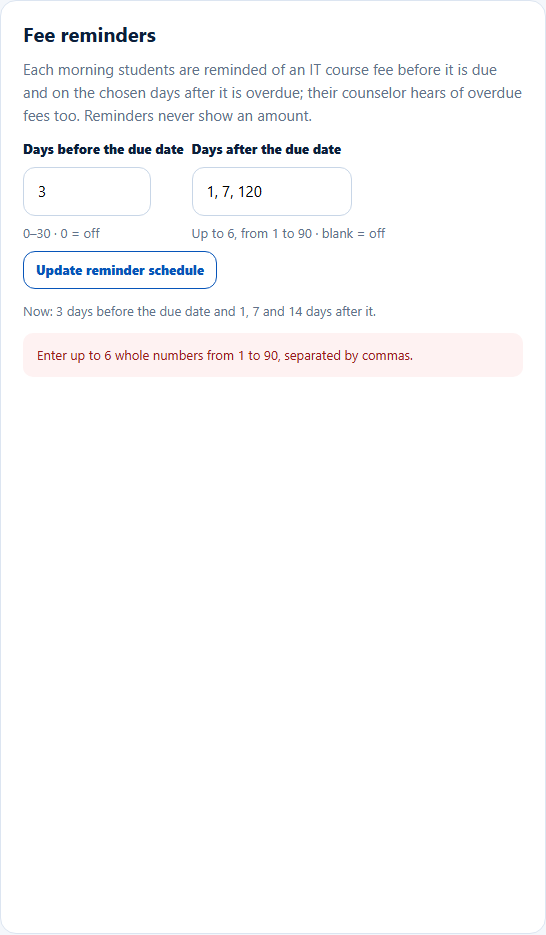

# Fee reminder schedule
> Doc ID: DOC-ITC-ADM-010 · Verified on 2026-11-18 against `main` @ `6b61546c` · Roles: IT Admin

## Purpose
Choose when students are reminded about an IT course fee before it is due and after it is overdue.

## Who Can Use This Feature
- **IT Admin**.

## Prerequisites
- None.

## How to Access
IT Admin sidebar **Payments** → card **Fee reminders**: "Each morning students are reminded of an IT course fee before it is due and on the chosen days after it is overdue; their counselor hears of overdue fees too. Reminders never show an amount."

## Steps
### Step 1 — Set the days
- **Days before the due date**: one number, **0–30 · 0 = off**.
- **Days after the due date**: up to six numbers separated by commas, **Up to 6, from 1 to 90 · blank = off**.

### Step 2 — Save
Select **Update reminder schedule**. The message **Reminder schedule saved. It applies from the next daily run.** appears and the card shows **Now: {schedule}**.

## Fields
| Field | Required | Example (default) |
|---|---|---|
| Days before the due date | Yes | 3 |
| Days after the due date | No | 1, 7, 14 |

## Validation Messages
| Message | When |
|---|---|
| Reminder schedule saved. It applies from the next daily run. | Saved |
| Enter a whole number of days from 0 to 30. | Days before out of range (from code; not captured) |
| Enter up to 6 whole numbers from 1 to 90, separated by commas. | Days after invalid (for example 120) |

## Expected Result
The daily check runs at 08:30 IST. What students and counselors then see is in [Overdue fees and reminders](../../user-manual/fees/fee-003-overdue-reminders.md).

## Related Features
- [Overdue fees and reminders](../../user-manual/fees/fee-003-overdue-reminders.md)
