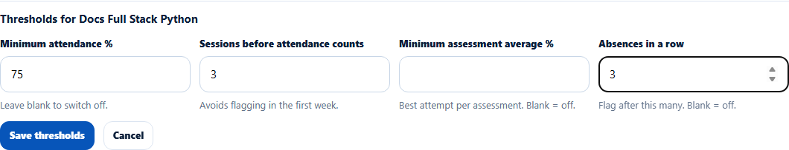
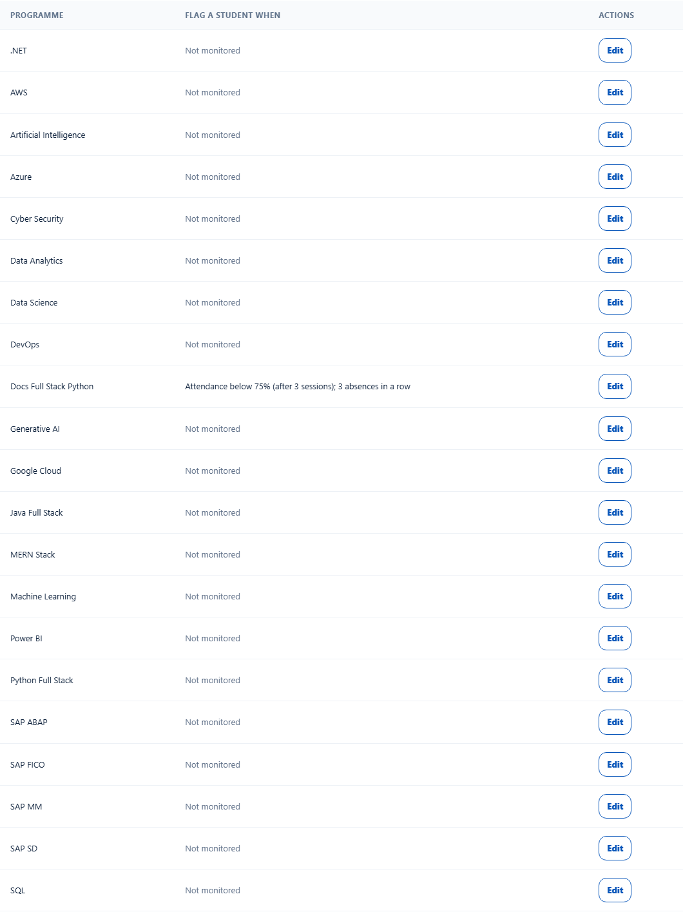
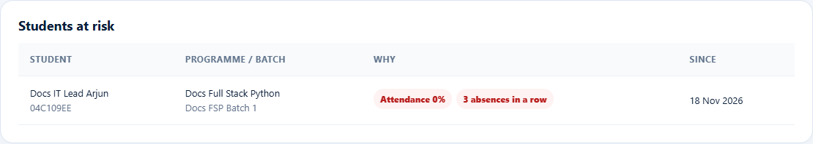

# At-risk thresholds and flagged students
> Doc ID: DOC-ITC-ADM-011 · Verified on 2026-11-18 against `main` @ `6b61546c` (state prepared by data setup) · Roles: IT Admin

## Purpose
Decide when a student counts as at risk, per programme, and see who the daily check flagged.

## Who Can Use This Feature
- **IT Admin** (counselors and trainers see their own flagged students).

## Prerequisites
- None. Every programme starts as **Not monitored**.

## How to Access
IT Admin sidebar **At Risk** ("Thresholds per programme, and the students the daily check flagged.").

## Steps
### Step 1 — Set a programme's thresholds
Under **At-risk thresholds** select **Edit** on the programme. Fill any of **Minimum attendance %** ("Leave blank to switch off."), **Sessions before attendance counts** ("Avoids flagging in the first week."), **Minimum assessment average %** ("Best attempt per assessment. Blank = off.") and **Absences in a row** ("Flag after this many. Blank = off."). Select **Save thresholds**: **Thresholds for {programme} saved. The next daily check (07:00 IST) applies them.**

### Step 2 — See flagged students
**Students at risk** lists **Student**, **Programme / batch**, **Why** and **Since**.

## Fields
| Field | Example |
|---|---|
| Minimum attendance % | 75 |
| Sessions before attendance counts | 3 |
| Minimum assessment average % | (blank = off) |
| Absences in a row | 3 |

## Expected Result
"Each day at 07:00 IST, active students of a monitored programme are checked. A student who crosses a threshold is flagged, and they, their trainer and their counselor are told once; they are told again when they are back on track."

## Tips
- In this guide three absences were added with a data setup and the check was run by hand.

## Related Features
- [Risk and lifecycle cards](../../user-manual/students/stu-004-risk-lifecycle.md)
