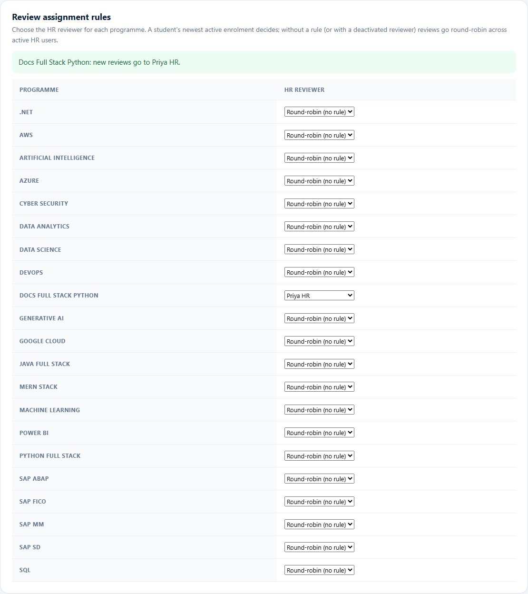

# HR review assignment and rules
> Doc ID: DOC-ITC-ADM-012 · Verified on 2026-11-18 against `main` @ `6b61546c` · Roles: IT Admin

## Purpose
Decide which HR user reviews the resumes of each programme's students, and reassign a review when its owner is away.

## Who Can Use This Feature
- **IT Admin**.

## Prerequisites
- At least one active HR user (in the demo: **Priya HR**).

## How to Access
IT Admin sidebar **HR Reviews** ("Resume reviews by HR: reassign an owner, and choose each programme's HR reviewer.").

## Steps
### Step 1 — Choose a programme's reviewer
Under **Review assignment rules**, pick the reviewer in **HR reviewer for {programme}**. The message **{programme}: new reviews go to {HR user}.** appears. "A student's newest active enrolment decides; without a rule (or with a deactivated reviewer) reviews go round-robin across active HR users."

### Step 2 — Watch and reassign reviews
**Resume reviews** lists the reviews; filter with **Stage** (All open, Resume received, Under review, Changes requested, Screening, Interview ready, Completed, Withdrawn) and **Needs an owner only**. "Reassign a review when its owner is away or deactivated." Reassigning was not captured.

## Validation Messages
| Message | When |
|---|---|
| {programme}: new reviews go to {HR user}. | Rule saved |

## Expected Result
New reviews for students of that programme go to the chosen reviewer's **Review Queue**. A student whose review already has an active HR owner keeps that owner when a new version is shared.

## Related Features
- [HR works the resume review](../handoffs/ho-004-hr-review.md)
- [HR review status](../../user-manual/resume/res-002-hr-review-status.md)
