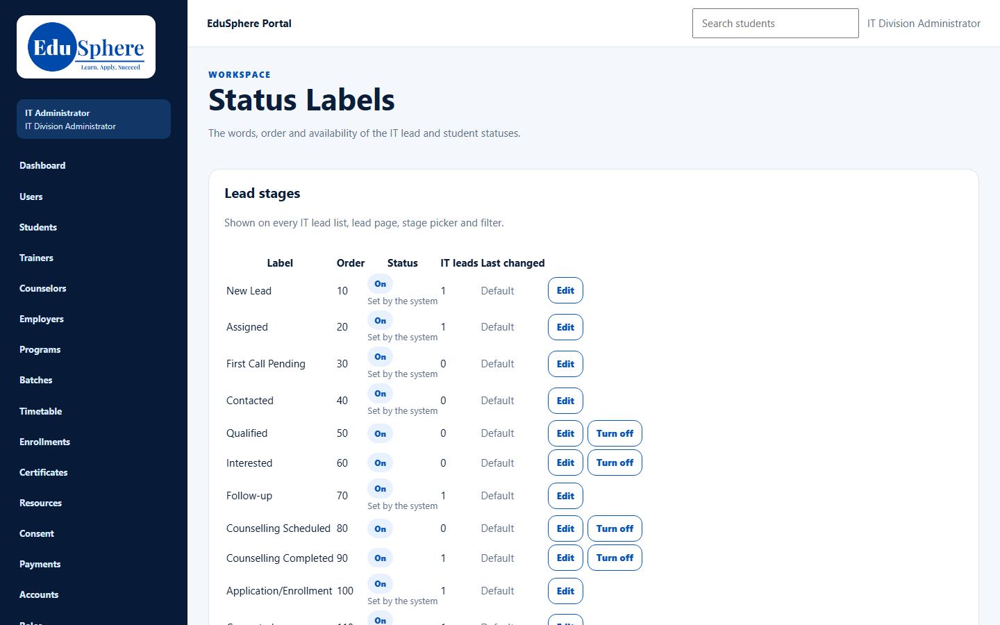
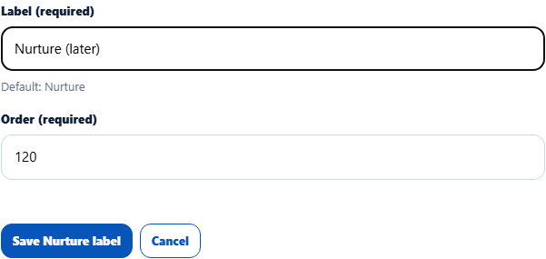

# Status labels for lead and lifecycle stages
> Doc ID: DOC-ITC-ADM-013 · Verified on 2026-11-18 against `main` @ `6b61546c` · Roles: IT Admin

## Purpose
Choose the words, order and availability of the IT lead stages and student lifecycle stages.

## Who Can Use This Feature
- **IT Admin**.

## Prerequisites
- None.

## How to Access
IT Admin sidebar **Status Labels** ("The words, order and availability of the IT lead and student statuses.").

## Steps
### Step 1 — Read the tables
- **Lead stages**: "Shown on every IT lead list, lead page, stage picker and filter." Columns **Label**, **Order**, **Status**, **IT leads** (how many leads are in it), **Last changed**, **Actions**.
- **Student lifecycle stages**: "Shown on the student record and the student's own profile." Column **Set by hand** marks the stages people can set (Not placed, Closed).
Stages marked **Set by the system** cannot be turned off.

### Step 2 — Rename or reorder
Select **Edit {label}**. Change **Label (required)** (the default is shown under it) or **Order (required)**, then **Save {default} label**. The message **Saved {label}.**

### Step 3 — Turn a stage off or on
Select **Turn off** (or **Turn on**) on a stage that is not set by the system. Not captured.

## Validation Messages
| Message | When |
|---|---|
| Saved {label}. | Saved |
| Enter a label. | Label empty (from code; not captured) |
| Enter an order from 0 to 9999. | Order out of range (from code; not captured) |

## Tips
- In this guide **Nurture** was renamed and then set back.

## Related Features
- [Change the stage](../../user-manual/leads/lead-005-change-stage.md)
- [Risk and lifecycle cards](../../user-manual/students/stu-004-risk-lifecycle.md)
