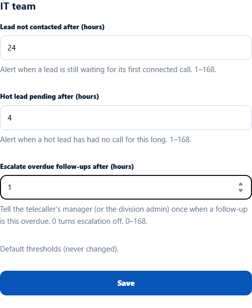
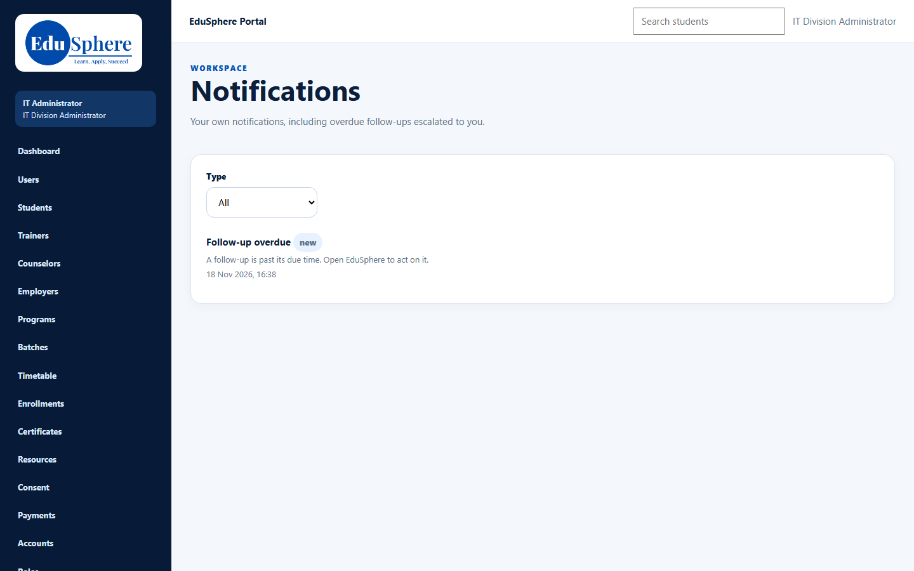

# Overdue follow-up escalation
> Doc ID: DOC-ITC-ADM-014 · Verified on 2026-11-18 against `main` @ `6b61546c` (state prepared by data setup) · Roles: Telecaller Manager (setting), IT Admin (notices)

## Purpose
Make sure an overdue follow-up is noticed: after the set number of hours, EduSphere tells the manager once.

## Who Can Use This Feature
| Role | What they do |
|---|---|
| Telecaller Manager | Sets the hours per team on **Alert settings** (finding P4: the setting lives on the telecaller manager's page) |
| IT Admin | Receives the escalation of an **IT counselor's** overdue follow-up |

## Prerequisites
- Escalation is off by default (**0** hours).

## How to Access
- Setting: Telecaller Manager (signs in at `/admin/login`) → `/telecaller/manager/alerts` → **Alert settings** → **IT team**.
- Notices: IT Admin sidebar **Notifications**.

## Steps
### Step 1 — Switch escalation on
In the **IT team** row set **Escalate overdue follow-ups after (hours)** ("Tell the telecaller's manager (or the division admin) once when a follow-up is this overdue. 0 turns escalation off. 0–168.") and select **Save**: **Saved. Alerts use the new thresholds from the next check (within 15 minutes).**

### Step 2 — The IT Admin receives the escalation
When an IT counselor's follow-up is overdue by that many hours, every active IT Admin gets **Follow-up overdue** ("A follow-up is past its due time. Open EduSphere to act on it."). It names no lead or student.

## Expected Result
- Each follow-up is escalated once. Only follow-ups that became overdue within the last day are escalated, so switching it on does not flood anyone with old work.
- A telecaller's follow-up goes to their reporting manager instead.

## Tips
- The check runs every 15 minutes. In this guide the follow-up was moved to 3 hours ago with a data setup and the check was run by hand.

## Related Features
- [Follow-ups](../../user-manual/leads/lead-007-follow-ups.md)
