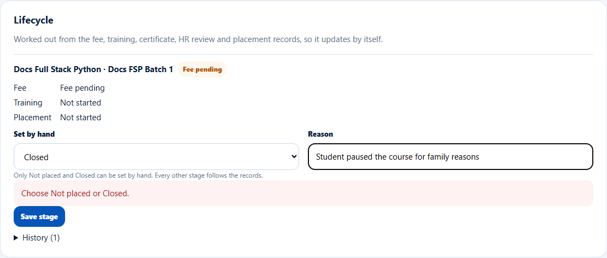
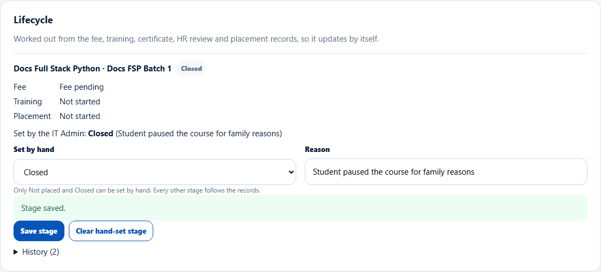
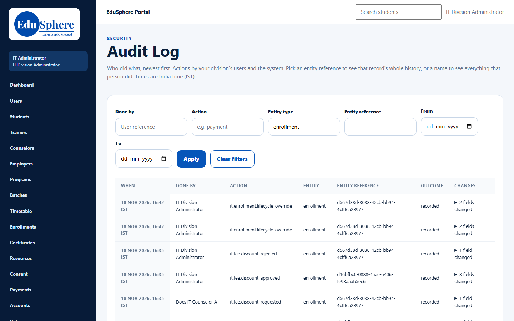

# Set a student's lifecycle stage; audit log
> Doc ID: DOC-ITC-ADM-015 · Verified on 2026-11-18 against `main` @ `6b61546c` · Roles: IT Admin

## Purpose
Mark a student **Not placed** or **Closed** when the records can't tell, and check who changed what in the audit log.

## Who Can Use This Feature
- **IT Admin**. Counselors see the lifecycle read only.

## Prerequisites
- The student has an enrolment.

## How to Access
- IT Admin **Students** → **Profile** → card **Lifecycle**.
- IT Admin sidebar **Audit Log**.

## Steps
### Step 1 — Set the stage by hand
Under the enrolment, choose **Set by hand** (**Not placed** or **Closed**) and fill **Reason** (at least 3 characters). "Only Not placed and Closed can be set by hand. Every other stage follows the records." Select **Save stage**: **Stage saved.**

### Step 2 — Clear it
Select **Clear hand-set stage**: **Hand-set stage cleared.** The stage follows the records again.

### Step 3 — Check the audit log
**Audit Log**: "Who did what, newest first." Filter with **Done by**, **Action**, **Entity type**, **Entity reference**, **From** and **To**, then **Apply**. Select an entity reference for that record's whole history, or a name for everything that person did. Times are IST.

## Validation Messages
| Message | When |
|---|---|
| Choose Not placed or Closed. | **Save stage** without a stage |
| Give a reason of at least 3 characters. | Reason too short (from code; not captured) |
| Stage saved. | Saved |
| Hand-set stage cleared. | Cleared |

## Tips
- Useful audit actions: `it.enrollment.lifecycle_override`, `it.fee.discount_requested` / `_approved` / `_rejected`, `it.student.counselor_assign`, `it.status_label.update`.

## Related Features
- [Risk and lifecycle cards](../../user-manual/students/stu-004-risk-lifecycle.md)
