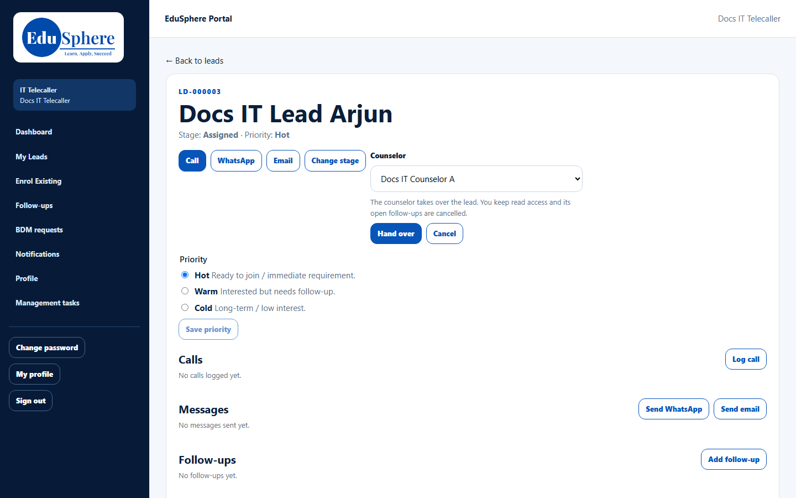
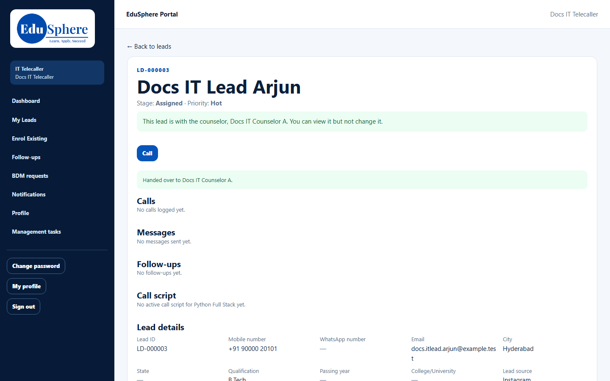
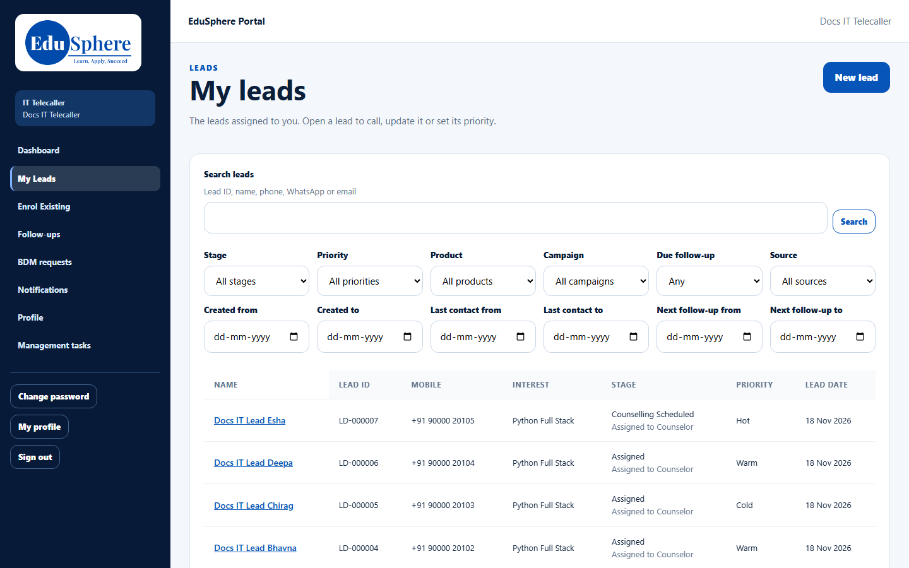

# Telecaller hands a lead to an IT counselor
> Doc ID: DOC-ITC-HO-001 · Verified on 2026-11-18 against `main` @ `6b61546c` · Roles: Telecaller (IT team)

## Purpose
Move a lead the IT telecaller has qualified on the phone to an IT counselor, who then counsels and converts it.

## Who Can Use This Feature
- **Telecaller** in the IT team, on their own leads.

## Prerequisites
- The lead belongs to the telecaller and is open.
- At least one active IT counselor exists. See [Create an IT counselor account](../admin/adm-001-create-it-counselor.md).
- If the lead needs a counselling appointment, book it **before** handing over (see Tips).

## How to Access
IT telecaller portal → **My Leads** → open the lead.

## Steps
### Step 1 — Open Assign to counselor
On the lead page select **Assign to counselor**. A small form opens with the note "The counselor takes over the lead. You keep read access and its open follow-ups are cancelled."

### Step 2 — Choose the counselor
In **Counselor**, choose the IT counselor. The list shows only IT counselors.

### Step 3 — Hand over
Select **Hand over**. The message **Handed over to {counselor}.** appears and the page says "This lead is with the counselor, {counselor}. You can view it but not change it."

The lead stays in the telecaller's **My leads** list.

## Fields
| Field | Description | Required | Example |
|---|---|---|---|
| Counselor | The IT counselor who takes over | Yes | Docs IT Counselor A |

## Expected Result
- The lead appears in the counselor's **Leads** (page title **My leads**).
- The telecaller can still view the lead but not change it; open follow-ups are cancelled.

## Validation Messages
| Message | When |
|---|---|
| Handed over to {counselor}. | Success |

## Common Errors
**Problem:** The telecaller cannot book counselling after the hand-over. **Cause:** Only the lead's telecaller books, and only while the lead is still theirs to change. **Resolution:** Book the appointment first, then hand over. See [Lead appointments](../../user-manual/appointments/appt-001-lead-appointments.md).

## Tips
- To move the lead to a different counselor later, ask a Telecaller Manager. See [Telecaller Manager changes the counselor](ho-002-manager-change-counselor.md).

## Related Features
- [My leads](../../user-manual/leads/lead-001-my-leads.md)
- [Return a lead to the telecaller](../../user-manual/leads/lead-013-return-to-telecaller.md)
