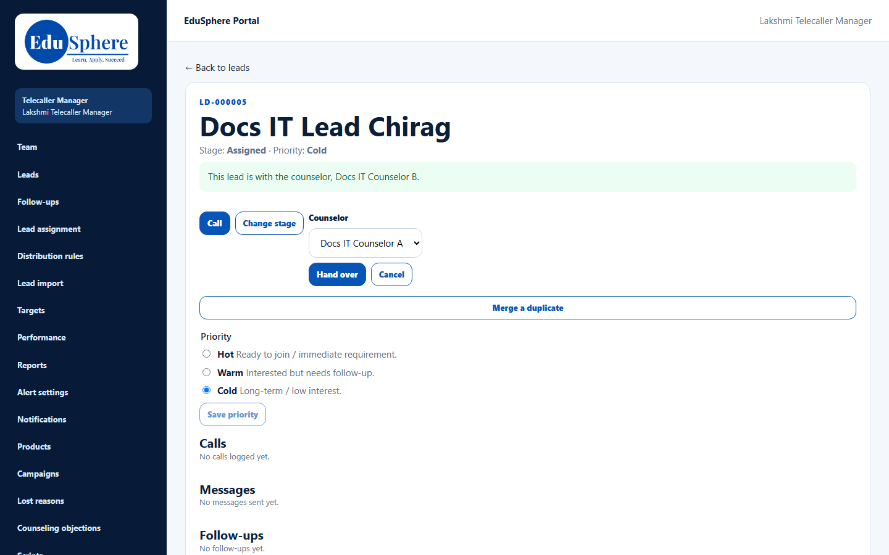
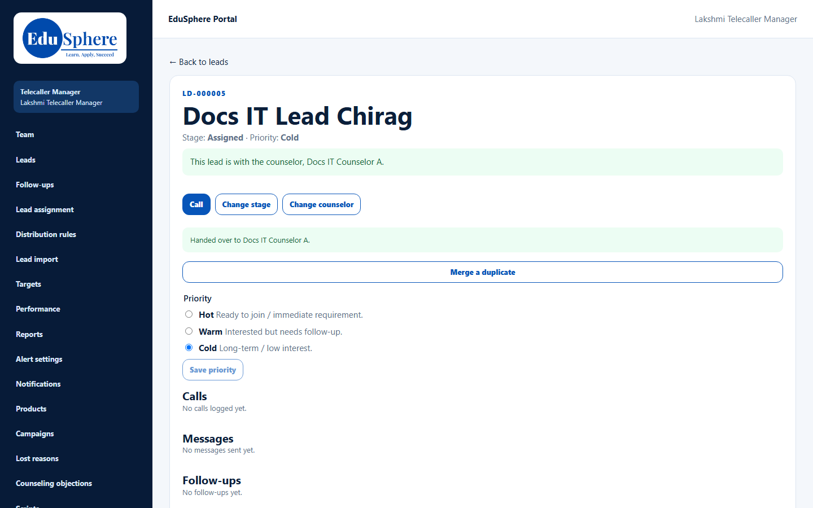

# Telecaller Manager changes the counselor
> Doc ID: DOC-ITC-HO-002 · Verified on 2026-11-18 against `main` @ `6b61546c` · Roles: Telecaller Manager

## Purpose
Move a lead from one IT counselor to another, for example when a counselor is on leave.

## Who Can Use This Feature
- **Telecaller Manager**. The IT counselor cannot pass a lead to another counselor.

## Prerequisites
- The lead is already with an IT counselor.
- You sign in at the administration sign-in (`/admin/login`); the Telecaller Manager is not tied to one division.

## How to Access
Telecaller Manager portal → **Leads** → open the lead (`/telecaller/manager/leads/{id}`).

## Steps
### Step 1 — Open Change counselor
The lead page says "This lead is with the counselor, {counselor}." Select **Change counselor**.

### Step 2 — Choose the new counselor
In **Counselor**, choose the new IT counselor. The current counselor is not in the list. Select **Hand over**.

### Step 3 — Check the result
The message **Handed over to {counselor}.** appears and the lead now shows the new counselor.

## Fields
| Field | Description | Required | Example |
|---|---|---|---|
| Counselor | The new IT counselor | Yes | Docs IT Counselor A |

## Expected Result
The lead leaves the old counselor's **My leads** and appears in the new counselor's list.

## Validation Messages
| Message | When |
|---|---|
| Handed over to {counselor}. | Success |

## Tips
- No reason is asked for. Add a note on the lead if the reason matters.
- The same page has **Merge a duplicate** for duplicate leads.

## Related Features
- [Telecaller hands a lead to an IT counselor](ho-001-telecaller-handover.md)
- [My leads](../../user-manual/leads/lead-001-my-leads.md)
