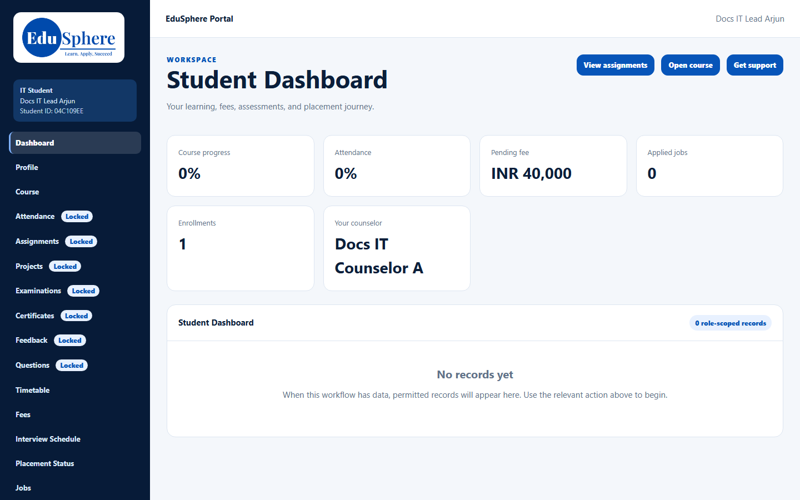
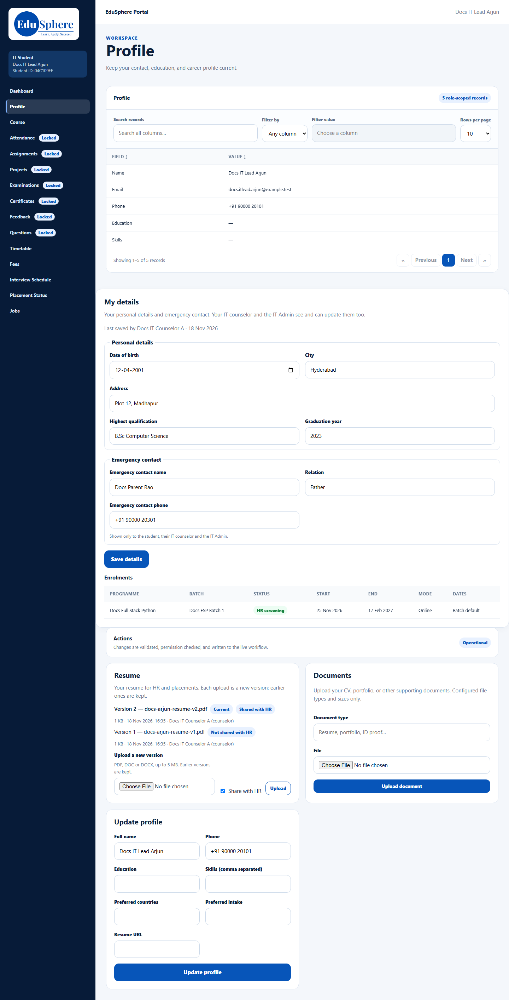
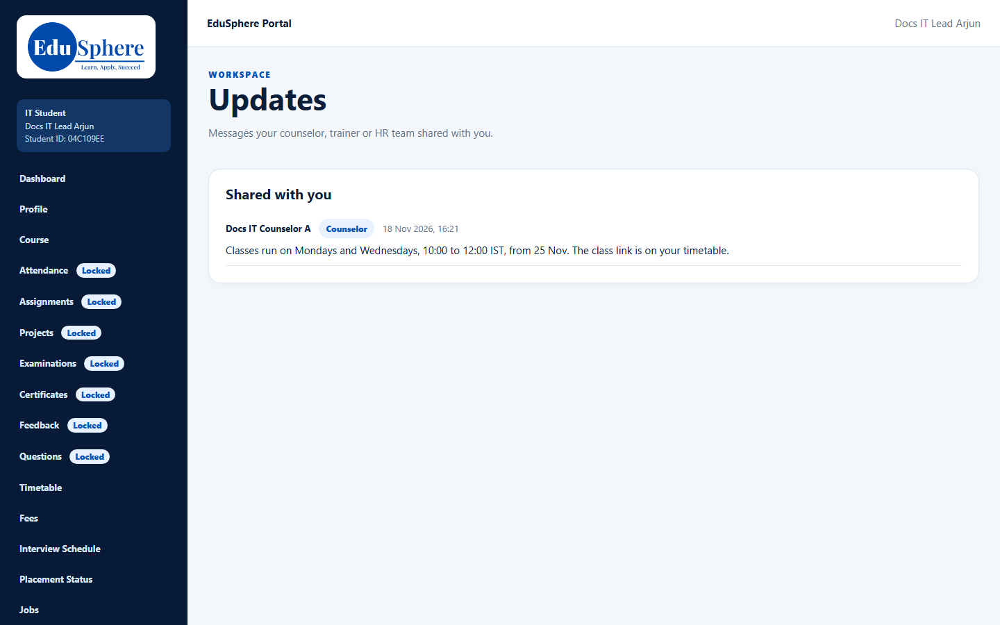
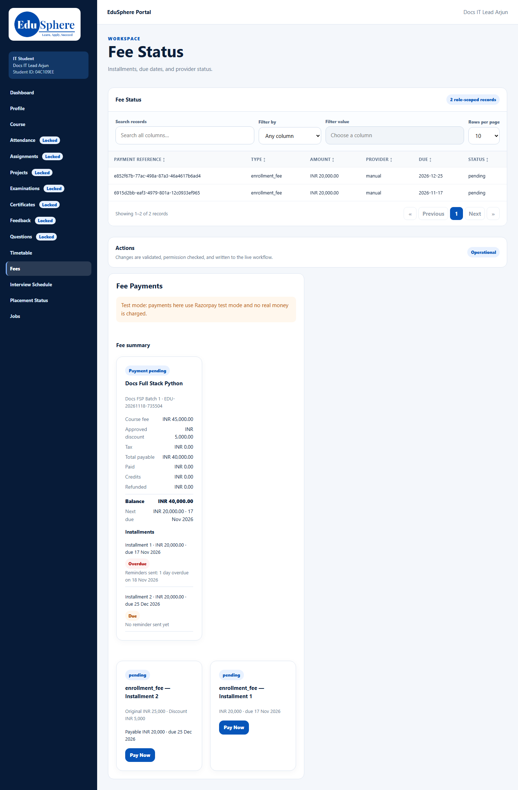
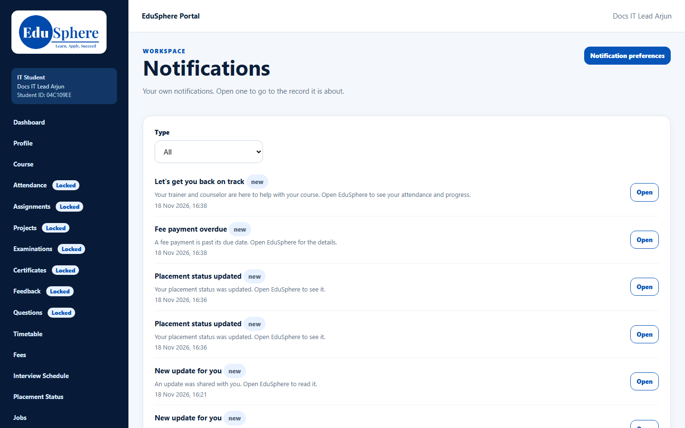
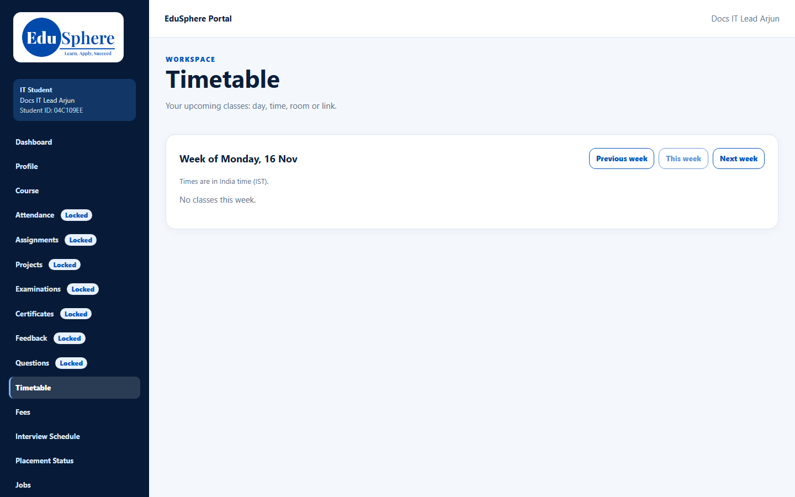

# What the student sees
> Doc ID: DOC-ITC-HO-003 · Verified on 2026-11-18 against `main` @ `6b61546c` · Roles: IT Student (hand-off from IT Counselor)

## Purpose
Know what your student sees after conversion, so you can guide them: their counselor, shared notes, fees, resume and notifications.

## Who Can Use This Feature
- The **IT student** (in the demo **Docs IT Lead Arjun**, signing in at `/it/login`).

## Prerequisites
- The student set their password from the welcome email and accepted the enrolment agreement (**Course** page, **I have read and accept this agreement**), which makes the enrolment active.

## What the student sees
### Dashboard
**Course progress**, **Attendance**, **Pending fee**, **Applied jobs**, **Enrollments** and **Your counselor**.

### Profile
Contact details, **My details** (personal details and emergency contact: "Your IT counselor and the IT Admin see and can update them too."), **Enrolments**, and **Resume** with every version, including those you uploaded.

### Updates
"Messages your counselor, trainer or HR team shared with you." Only notes you shared appear ([Student notes](../../user-manual/notes/note-001-student-notes.md)).

### Fees
The same fee summary and installments you see, with **Pay Now** on each unpaid installment (Razorpay; test mode in the demo). Nothing was paid in this guide.

### Notifications
For example **Enrollment confirmed**, **Course or batch updated**, **New update for you**, **Placement status updated** (HR review changes), **Fee payment overdue** and **Let's get you back on track** (at risk).

### Timetable
"Your upcoming classes: day, time, room or link." Classes start with the batch (25 Nov in the demo). The class link shows once the IT Admin's **Student access by payment** rule opens **Live classes** for the student (from code); counselors never see it.

## Tips
- Fee reminders and at-risk messages never show amounts or marks; the student opens EduSphere for details.

## Related Features
- [Fee summary](../../user-manual/fees/fee-001-fee-summary.md)
- [HR review status](../../user-manual/resume/res-002-hr-review-status.md)
