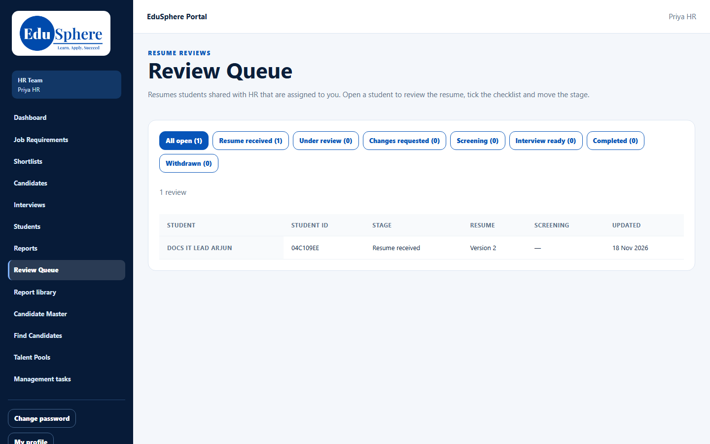
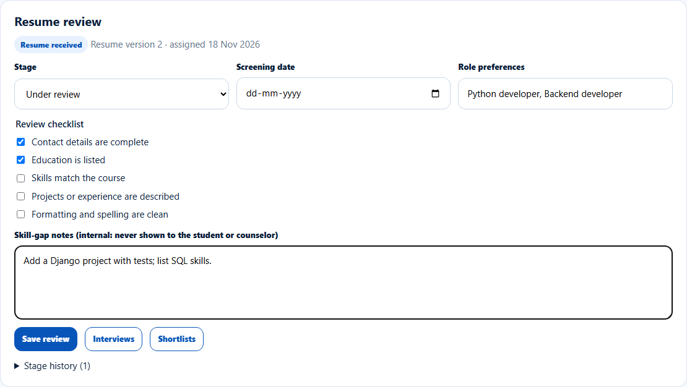
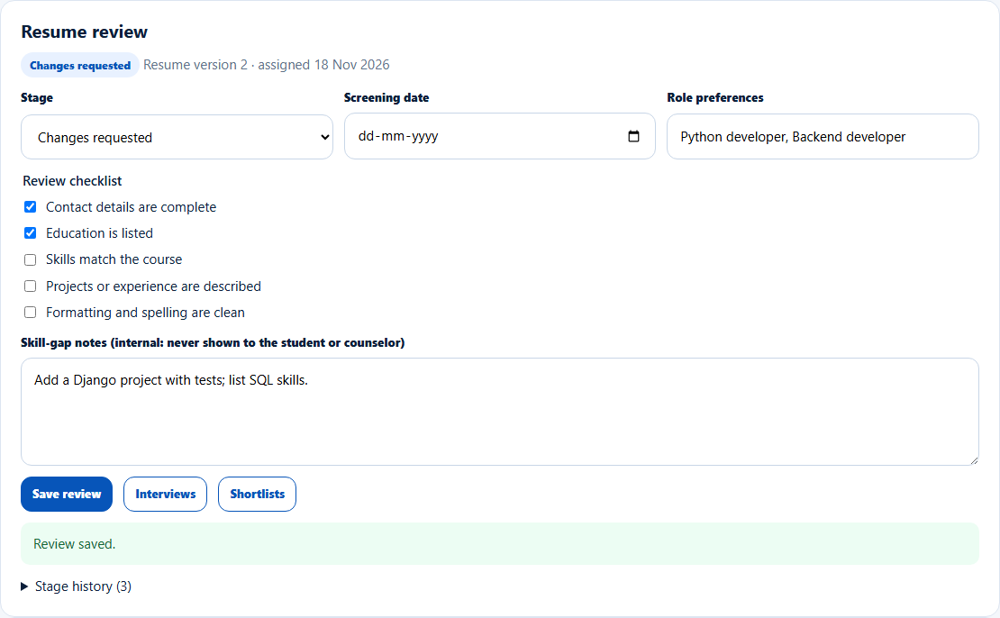

# HR works the resume review
> Doc ID: DOC-ITC-HO-004 · Verified on 2026-11-18 against `main` @ `6b61546c` · Roles: HR Team (hand-off from IT Counselor)

## Purpose
Show what happens on the HR side after a counselor shares a resume, so the counselor knows what to expect.

## Who Can Use This Feature
- **HR Team** user who owns the review (in the demo: **Priya HR**, signing in at `/it/login`).

## Prerequisites
- A resume version was shared with HR ([Upload a resume](../../user-manual/resume/res-001-upload-resume.md)).

## How to Access
HR sidebar **Review Queue** ("Resumes students shared with HR that are assigned to you.").

## Steps
### Step 1 — Find the review
Tabs filter by stage with counts: **All open**, **Resume received**, **Under review**, **Changes requested**, **Screening**, **Interview ready**, **Completed**, **Withdrawn**. Each row shows **Student**, **Student ID**, **Stage**, **Resume**, **Screening** and **Updated**.

### Step 2 — Review the resume
Open the student. Under **Resume review** set **Stage**, **Screening date** and **Role preferences**, tick the **Review checklist** (Contact details are complete, Education is listed, Skills match the course, Projects or experience are described, Formatting and spelling are clean) and add **Skill-gap notes (internal: never shown to the student or counselor)**. Select **Save review**: **Review saved.**

### Step 3 — Ask for changes
Set **Stage** to **Changes requested** and save.

## Expected Result
- The counselor's **HR review** card shows the new stage and next action, and they get **HR review updated** ([HR review status](../../user-manual/resume/res-002-hr-review-status.md)).
- The student is notified too (their notification reads **Placement status updated**).
- **Changes requested** counts in **Pending HR actions** on the counselor's dashboard.

## Related Features
- [HR review assignment and rules](../admin/adm-012-hr-review-rules.md)
