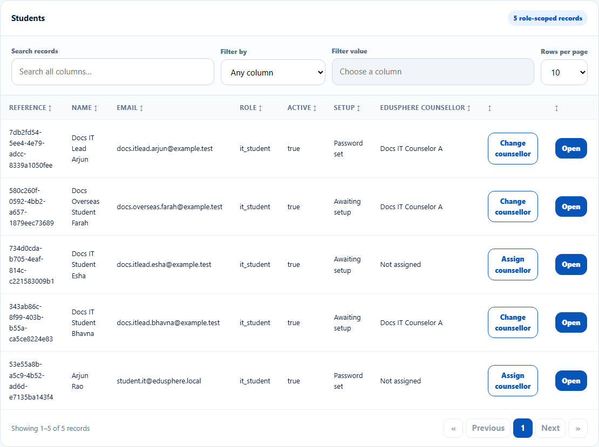

# Role guide: IT Admin (IT counselors)

You set up IT counselors, keep their students and leads in the right hands, approve fee changes, and run the rules that warn counselors early. This guide covers the counselor-related screens only. Each step links to the full page.

## Your workspace at a glance

- **Sign in** at `/it/login` as the IT Admin. The Super Admin can also create IT counselors from `/admin/login`.
- The pages you use most: **Users**, **Students**, **Leads**, **Payments**, **At Risk**, **HR Reviews**, **Status Labels**, **Counselor Dashboard**, **Notifications** and **Audit Log**.

## Setting up a counselor
| Step | Page |
|---|---|
| Create the account; the counselor gets a 72-hour welcome link | [Create an IT counselor](../admin-manual/admin/adm-001-create-it-counselor.md) |
| Edit details, re-send the link, deactivate or reactivate | [Manage IT counselor users](../admin-manual/admin/adm-002-manage-it-counselor-users.md) |
| Give them students | [Assign or change a student's counselor](../admin-manual/admin/adm-003-student-counselor.md) |

## Weekly routine
1. **Counselor Dashboard** with the **Owner** filter, counselor by counselor: [IT Counselor Dashboard](../admin-manual/admin/adm-005-counselor-dashboard.md).
2. **Discount approvals** on **Payments**: [Approve or reject a discount](../admin-manual/admin/adm-009-discount-approvals.md).
3. **At Risk**: who the daily check flagged: [At-risk thresholds](../admin-manual/admin/adm-011-at-risk.md).
4. **Notifications**: overdue follow-ups escalated to you: [Escalation](../admin-manual/admin/adm-014-escalation.md).
5. **Leads**: duplicates and stuck leads: [Admin leads](../admin-manual/admin/adm-006-admin-leads.md) · [Merge a duplicate](../admin-manual/admin/adm-007-merge-duplicate.md).

## One-time settings
| Setting | Page |
|---|---|
| Resume size limit | [Resume upload limit](../admin-manual/admin/adm-004-resume-limit.md) |
| Fee reminders before and after the due date | [Fee reminder schedule](../admin-manual/admin/adm-010-fee-reminders.md) |
| At-risk thresholds per programme | [At-risk thresholds](../admin-manual/admin/adm-011-at-risk.md) |
| HR reviewer per programme | [HR review rules](../admin-manual/admin/adm-012-hr-review-rules.md) |
| Names and order of stages | [Status labels](../admin-manual/admin/adm-013-status-labels.md) |
| Escalation hours (ask the Telecaller Manager) | [Escalation](../admin-manual/admin/adm-014-escalation.md) |

## Payments
Payments, refunds and corrections are recorded on **Payments** ([Payments screens](../admin-manual/admin/adm-008-payments.md)). This guide shows the screens only; no payment was recorded while it was written.

## Rules worth remembering
- Before deactivating a counselor, move their students: deactivation does not.
- **Change counsellor** does not work for a student who joined IT from Overseas ("Student not found").
- Students are moved one row at a time; there is no bulk reassign.
- Escalation is off until the Telecaller Manager sets hours for the IT team.
- Only **Not placed** and **Closed** can be set by hand; every other lifecycle stage follows the records.

## Related
[Administrator manual index](../admin-manual/README.md) · [FAQ](../faq.md) · [Troubleshooting](../troubleshooting.md)
