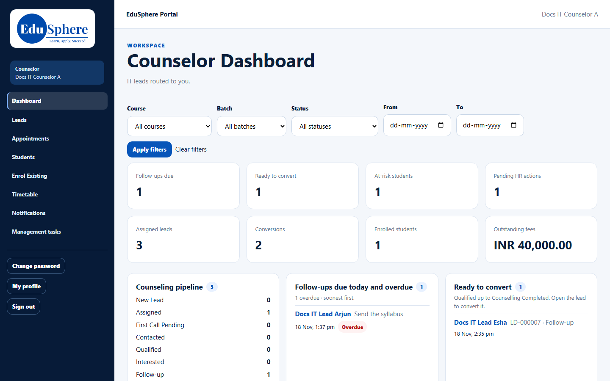

# Role guide: IT Counselor

You turn IT course enquiries into enrolled students, then look after them: fees, resume, progress and placement readiness. This guide puts the manual pages in the order you use them. Each step links to the full page.

## Your workspace at a glance

- **Sign in** at `/it/login`: [Sign in](../user-manual/account-access/auth-001-sign-in.md). Your first password comes from the welcome email (valid 72 hours): [Set your first password](../user-manual/account-access/auth-002-first-password.md).
- The sidebar has **Dashboard**, **Leads**, **Appointments**, **Students**, **Enrol Existing**, **Timetable**, **Notifications** and **Management tasks**: [Portal tour](../user-manual/navigation/nav-001-portal-tour.md). On a phone, sign out from **My profile** → **Logout**: [Sign out](../user-manual/account-access/auth-006-sign-out.md).

## A typical day
1. **Start on the dashboard.** The [Counselor dashboard](../user-manual/dashboard/dash-001-dashboard.md) lists overdue follow-ups, leads ready to convert, students at risk, HR actions and outstanding fees.
2. **Check notifications.** [Notifications](../user-manual/notifications/notif-001-notifications.md) tell you about new students, reassignments, batch changes, HR updates, overdue fees and at-risk flags.
3. **Confirm and close appointments.** [Lead appointments](../user-manual/appointments/appt-001-lead-appointments.md): confirm them, then mark each completed or a no-show.
4. **Work your leads.** Open each one from [My leads](../user-manual/leads/lead-001-my-leads.md).
5. **Look after your students.** [My students](../user-manual/students/stu-001-my-students.md) → [Student 360](../user-manual/students/stu-002-student-360.md).
6. **Update management tasks.** [Management tasks](../user-manual/tasks/task-001-management-tasks.md).

## Workflow 1: from handover to enrolment
| Step | Page |
|---|---|
| The telecaller hands you a lead | [Handover](../admin-manual/handoffs/ho-001-telecaller-handover.md) |
| Set a next action, log calls, WhatsApp, email, meetings | [Next action](../user-manual/leads/lead-004-next-action.md) · [Calls](../user-manual/leads/lead-008-calls.md) · [WhatsApp](../user-manual/leads/lead-009-whatsapp.md) · [Email](../user-manual/leads/lead-010-email.md) · [Meetings](../user-manual/leads/lead-011-meetings.md) |
| Add follow-ups; record counselling | [Follow-ups](../user-manual/leads/lead-007-follow-ups.md) · [Counseling](../user-manual/leads/lead-012-counseling.md) |
| Qualify the lead and move its stage | [Qualification](../user-manual/leads/lead-006-qualification.md) · [Change stage](../user-manual/leads/lead-005-change-stage.md) |
| Convert: batch, fee and installments | [Convert to a new student](../user-manual/conversion/conv-001-convert-new-student.md) · [Into an existing account](../user-manual/conversion/conv-002-convert-existing-student.md) |
| Tick the onboarding checklist as the student completes it | [Onboarding checklist](../user-manual/conversion/conv-003-onboarding-checklist.md) |
| Not ready? Return it to the telecaller | [Return](../user-manual/leads/lead-013-return-to-telecaller.md) |

## Workflow 2: an Overseas student wants IT too
1. [Enrol an existing Overseas student in IT](../user-manual/conversion/conv-005-enrol-existing-overseas.md). They keep one login.
2. Enrol them in a batch afterwards; no fee is set by this step.

## Workflow 3: looking after a student
| Step | Page |
|---|---|
| Keep personal details and the emergency contact current | [Student record](../user-manual/students/stu-003-student-record.md) |
| Write notes; share one with the student when they should see it | [Student notes](../user-manual/notes/note-001-student-notes.md) |
| Check fees; ask for a discount; follow up overdue fees | [Fee summary](../user-manual/fees/fee-001-fee-summary.md) · [Discount](../user-manual/fees/fee-002-request-discount.md) · [Overdue fees](../user-manual/fees/fee-003-overdue-reminders.md) |
| Upload the resume and share it with HR; follow HR's stage | [Resume](../user-manual/resume/res-001-upload-resume.md) · [HR review status](../user-manual/resume/res-002-hr-review-status.md) |
| Watch the lifecycle and at-risk flag; see the timetable | [Risk and lifecycle](../user-manual/students/stu-004-risk-lifecycle.md) · [Timetable](../user-manual/timetable/tt-001-timetable.md) |
| Know what the student sees | [What the student sees](../admin-manual/handoffs/ho-003-student-view.md) |

## Rules worth remembering
- You see only your own leads and students. A student moved to another counselor disappears from your list.
- Only the telecaller books counselling appointments, and only before handing the lead over.
- A new enrolment is **Pending consent** until the student accepts the enrolment agreement; until then it shows no classes and gets no batch notices.
- Discounts change the fee only after the IT Admin approves them. You never record payments.
- There is no Tasks or Calendar page for IT counselors and no lead export: use the lead page and the dashboard.

## Related
[User manual index](../user-manual/README.md) · [FAQ](../faq.md) · [Troubleshooting](../troubleshooting.md)
