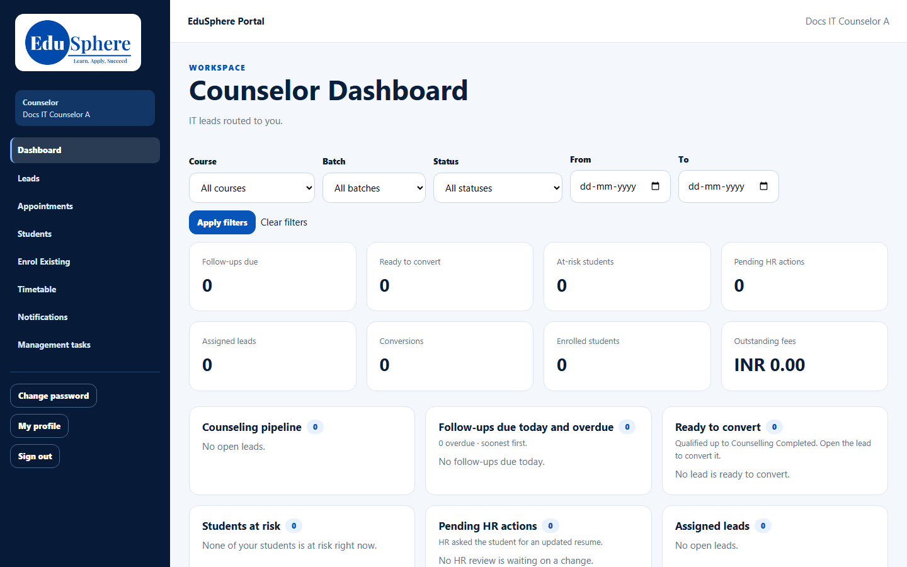
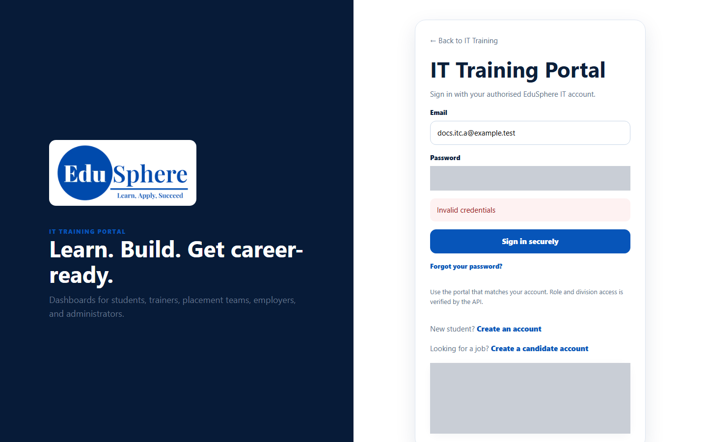
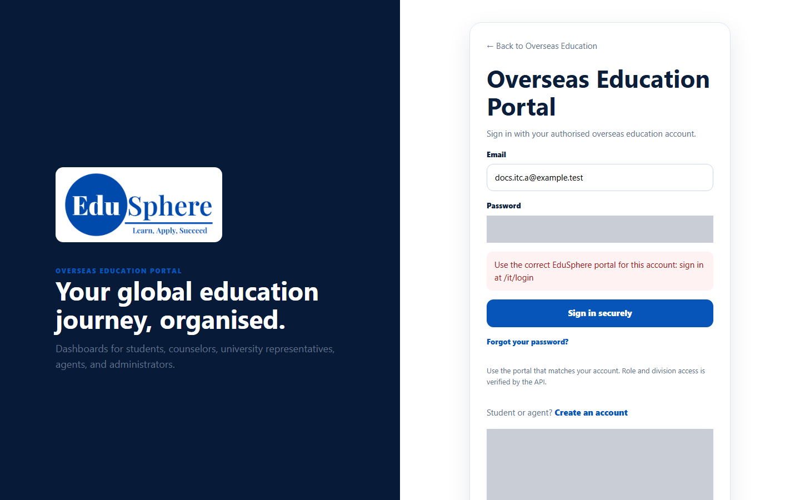

# Sign in to the IT portal
> Doc ID: DOC-ITC-AUTH-001 · Verified on 2026-11-18 against `main` @ `6b61546c` · Roles: IT Counselor

## Purpose
Open your IT Counselor workspace. After you sign in you land on **Counselor Dashboard**.

## Who Can Use This Feature
- **IT Counselor**: an account with role **counselor** in division **it**.

## Prerequisites
- An IT Admin or Super Admin has created your account. See [Create an IT counselor account](../../admin-manual/admin/adm-001-create-it-counselor.md).
- You have set your password from the welcome email. See [Set your first password](auth-002-first-password.md).

## How to Access
Go to `/it/login` (the **IT Training Portal** sign-in page).

## Steps
### Step 1 — Open the IT Training Portal
Open `/it/login`. The page is titled **IT Training Portal**.

### Step 2 — Enter your email and password
Enter your **Email** and **Password**, then select **Sign in securely**.

### Step 3 — Start on your dashboard
You land on **Dashboard** (page title **Counselor Dashboard**), with the sidebar on the left. See [Portal tour](../navigation/nav-001-portal-tour.md).

## Fields
| Field | Description | Required | Example |
|---|---|---|---|
| Email | Your EduSphere sign-in email | Yes | docs.itc.a@example.test |
| Password | Your password (at least 10 characters) | Yes | — |

## Expected Result
You are signed in and see **Counselor Dashboard** at `/it/counselor/dashboard`.

## Validation Messages
| Message | When |
|---|---|
| Invalid credentials | The email or password is wrong, or the account is inactive |
| Use the correct EduSphere portal for this account: sign in at /it/login | You signed in at another portal (for example `/overseas/login`) |

## Common Errors
**Problem:** "Use the correct EduSphere portal for this account". **Cause:** You used the Overseas or administration sign-in page. **Resolution:** Sign in at `/it/login`.

**Problem:** "Invalid credentials" with the right password. **Cause:** Your account may have been deactivated. **Resolution:** Ask your IT Admin.

## Tips
- If you open a portal page while signed out, you are sent to `/it/login` and returned to that page after you sign in.
- Forgot your password? Select **Forgot your password?**. See [Forgot / reset your password](auth-003-forgot-password.md).

## Related Features
- [Set your first password](auth-002-first-password.md)
- [Portal tour](../navigation/nav-001-portal-tour.md)
- [Sign out](auth-006-sign-out.md)
