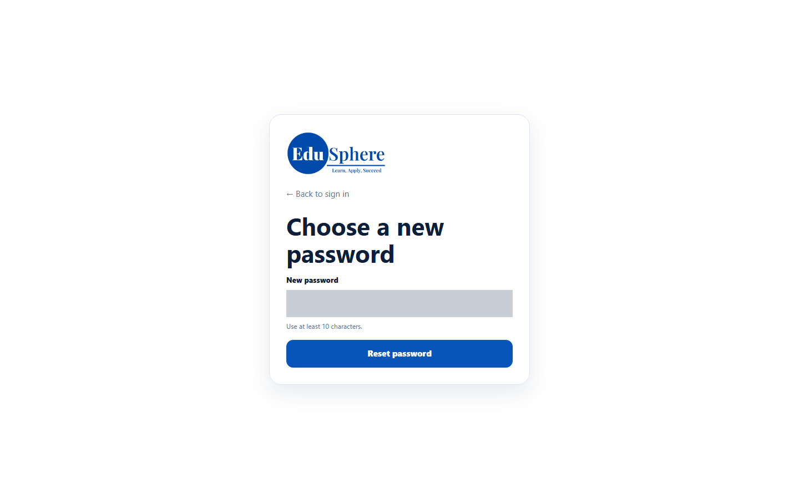
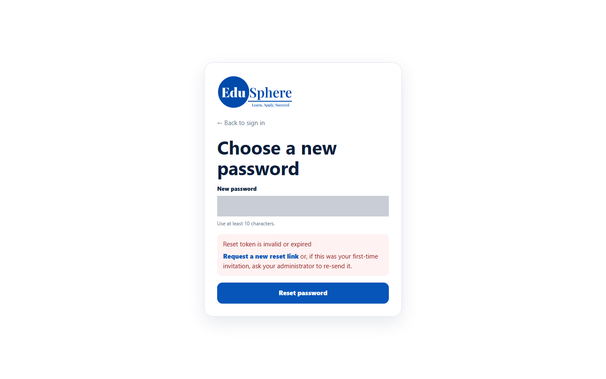

# Set your first password from the welcome email
> Doc ID: DOC-ITC-AUTH-002 · Verified on 2026-11-18 against `main` @ `6b61546c` · Roles: IT Counselor

## Purpose
Choose the password for your new IT Counselor account, using the link in the welcome email.

## Who Can Use This Feature
- **IT Counselor** whose account shows **Awaiting setup**.

## Prerequisites
- Your IT Admin has created your account.
- You have the welcome email. The link is valid for **72 hours**.

## How to Access
Open the link in the welcome email.

## Steps
### Step 1 — Open the link
The page **Choose a new password** opens.

### Step 2 — Enter a new password
Type your password in **New password**. Use at least 10 characters. A shorter password is refused by the browser before anything is sent.

### Step 3 — Save it
Select **Reset password**. You are taken to the **IT Training Portal** sign-in page. Sign in with your email and the new password.

## Fields
| Field | Description | Required | Example |
|---|---|---|---|
| New password | Your new password | Yes, at least 10 characters | — |

## Expected Result
Your password is set and your account changes from **Awaiting setup** to **Password set** in the admin's user list.

## Validation Messages
| Message | When |
|---|---|
| Please lengthen this text to 10 characters or more | Fewer than 10 characters (browser message; wording depends on your browser) |
| Reset token is invalid or expired. Request a new reset link or, if this was your first-time invitation, ask your administrator to re-send it. | The link was already used, replaced by a newer link, or is older than 72 hours |

## Common Errors
**Problem:** "Reset token is invalid or expired". **Cause:** You used the link before, the admin re-sent a newer one, or 72 hours passed. **Resolution:** Ask your IT Admin to **Re-send link**, or use **Forgot your password?** if you already set a password.

## Tips
- Each link works once. Only the newest link works.

## Related Features
- [Sign in to the IT portal](auth-001-sign-in.md)
- [Manage IT counselor users (Re-send link)](../../admin-manual/admin/adm-002-manage-it-counselor-users.md)
