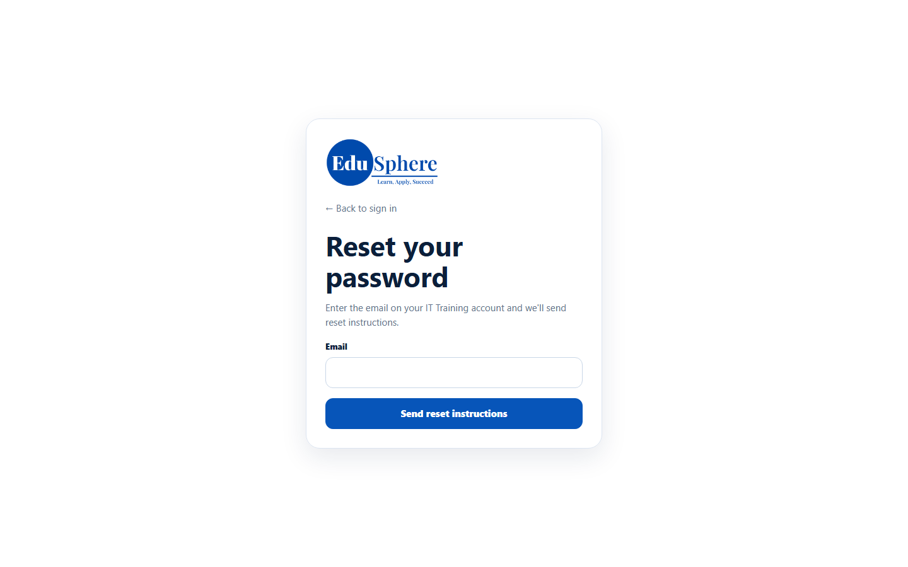
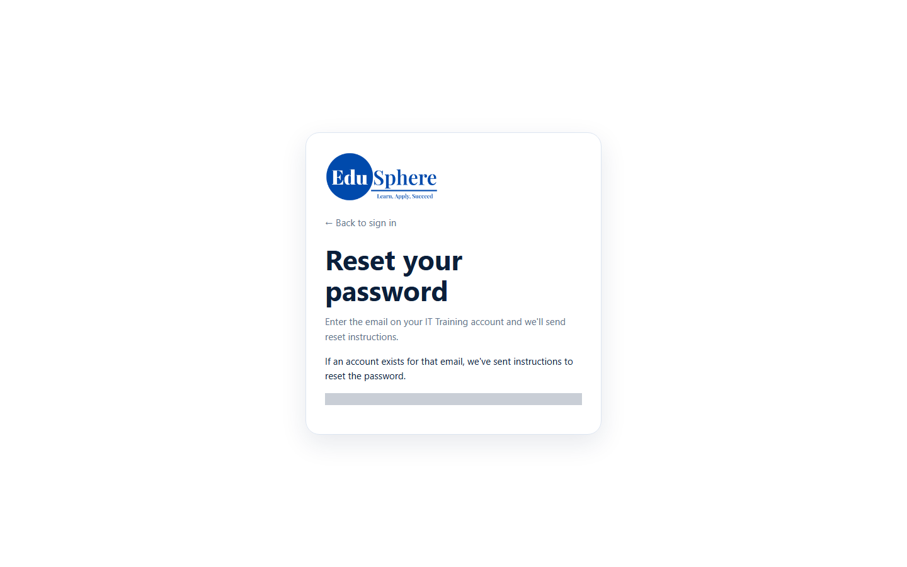

# Forgot / reset your password
> Doc ID: DOC-ITC-AUTH-003 · Verified on 2026-11-18 against `main` @ `6b61546c` · Roles: IT Counselor

## Purpose
Get a new password when you cannot remember the current one.

## Who Can Use This Feature
- **IT Counselor** with an active account.

## Prerequisites
- You can read email sent to your sign-in address.

## How to Access
On `/it/login`, select **Forgot your password?**. The page `/it/forgot-password` opens.

## Steps
### Step 1 — Open Forgot your password

### Step 2 — Request the email
Enter your **Email** and select **Send reset instructions**. The page shows **If an account exists for that email, we've sent instructions to reset the password.**

### Step 3 — Choose a new password
Open the link in the email. On **Choose a new password**, enter a **New password** (at least 10 characters) and select **Reset password**. You return to the IT sign-in page. The steps are the same as in [Set your first password](auth-002-first-password.md).

## Fields
| Field | Description | Required | Example |
|---|---|---|---|
| Email | Your sign-in email | Yes | docs.itc.a@example.test |

## Expected Result
You can sign in with the new password. The old password stops working.

## Validation Messages
| Message | When |
|---|---|
| If an account exists for that email, we've sent instructions to reset the password. | Always shown, so nobody can test which emails have accounts |
| Reset token is invalid or expired… | The reset link was already used or is older than 30 minutes |

## Common Errors
**Problem:** No email arrives. **Cause:** A typo in the email, or the message is in spam. **Resolution:** Check spam, then try again. If it still does not arrive, ask your IT Admin.

## Tips
- A reset link expires after 30 minutes and works once.

## Related Features
- [Change your password](auth-004-change-password.md)
- [Sign in to the IT portal](auth-001-sign-in.md)
