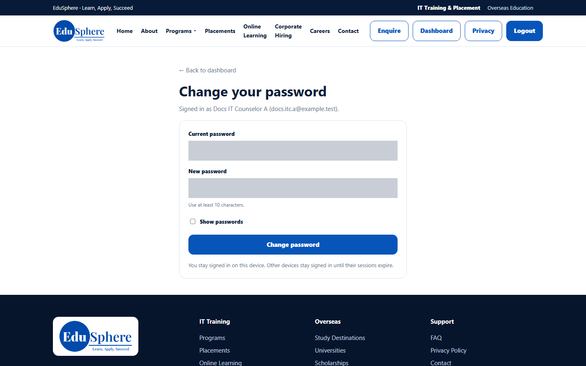
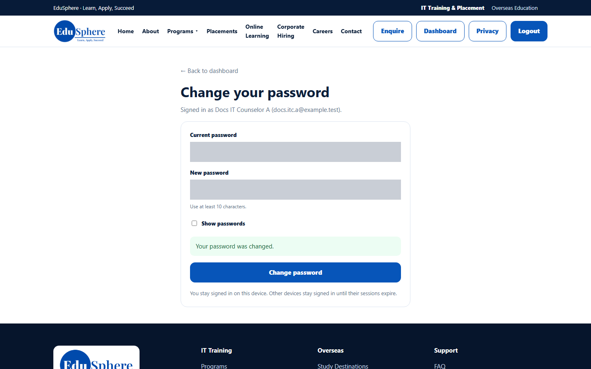
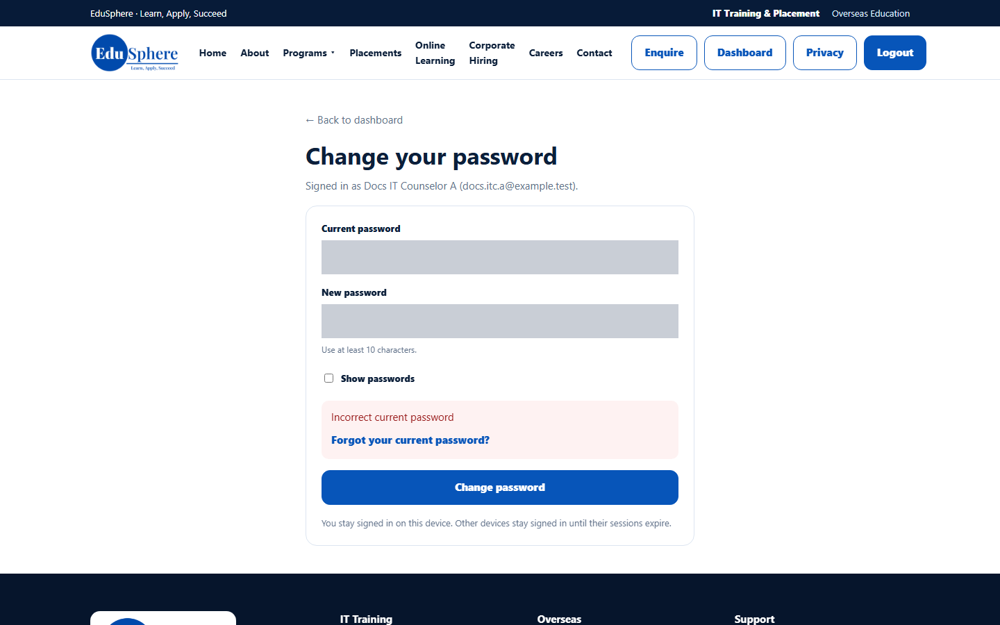
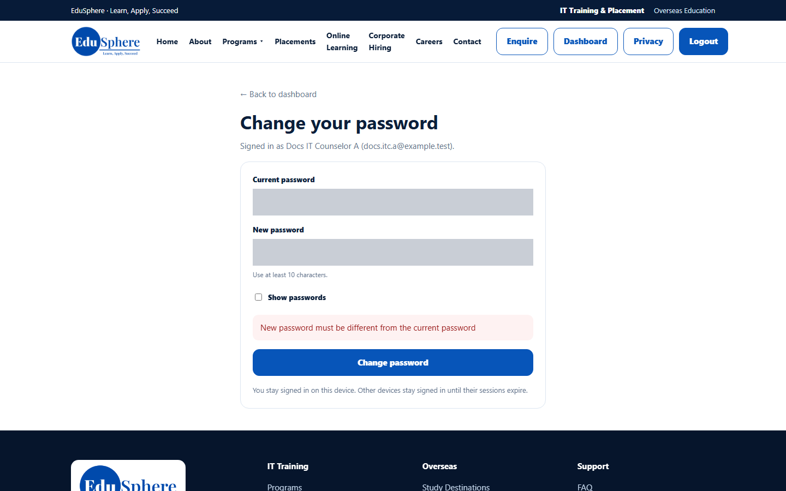

# Change your password
> Doc ID: DOC-ITC-AUTH-004 · Verified on 2026-11-18 against `main` @ `6b61546c` · Roles: IT Counselor

## Purpose
Replace your password while you are signed in.

## Who Can Use This Feature
- **IT Counselor** (signed in).

## Prerequisites
- You know your current password. If not, use [Forgot / reset your password](auth-003-forgot-password.md).

## How to Access
In the sidebar, below the menu, select **Change password** (`/account/password`).

## Steps
### Step 1 — Open Change password

### Step 2 — Enter both passwords
Enter **Current password** and **New password** (at least 10 characters, different from the current one).

### Step 3 — Save
Select **Change password**. The message **Your password was changed.** appears.

## Fields
| Field | Description | Required | Example |
|---|---|---|---|
| Current password | The password you use now | Yes | — |
| New password | Your new password | Yes, at least 10 characters | — |

## Expected Result
Use the new password the next time you sign in.

## Validation Messages
| Message | When |
|---|---|
| Your password was changed. | Success |
| Incorrect current password (with a **Forgot your current password?** link) | **Current password** is wrong |
| New password must be different from the current password | Both passwords are the same |

## Common Errors
**Problem:** "Incorrect current password". **Resolution:** Retype it carefully, or follow **Forgot your current password?**.

## Related Features
- [Forgot / reset your password](auth-003-forgot-password.md)
- [My profile](auth-005-my-profile.md)
