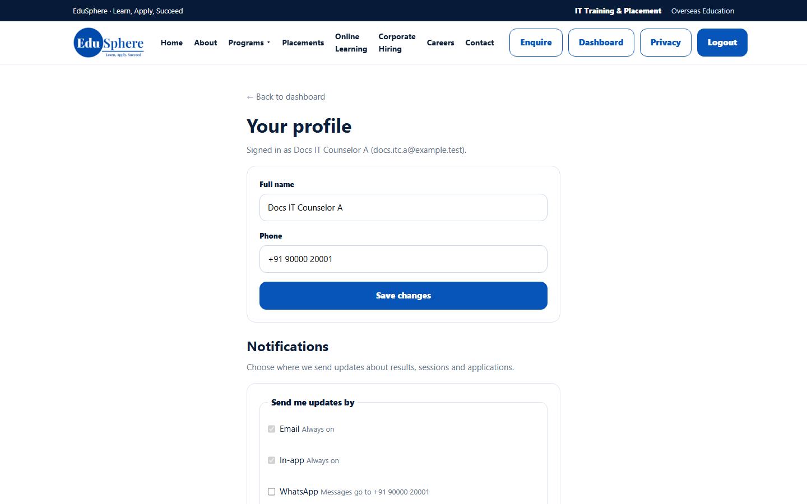
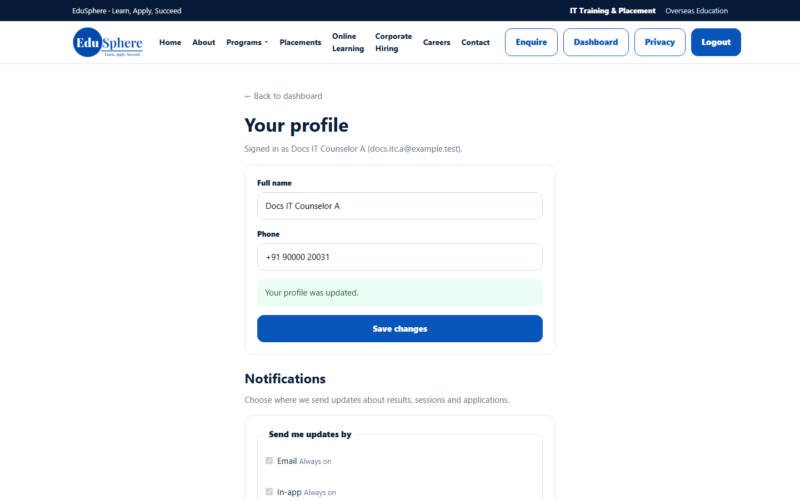

# My profile and contact preferences
> Doc ID: DOC-ITC-AUTH-005 · Verified on 2026-11-18 against `main` @ `6b61546c` · Roles: IT Counselor

## Purpose
Keep your name and phone number up to date, and choose how EduSphere sends you updates.

## Who Can Use This Feature
- **IT Counselor** (signed in).

## Prerequisites
- None.

## How to Access
In the sidebar, below the menu, select **My profile** (`/account/profile`). The page opens with the public EduSphere site header; select **Dashboard** or **← Back to dashboard** to return.

## Steps
### Step 1 — Open My profile
The page **Your profile** shows who you are signed in as.

### Step 2 — Change your name or phone
Edit **Full name** or **Phone** and select **Save changes**. The message **Your profile was updated.** appears.

### Step 3 — Choose how you get updates
Under **Notifications** → **Send me updates by**:
- **Email** and **In-app** are always on.
- Tick **WhatsApp** or **SMS** to also get messages on your phone. They need a valid mobile number in **Phone**.

Under **Phone calls**, **Phone calls from our team** is meant for students ("Counselors and staff may call you about your course"); you can leave it as it is.

Select **Save notification settings**. Ticking a box does nothing until you save.

## Fields
| Field | Description | Required | Example |
|---|---|---|---|
| Full name | Your name as others see it | Yes | Docs IT Counselor A |
| Phone | Your mobile number; also used for WhatsApp/SMS | No | +91 90000 20031 |
| WhatsApp / SMS | Extra channels for updates | No | Off |

## Expected Result
Your new details show across the portal; the chosen channels are used for future updates.

## Validation Messages
| Message | When |
|---|---|
| Your profile was updated. | Name or phone saved |
| Add a mobile number in your profile above to turn on WhatsApp or SMS. | No phone number (from code; not captured) |

## Common Errors
**Problem:** WhatsApp and SMS cannot be ticked. **Cause:** **Phone** is empty or not a valid mobile number. **Resolution:** Enter a 10-digit Indian mobile number or an international number, then save.

## Tips
- Your email cannot be changed here. Ask your IT Admin.
- On a phone, the public header's **Logout** also signs you out. See [Portal tour](../navigation/nav-001-portal-tour.md).

## Related Features
- [Change your password](auth-004-change-password.md)
- [Notifications](../notifications/notif-001-notifications.md)
