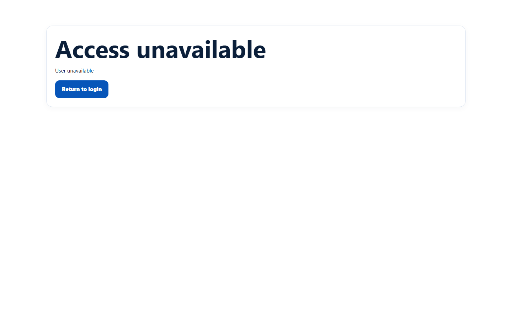
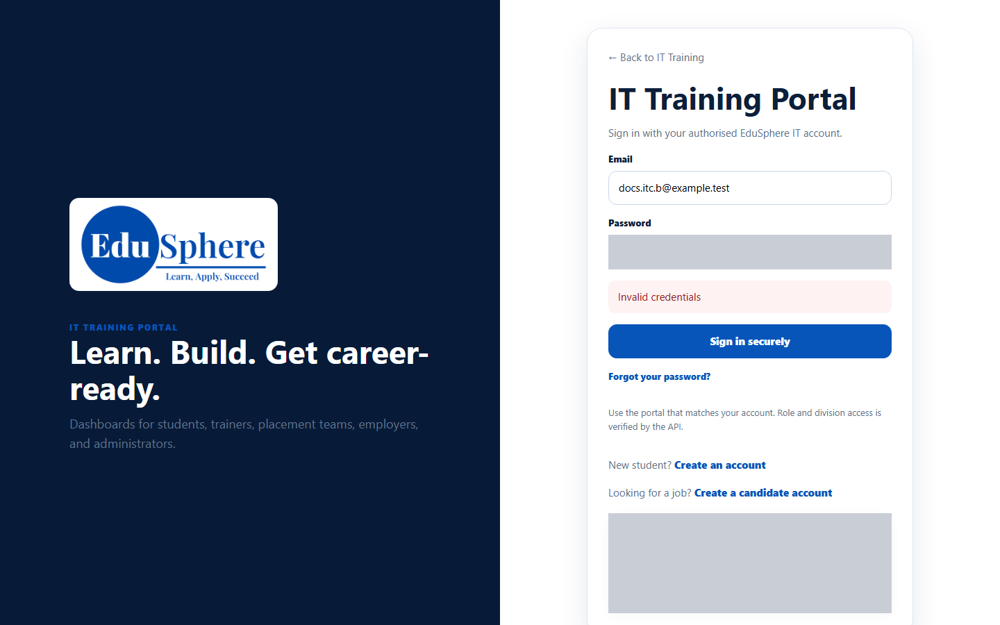

# Sign out, ended sessions, deactivated account
> Doc ID: DOC-ITC-AUTH-006 · Verified on 2026-11-18 against `main` @ `6b61546c` · Roles: IT Counselor

## Purpose
End your session safely, and know what happens when you are signed out or your account is switched off.

## Who Can Use This Feature
- **IT Counselor**.

## Prerequisites
- You are signed in.

## How to Access
In the sidebar, below the menu, select **Sign out**.

## Steps
### Step 1 — Sign out
Select **Sign out** at the bottom of the sidebar. You are taken to the EduSphere home page.

### Step 2 — After signing out
If you open a portal page again (for example from a bookmark), you are sent to `/it/login`. After you sign in you return to that page.

### Deactivated account
When the IT Admin deactivates your account ([Manage IT counselor users](../../admin-manual/admin/adm-002-manage-it-counselor-users.md)):
- A page you already have open shows **Access unavailable** — **User unavailable** with **Return to login** the next time it loads.

- Signing in again shows only **Invalid credentials**. The page does not say the account is deactivated: if your password is right, ask the IT Admin.

- Once the IT Admin reactivates the account, you sign in as before with the same password.

## Expected Result
You are signed out on this browser.

## Common Errors
**Problem:** **Invalid credentials** although the password is right. **Cause:** The account may be deactivated. **Resolution:** Ask the IT Admin to check the account.

**Problem:** There is no **Sign out** in the phone menu. **Cause:** The mobile menu shows only the page links, **Change password** and **My profile**. **Resolution:** Open **My profile** and use **Logout** in the site header, or use a wider screen.

## Tips
- Sign out on shared computers.

## Related Features
- [Sign in to the IT portal](auth-001-sign-in.md)
- [Portal tour](../navigation/nav-001-portal-tour.md)
