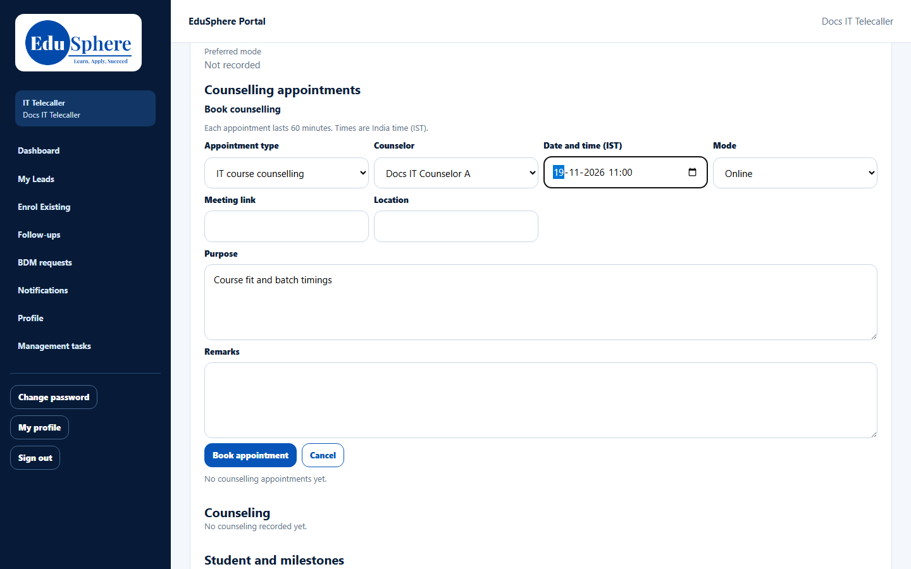
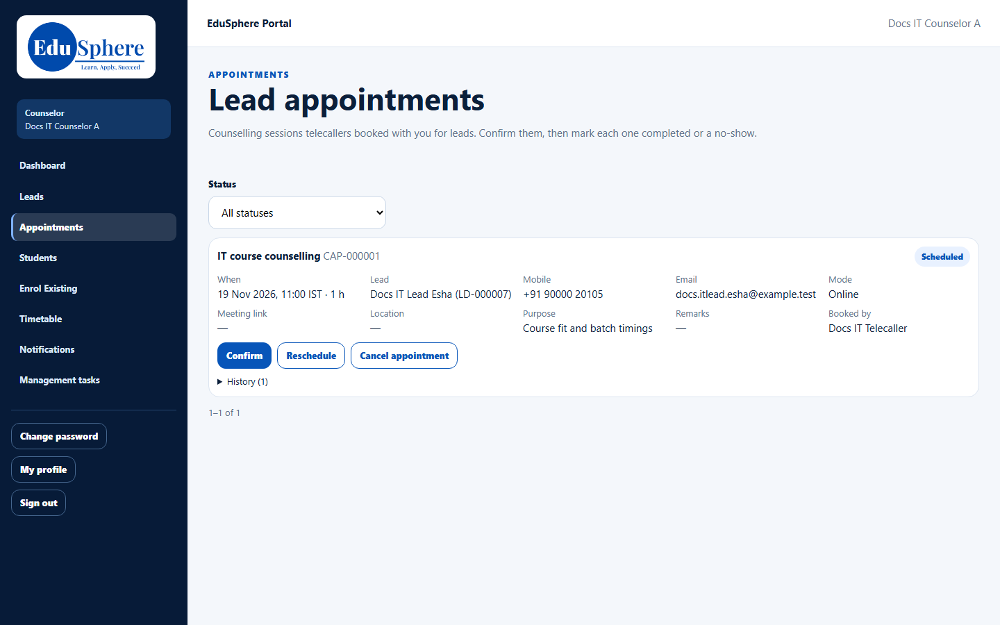
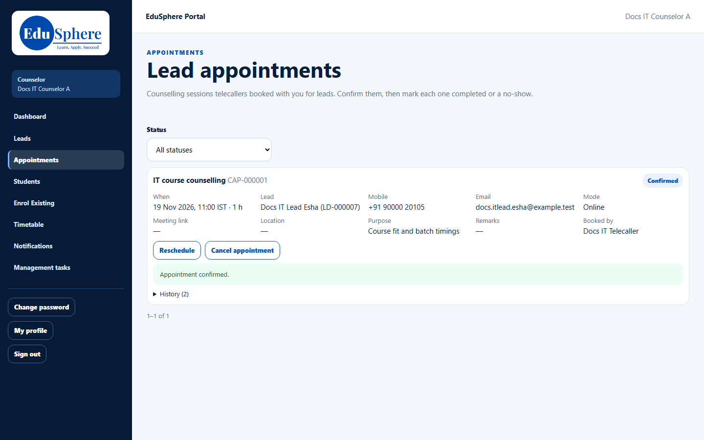
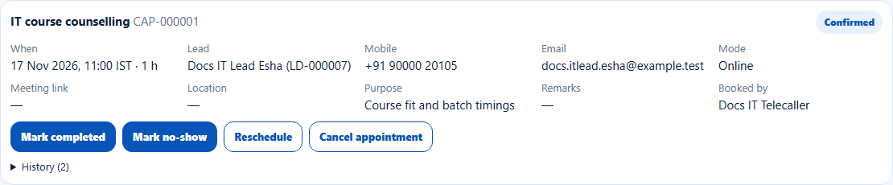
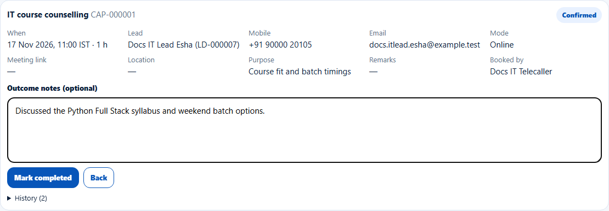
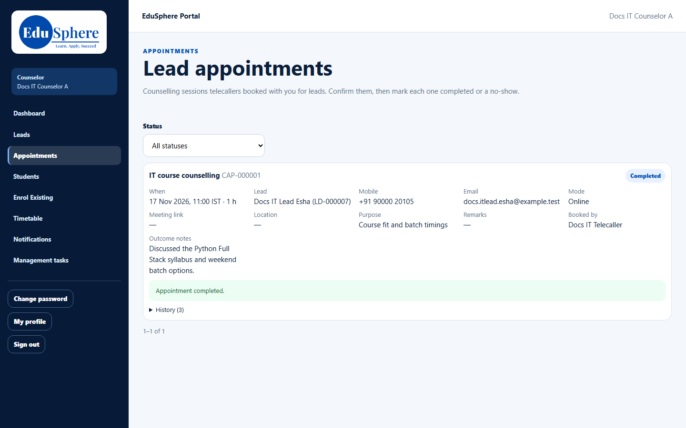

# Lead appointments
> Doc ID: DOC-ITC-APPT-001 · Verified on 2026-11-18 against `main` @ `6b61546c` · Roles: IT Counselor, Telecaller

## Purpose
Handle the counselling sessions telecallers book with you: confirm them, then mark each one completed or a no-show.

## Who Can Use This Feature
- **Telecaller**: books the appointment, on their own lead, **before** handing it over.
- **IT Counselor**: confirms, reschedules, cancels, completes or marks a no-show.

### What each role sees
| | Telecaller | IT Counselor |
|---|---|---|
| Where | Lead page → **Counselling appointments** → **Book counselling** | Sidebar **Appointments** (page title **Lead appointments**) |
| Can book | Yes, while the lead is theirs to change | No |
| Can confirm / complete / no-show | No | Yes |
| Can reschedule / cancel | Yes | Yes |

## Prerequisites
- The lead is open and has no other open appointment.

## How to Access
Sidebar **Appointments**.

## Steps
### Step 1 — The telecaller books (before hand-over)
On the lead page the telecaller selects **Book counselling**, chooses **Appointment type**, **Counselor**, **Date and time (IST)** and **Mode**, optionally **Meeting link**, **Location**, **Purpose** and **Remarks**, and selects **Book appointment**. Each appointment lasts 60 minutes. The message is **Appointment CAP-{number} booked with {counselor}.** and the lead moves to **Counselling Scheduled**.

### Step 2 — Open Lead appointments
Each card shows the type, number (for example **CAP-000001**), status, **When**, **Lead**, **Mobile**, **Email**, **Mode**, **Meeting link**, **Location**, **Purpose**, **Remarks** and **Booked by**. Filter with **Status**.

### Step 3 — Confirm
Select **Confirm**. The message **Appointment confirmed.** appears and the status changes to **Confirmed**. **History** lists every change.

### Step 4 — Complete or no-show
After the session time, the card offers **Mark completed**, **Mark no-show**, **Reschedule** and **Cancel appointment**. (State prepared by data setup: the appointment was moved to yesterday 11:00 IST.)

Select **Mark completed**, optionally fill **Outcome notes (optional)**, and select **Mark completed** again. The message **Appointment completed.** appears and the card shows **Completed** with the outcome notes. The lead moves to **Counselling Completed**.

**Mark no-show** works the same way (from code; not captured: there was one demo appointment).

## Fields
| Field (booking) | Description | Required | Example |
|---|---|---|---|
| Appointment type | Career counselling or IT course counselling | Yes | IT course counselling |
| Counselor | IT counselor for the session | Yes | Docs IT Counselor A |
| Date and time (IST) | Start time, India time | Yes | 19-11-2026 11:00 |
| Mode | Online, Phone or In person | Yes | Online |
| Purpose | What the session is for | No | Course fit and batch timings |

## Expected Result
The appointment shows on your **Lead appointments** with its current status.

## Validation Messages
| Message | When |
|---|---|
| Appointment CAP-{number} booked with {counselor}. | Booking saved |
| Check the highlighted fields. | A required booking field is empty |
| Appointment confirmed. | Counselor confirmed |
| Appointment completed. | Marked completed |
| This lead already has an open counselling appointment | A second booking on the same lead (from code; not captured) |

## Common Errors
**Problem:** The telecaller sees no **Book counselling** button. **Cause:** The lead was already handed over, is closed, or has an open appointment. **Resolution:** Book before hand-over; reschedule or cancel the open one.

## Related Features
- [Telecaller hands a lead to an IT counselor](../../admin-manual/handoffs/ho-001-telecaller-handover.md)
- [Record counseling](../leads/lead-012-counseling.md)
