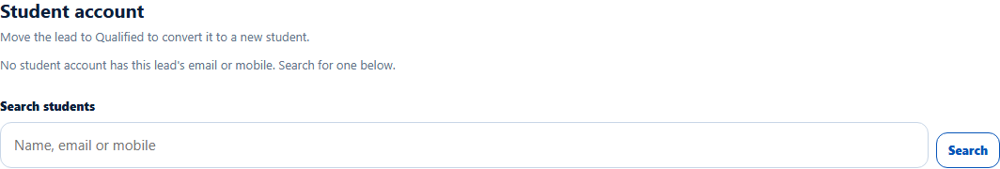
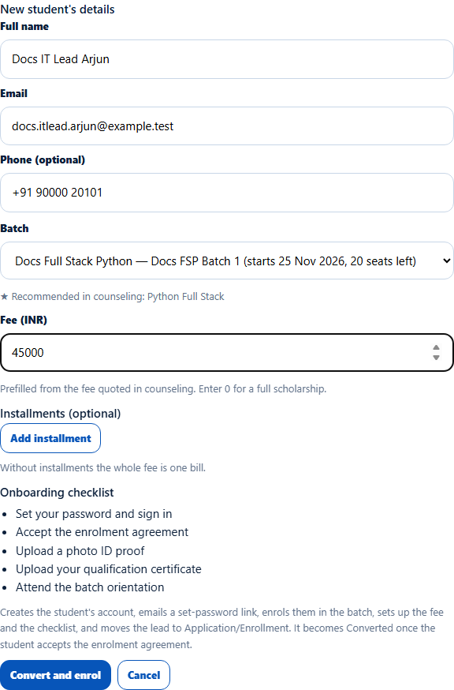
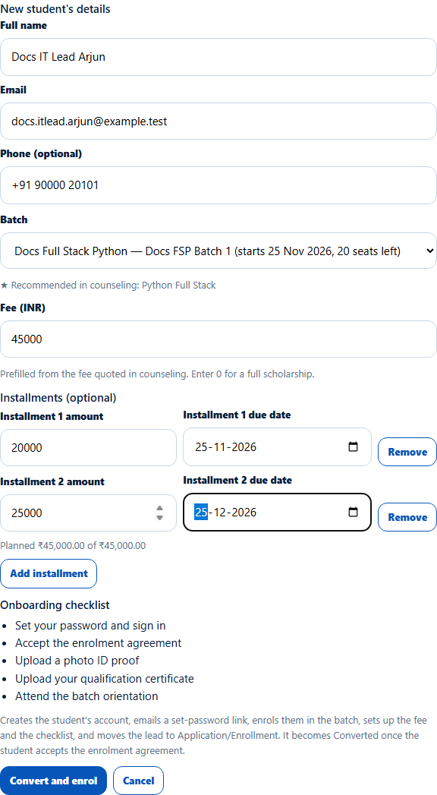
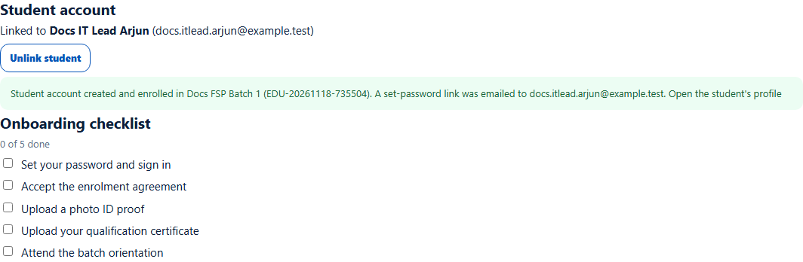

# Convert a lead to a new IT student
> Doc ID: DOC-ITC-CONV-001 · Verified on 2026-11-18 against `main` @ `6b61546c` · Roles: IT Counselor (IT Admin: see Related Features)

## Purpose
Turn a qualified lead into an IT student in one step: create their account, enrol them in a batch, set the fee (with optional installments) and the onboarding checklist.

## Who Can Use This Feature
- **IT Counselor**, on their own leads.
- **IT Admin**, from **Leads** (same form). See [Admin leads](../../admin-manual/admin/adm-006-admin-leads.md).

## Prerequisites
- The lead is at **Qualified** or a later open stage. Before that, **Student account** says "Move the lead to Qualified to convert it to a new student."
- No IT student already uses the lead's email or mobile. If one does, see [Convert into an existing student account](conv-002-convert-existing-student.md).
- The batch has seats left.

## How to Access
Lead page → **Student account** → **Convert to IT student**.

## Steps
### Step 1 — Open the form
Select **Convert to IT student**. **Full name**, **Email** and **Phone (optional)** come from the lead. Batches are listed with their start date and seats left; the course recommended in counseling is marked **★ Recommended in counseling**. **Fee (INR)** is prefilled from the fee quoted in counseling (otherwise from the course fee).

### Step 2 — Add installments (optional)
Select **Add installment** for each part payment and enter **Installment {n} amount** and **Installment {n} due date**. The line **Planned ₹… of ₹…** shows how much of the fee is planned. **Remove** deletes an installment. Without installments the whole fee is one bill.

### Step 3 — Convert and enrol
Check the **Onboarding checklist** preview and select **Convert and enrol**. The message is **Student account created and enrolled in {batch} ({enrolment code}). A set-password link was emailed to {email}.** with a link **Open the student's profile**.

## Fields
| Field | Description | Required | Example |
|---|---|---|---|
| Full name | Student's name | Yes | Docs IT Lead Arjun |
| Email | Student's sign-in email | Yes | docs.itlead.arjun@example.test |
| Phone (optional) | Student's mobile | No | +91 90000 20101 |
| Batch | Batch to enrol in | Yes | Docs Full Stack Python — Docs FSP Batch 1 |
| Fee (INR) | Total fee; 0 for a full scholarship | Yes | 45000 |
| Installment {n} amount / due date | Part payments | No | 20000 · 25-11-2026 |

## Expected Result
- The student account exists and the student gets a set-password email.
- The student is enrolled in the batch with the fee schedule you set. **No payment is recorded**; payments are recorded later by the IT Admin.
- The lead moves to **Application/Enrollment**. It becomes **Converted** once the student accepts the enrolment agreement in their portal.
- The student appears in your **Students** list. See [My students](../students/stu-001-my-students.md).

## Validation Messages
| Message | When |
|---|---|
| Student account created and enrolled in {batch} ({code}). A set-password link was emailed to {email}. | Success |
| An IT student already has this email or mobile. Link the existing student instead. | A student account already matches |
| Unable to convert the lead. | Unexpected failure (from code; not captured) |

## Common Errors
**Problem:** "An IT student already has this email or mobile." **Resolution:** Choose **Enrol {name}**. See [Convert into an existing student account](conv-002-convert-existing-student.md).

**Problem:** The set-password email did not arrive. **Resolution:** Ask the IT Admin to re-send it from **Users**.

## Tips
- The onboarding checklist items are: Set your password and sign in; Accept the enrolment agreement; Upload a photo ID proof; Upload your qualification certificate; Attend the batch orientation. See [Onboarding checklist](conv-003-onboarding-checklist.md).

## Related Features
- [Record counseling](../leads/lead-012-counseling.md)
- [Fee summary and installments](../fees/fee-001-fee-summary.md)
- [Student and milestones](../leads/lead-015-milestones.md)
