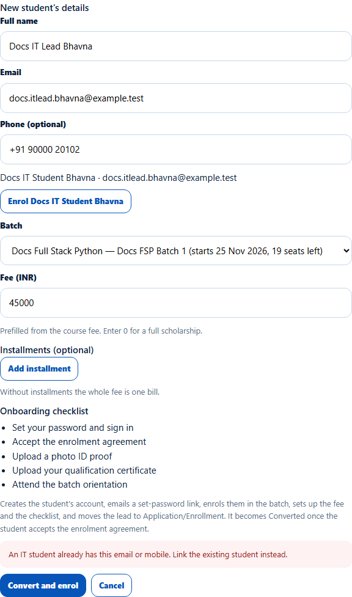
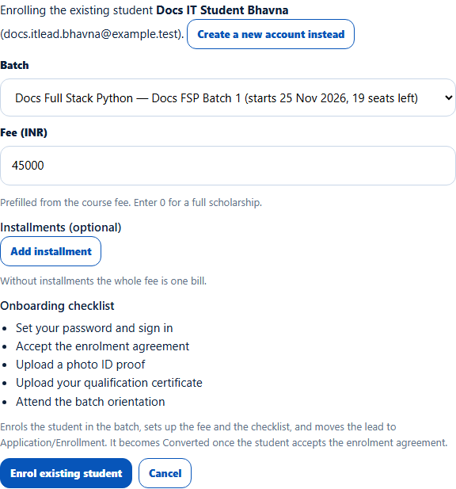
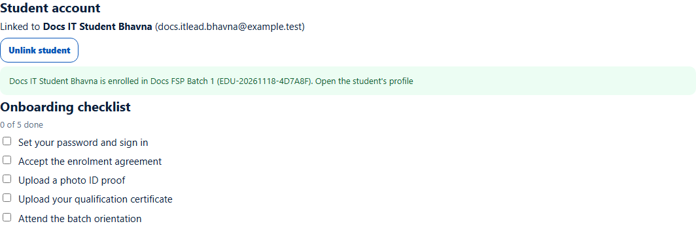

# Convert a lead into an existing student account
> Doc ID: DOC-ITC-CONV-002 · Verified on 2026-11-18 against `main` @ `6b61546c` · Roles: IT Counselor

## Purpose
Enrol a lead whose IT student account already exists (same email or mobile), instead of creating a second account.

## Who Can Use This Feature
- **IT Counselor**, on their own leads.

## Prerequisites
- The lead is at **Qualified** or later.
- An IT student account uses the lead's email or mobile. **Student account** then lists it (name, email, phone) with a **Link** button.

## How to Access
Lead page → **Student account** → **Convert to IT student**.

## Steps
### Step 1 — Try to convert
Fill in **Batch** and **Fee (INR)** and select **Convert and enrol**. The form shows **An IT student already has this email or mobile. Link the existing student instead.** and lists the matching student with **Enrol {name}**.

### Step 2 — Choose the existing student
Select **Enrol {name}**. The form now shows the chosen student, with **Create a new account instead** if you change your mind. The submit button becomes **Enrol existing student**.

### Step 3 — Enrol
Select **Enrol existing student**. The message is **{name} is enrolled in {batch} ({enrolment code}).** with **Open the student's profile**. The lead is linked to that student and shows the onboarding checklist.

## Expected Result
- No new account is created; no new set-password email is sent.
- The existing student is enrolled with the fee and installments you set, and linked to the lead.
- The lead moves to **Application/Enrollment**.

## Validation Messages
| Message | When |
|---|---|
| An IT student already has this email or mobile. Link the existing student instead. | A matching account exists |
| {name} is enrolled in {batch} ({code}). | Success |

## Tips
- If you only want to connect the lead to the student, without a new enrolment, use **Link** instead. See [Link or unlink a student](conv-004-link-student.md).

## Related Features
- [Convert a lead to a new IT student](conv-001-convert-new-student.md)
