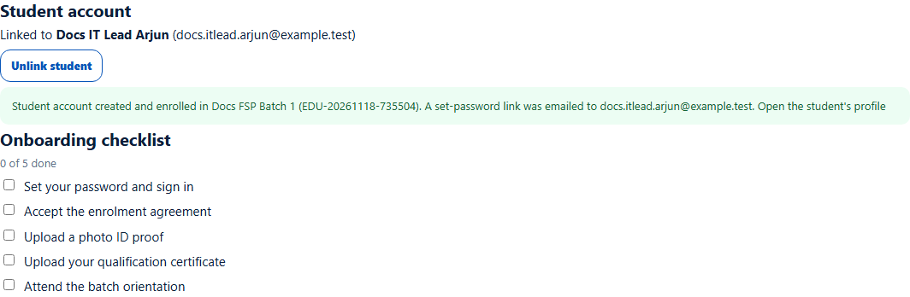
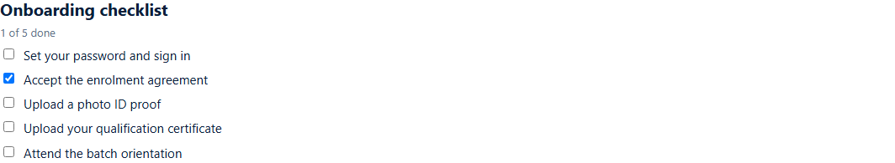

# Onboarding checklist after conversion
> Doc ID: DOC-ITC-CONV-003 · Verified on 2026-11-18 against `main` @ `6b61546c` · Roles: IT Counselor

## Purpose
Track the first steps a new IT student must complete after enrolment.

## Who Can Use This Feature
- **IT Counselor**, on the lead page of a converted lead.

## Prerequisites
- The lead was converted or enrolled. See [Convert a lead to a new IT student](conv-001-convert-new-student.md).

## How to Access
Lead page → **Student account** → **Onboarding checklist**.

## Steps
### Step 1 — Read the checklist
After conversion the checklist shows **0 of 5 done** and five items:
1. Set your password and sign in
2. Accept the enrolment agreement
3. Upload a photo ID proof
4. Upload your qualification certificate
5. Attend the batch orientation

### Step 2 — Tick items
The student's IT counselor (on the lead page) and the IT Admin tick items as the student completes them. Tick an item's box: the count updates at once (**1 of 5 done**) and the tick is saved. Untick it the same way.

Items are not ticked automatically: even after Arjun set his password and accepted the agreement, the list still read **0 of 5 done** until the counselor ticked it (finding P14).

## Expected Result
The count (**{n} of 5 done**) shows the student's onboarding progress.

## Tips
- The same list is previewed in the conversion form before you convert.
- The lead becomes **Converted** when the student accepts the enrolment agreement.

## Related Features
- [Convert a lead to a new IT student](conv-001-convert-new-student.md)
- [What the student sees](../../admin-manual/handoffs/ho-003-student-view.md)
