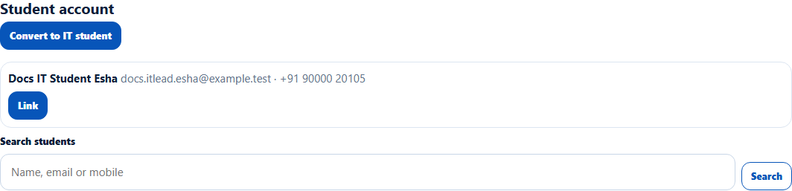
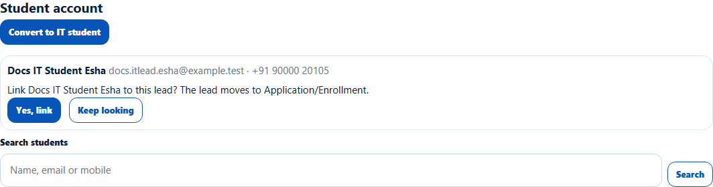
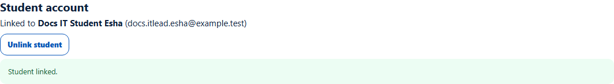
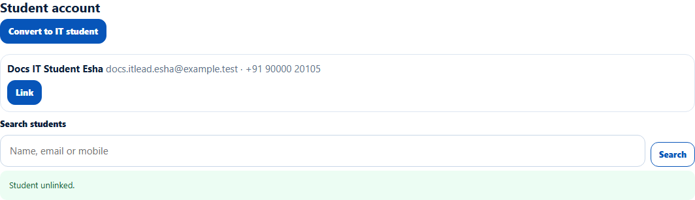

# Link or unlink a student on a lead
> Doc ID: DOC-ITC-CONV-004 · Verified on 2026-11-18 against `main` @ `6b61546c` · Roles: IT Counselor (IT Admin: see Tips)

## Purpose
Connect a lead to the IT student account it belongs to, without a new enrolment, or remove a wrong link.

## Who Can Use This Feature
- **IT Counselor**, on their own leads.

## Prerequisites
- An IT student account exists. If it uses the lead's email or mobile, it is suggested automatically; otherwise use **Search students**.

## How to Access
Lead page → **Student account**.

## Steps
### Step 1 — Find the student
**Student account** lists matching students (name, email, phone) with **Link**. If none match it says "No student account has this lead's email or mobile. Search for one below."; type in **Search students** and select **Search**.

### Step 2 — Link
Select **Link**. The question **Link {student} to this lead? The lead moves to Application/Enrollment.** appears. Select **Yes, link** (or **Keep looking**). The message **Student linked.** appears.

### Step 3 — Unlink (if the link is wrong)
Select **Unlink student**. The question **Unlink {student}? The lead goes back to Follow-up.** appears. Select **Yes, unlink** (or **Keep it**). The message **Student unlinked.** appears.

## Expected Result
- Linked: the lead moves to **Application/Enrollment** and **Student and milestones** shows the student.
- Unlinked: the lead goes back to **Follow-up**.

## Validation Messages
| Message | When |
|---|---|
| Student linked. | Linked |
| Student unlinked. | Unlinked |

## Tips
- Linking does not enrol the student in a batch. To enrol, use **Convert to IT student**.
- When a linked student's enrolment becomes active, the system moves the lead to **Converted** (checked every 15 minutes).
- The IT Admin can also **Link student** (by the student's email) and **Unlink** from **Leads**.
- Once the lead is **Converted**, **Unlink student** is gone: "The student has enrolled, so the lead is converted. Only an admin can unlink it."

## Related Features
- [Convert into an existing student account](conv-002-convert-existing-student.md)
- [Student and milestones](../leads/lead-015-milestones.md)
