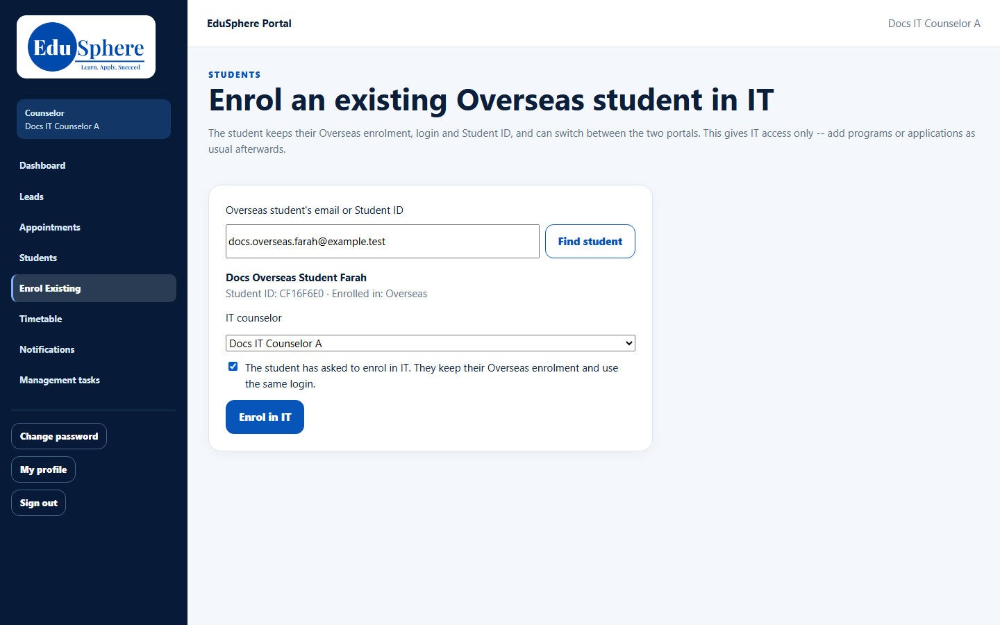
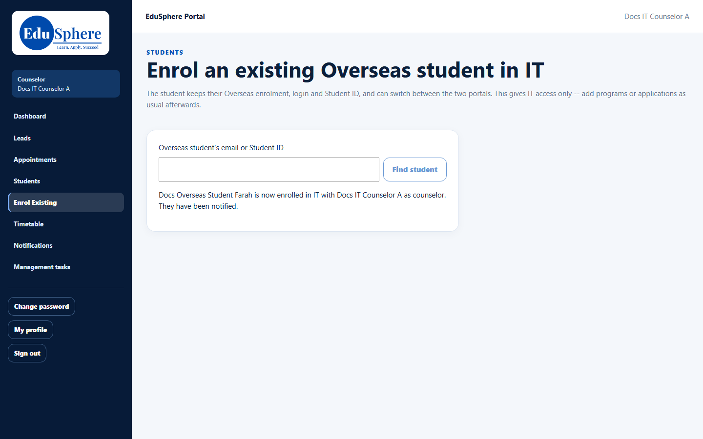

# Enrol an existing Overseas student in IT
> Doc ID: DOC-ITC-CONV-005 · Verified on 2026-11-18 against `main` @ `6b61546c` · Roles: IT Counselor

## Purpose
Give a student who already studies with EduSphere Overseas access to IT as well, keeping one login and one Student ID.

## Who Can Use This Feature
- **IT Counselor**.

## Prerequisites
- The student has an Overseas student account and has asked to enrol in IT.
- You know their email or Student ID.

## How to Access
Sidebar **Enrol Existing** (page title **Enrol an existing Overseas student in IT**).

## Steps
### Step 1 — Find the student
Enter **Overseas student's email or Student ID** and select **Find student**. The student's name, **Student ID** and **Enrolled in** appear.

### Step 2 — Choose the IT counselor and confirm
Choose the **IT counselor** (you or a colleague). Tick **The student has asked to enrol in IT. They keep their Overseas enrolment and use the same login.**

### Step 3 — Enrol
Select **Enrol in IT**. The message is **{name} is now enrolled in IT with {counselor} as counselor. They have been notified.**

## Fields
| Field | Description | Required | Example |
|---|---|---|---|
| Overseas student's email or Student ID | Who to find | Yes | docs.overseas.farah@example.test |
| IT counselor | Counselor for the IT side | Yes | Docs IT Counselor A |
| The student has asked to enrol in IT | Confirms the student's request | Yes | Ticked |

## Expected Result
- The student can switch between the Overseas and IT portals with the same login.
- They appear in the chosen counselor's **Students**.
- This gives IT access only: enrol them in a batch afterwards (no fee is set here).

## Validation Messages
| Message | When |
|---|---|
| {name} is now enrolled in IT with {counselor} as counselor. They have been notified. | Success |
| Pick a IT counselor. | No counselor chosen (from code; not captured) |
| Confirm the student asked to enrol. | Box not ticked (from code; not captured) |
| This student is already enrolled in IT. | Already an IT student (from code; not captured) |

## Related Features
- [My students](../students/stu-001-my-students.md)
