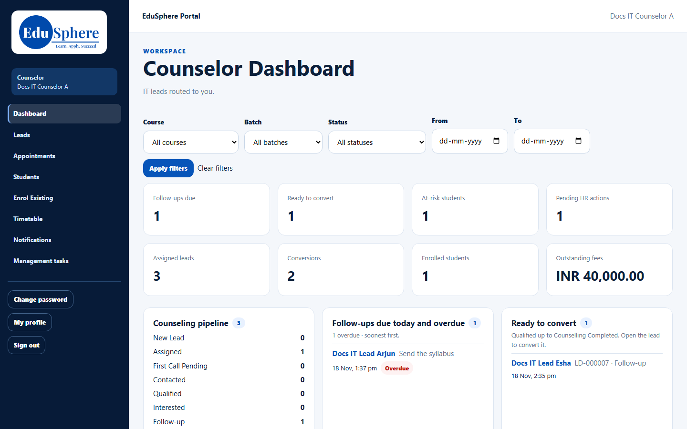
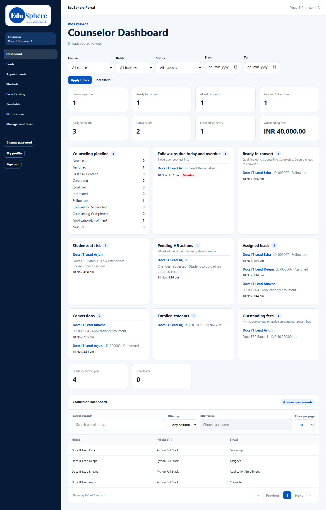

# Counselor dashboard
> Doc ID: DOC-ITC-DASH-001 · Verified on 2026-11-18 against `main` @ `6b61546c` (state prepared by data setup) · Roles: IT Counselor (IT Admin: see ADM-005)

## Purpose
Start the day with everything that needs you: overdue follow-ups, leads ready to convert, students at risk, HR actions and unpaid fees.

## Who Can Use This Feature
| Role | What they see |
|---|---|
| IT Counselor | Their own leads and students ("IT leads routed to you.") |
| IT Admin | Every counselor, with an **Owner** filter ([IT Counselor Dashboard](../../admin-manual/admin/adm-005-counselor-dashboard.md)) |

## Prerequisites
- None. You land here after signing in.

## How to Access
Sidebar **Dashboard** (`/it/counselor/dashboard`).

## Steps
### Step 1 — Read the tiles
**Follow-ups due**, **Ready to convert**, **At-risk students**, **Pending HR actions**, **Assigned leads**, **Conversions**, **Enrolled students** and **Outstanding fees**. Select a tile to jump to its list.

### Step 2 — Work the lists
| List | Shows |
|---|---|
| Counseling pipeline | Open leads per stage |
| Follow-ups due today and overdue | "{n} overdue · soonest first." with **Overdue** badges |
| Ready to convert | "Qualified up to Counselling Completed. Open the lead to convert it." |
| Students at risk | Student, batch and reasons (Low attendance, Consecutive absences) |
| Pending HR actions | "HR asked the student for an updated resume." |
| Assigned leads, Conversions, Enrolled students | Your recent leads, conversions and students |

Select a name to open the lead or student.

## Expected Result
Each count matches its list. Empty lists say so, for example "No follow-ups due today."

## Tips
- To narrow the dashboard, see [Filter the dashboard](dash-002-dashboard-filters.md).

## Related Features
- [Filter the dashboard](dash-002-dashboard-filters.md)
- [Follow-ups](../leads/lead-007-follow-ups.md)
- [Risk and lifecycle cards](../students/stu-004-risk-lifecycle.md)
