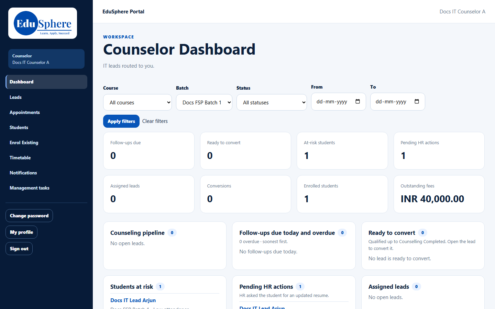

# Filter the dashboard
> Doc ID: DOC-ITC-DASH-002 · Verified on 2026-11-18 against `main` @ `6b61546c` · Roles: IT Counselor (IT Admin: same filters plus Owner)

## Purpose
Look at one course, batch, stage or date range on the dashboard.

## Who Can Use This Feature
- **IT Counselor** and **IT Admin**.

## Prerequisites
- None.

## How to Access
**Dashboard** → the filter row at the top.

## Steps
### Step 1 — Choose filters
Pick **Course**, **Batch**, **Status** (lead stage), **From** and **To** (dates).

### Step 2 — Apply
Select **Apply filters**. The tiles and lists recount for the filter, and the filter is kept in the page address so you can bookmark it. **Clear filters** resets them.

## Validation Messages
| Message | When |
|---|---|
| The start date must be on or before the end date | **From** is after **To** |

## Tips
- A batch filter keeps students of that batch but drops leads that have no batch yet, so lead tiles can show 0.

## Related Features
- [Counselor dashboard](dash-001-dashboard.md)
