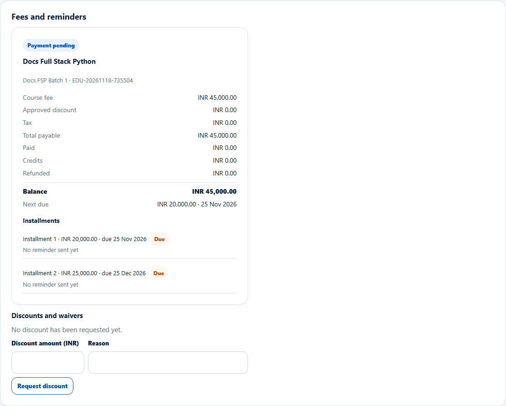

# Fee summary and installments
> Doc ID: DOC-ITC-FEE-001 · Verified on 2026-11-18 against `main` @ `6b61546c` · Roles: IT Counselor (IT Admin: same card)

## Purpose
See what a student owes, what is paid, and when each installment is due.

## Who Can Use This Feature
- **IT Counselor**: their own students (read only; counselors never record payments).
- **IT Admin**: same card on the student's record.

## Prerequisites
- The student has an enrolment with a fee (set when you [convert](../conversion/conv-001-convert-new-student.md) or enrol them).

## How to Access
**Students** → **Profile** → card **Fees and reminders**.

## Steps
### Step 1 — Read the summary
For each enrolment: the payment status (for example **Payment pending**), programme, batch and enrolment number, then **Course fee**, **Approved discount**, **Tax**, **Total payable**, **Paid**, **Credits**, **Refunded**, **Balance** and **Next due**.

### Step 2 — Read the installments
**Installments** lists each one: **Installment {n} · {amount} · due {date}**, its state (**Due**, **Overdue**, paid) and the reminders sent ("No reminder sent yet" until the daily check sends one). A single bill with no due date shows "no due date set".

## Expected Result
You can tell the student exactly what is due and when. **Fee balance** on [My students](../students/stu-001-my-students.md) shows the same balance.

## Tips
- Payments are recorded by the IT Admin (offline) or made by the student online. See [Payments screens](../../admin-manual/admin/adm-008-payments.md). No payment was recorded while writing this guide.
- To lower the fee, see [Request a discount](fee-002-request-discount.md). For overdue fees, see [Overdue fees and reminders](fee-003-overdue-reminders.md).

## Related Features
- [Request a discount](fee-002-request-discount.md)
- [Overdue fees and reminders](fee-003-overdue-reminders.md)
