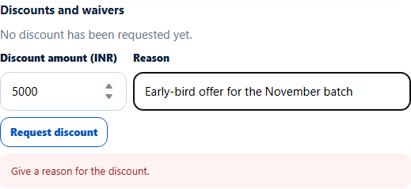
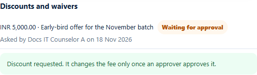
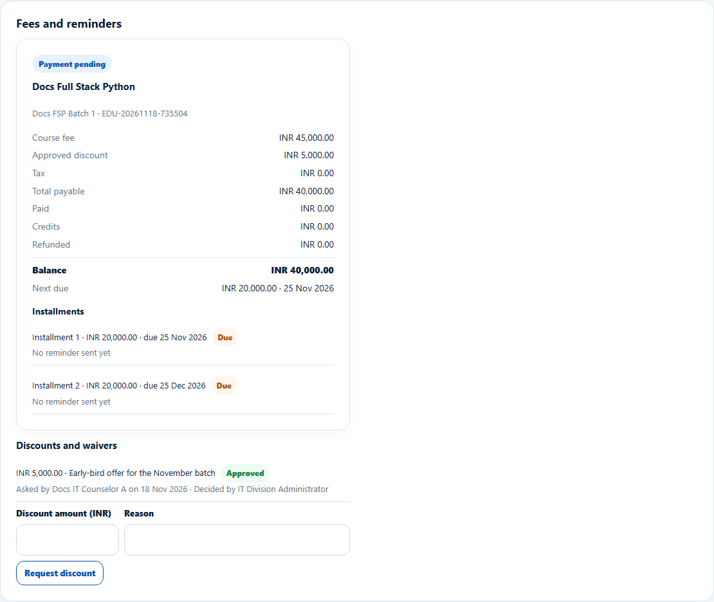
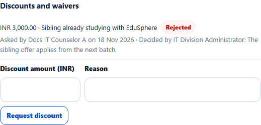

# Request a discount
> Doc ID: DOC-ITC-FEE-002 · Verified on 2026-11-18 against `main` @ `6b61546c` · Roles: IT Counselor (approval: IT Admin)

## Purpose
Ask for a discount or waiver on a student's fee. It changes the fee only after an approver approves it.

## Who Can Use This Feature
- **IT Counselor**: requests, on their own students.
- **IT Admin**: approves or rejects ([Approve or reject a discount](../../admin-manual/admin/adm-009-discount-approvals.md)). Nobody can decide their own request.

## Prerequisites
- The student still owes money on the enrolment.

## How to Access
**Students** → **Profile** → **Fees and reminders** → **Discounts and waivers**.

## Steps
### Step 1 — Enter the amount and reason
Fill **Discount amount (INR)** (above 0 and no more than the balance still owed) and **Reason**.

### Step 2 — Send the request
Select **Request discount**. The message **Discount requested. It changes the fee only once an approver approves it.** appears. The request is listed as **{amount} · {reason}**, **Waiting for approval**, "Asked by {you} on {date}".

### Step 3 — See the decision
- **Approved**: **Approved discount** and **Total payable** change, and the discount comes off the unpaid bills, latest due first (Arjun: installment 2, ₹25,000 → ₹20,000). The request shows **Approved** and "Decided by {approver}".

- **Rejected**: the fee stays the same and the request shows **Rejected** with the approver's note.

## Fields
| Field | Required | Example |
|---|---|---|
| Discount amount (INR) | Yes | 5000 |
| Reason | Yes | Early-bird offer for the November batch |

## Validation Messages
| Message | When |
|---|---|
| Enter an amount above 0 and no more than INR {balance}, the balance still owed. | Amount empty, 0 or above the balance |
| Give a reason for the discount. | Reason empty |
| Discount requested. It changes the fee only once an approver approves it. | Sent |
| A discount request for this enrolment is already waiting for approval | A second request while one is pending (from code; not captured) |

## Related Features
- [Fee summary](fee-001-fee-summary.md)
- [Approve or reject a discount](../../admin-manual/admin/adm-009-discount-approvals.md)
