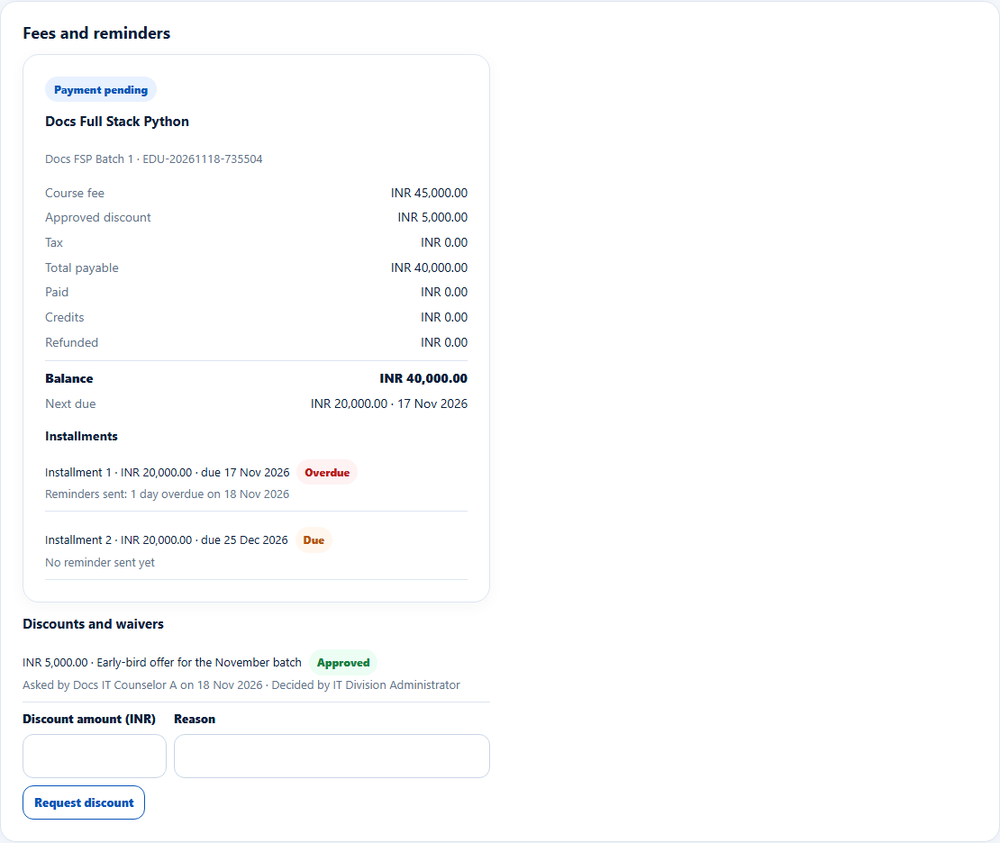
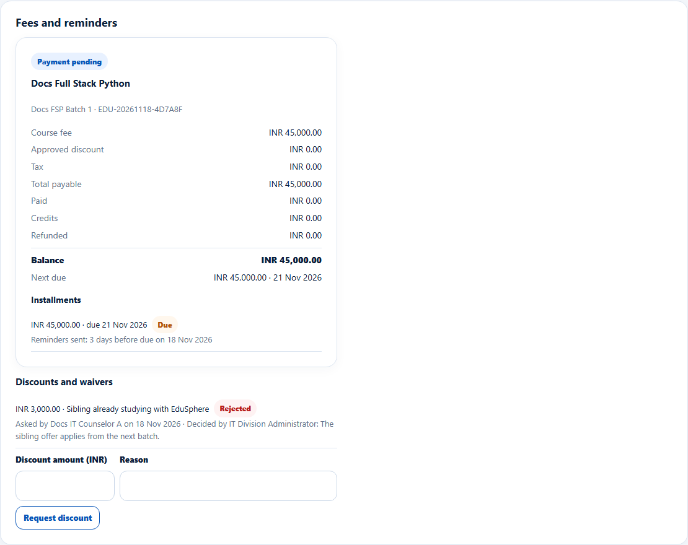

# Overdue fees and reminders sent
> Doc ID: DOC-ITC-FEE-003 · Verified on 2026-11-18 against `main` @ `6b61546c` (state prepared by data setup) · Roles: IT Counselor

## Purpose
Spot students whose fee is overdue, and see which reminders EduSphere has already sent, so you can follow up personally.

## Who Can Use This Feature
- **IT Counselor**: their own students.

## Prerequisites
- The daily fee check (08:30 IST) has run. Its schedule is set by the IT Admin ([Fee reminder schedule](../../admin-manual/admin/adm-010-fee-reminders.md); default 3 days before and 1, 7 and 14 days after).

## How to Access
- Notification **Student's fee payment overdue** ("A fee payment of your student is past its due date. Open EduSphere for the details.").
- **Students** → **Profile** → **Fees and reminders**.
- **Outstanding fees** on your [Dashboard](../dashboard/dash-001-dashboard.md).

## Steps
### Step 1 — Find the overdue installment
The installment shows **Overdue** and **Next due** shows the past date. Under it: **Reminders sent: {n} day(s) overdue on {date}**.

### Step 2 — Check upcoming reminders
An installment that falls due soon shows **Due** and **Reminders sent: 3 days before due on {date}**.

## Expected Result
- The student gets **Fee payment overdue** (or a due-soon reminder); reminders never show an amount.
- You get **Student's fee payment overdue** for overdue fees only.

## Tips
- In this guide the due dates were moved with a data setup (Arjun's installment 1 to yesterday, Bhavna's fee to three days ahead) and the daily check was run by hand. No payment was recorded.
- A rule fires only on its own day; a missed day is not caught up.

## Related Features
- [Fee summary](fee-001-fee-summary.md)
- [Notifications](../notifications/notif-001-notifications.md)
