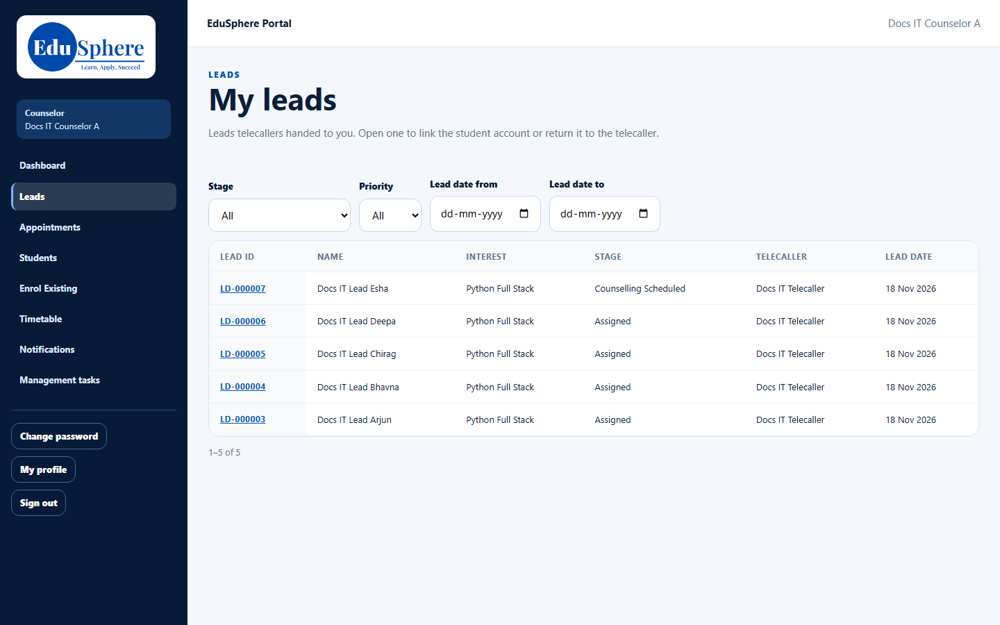
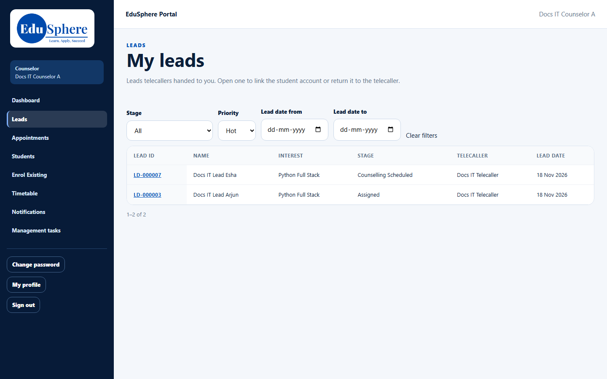

# My leads
> Doc ID: DOC-ITC-LEAD-001 · Verified on 2026-11-18 against `main` @ `6b61546c` · Roles: IT Counselor

## Purpose
See every lead the telecallers have handed to you and open one to work on it.

## Who Can Use This Feature
- **IT Counselor**. You see only leads handed to you.

## Prerequisites
- A telecaller has handed at least one lead to you. See [Telecaller hands a lead to an IT counselor](../../admin-manual/handoffs/ho-001-telecaller-handover.md).

## How to Access
Sidebar **Leads** (page title **My leads**).

## Steps
### Step 1 — Open My leads
The table lists **Lead ID**, **Name**, **Interest**, **Stage**, **Telecaller** and **Lead date**, newest first.

### Step 2 — Filter the list
Use **Stage**, **Priority**, **Lead date from** and **Lead date to**. The list updates as soon as you choose; select **Clear filters** to see everything again.

### Step 3 — Open a lead
Select the **Lead ID** to open the lead page. See [Lead page layout](lead-002-lead-page.md).

## Fields
| Filter | Description | Example |
|---|---|---|
| Stage | One lead stage (labels set by the IT Admin) | Counselling Scheduled |
| Priority | Hot, Warm or Cold | Hot |
| Lead date from / to | Range of lead creation dates | 18-11-2026 |

## Expected Result
Only your leads that match the filters are listed, with the count under the table (for example **1–2 of 2**).

## Common Errors
**Problem:** A lead you expect is missing. **Cause:** It was handed to another counselor, or a manager moved it. **Resolution:** Ask the Telecaller Manager.

## Tips
- There is no search box or export on this page.
- Stage names come from the IT Admin's **Status Labels**, so they may differ from these screenshots.

## Related Features
- [Lead page layout](lead-002-lead-page.md)
- [Counselor dashboard](../dashboard/dash-001-dashboard.md)
