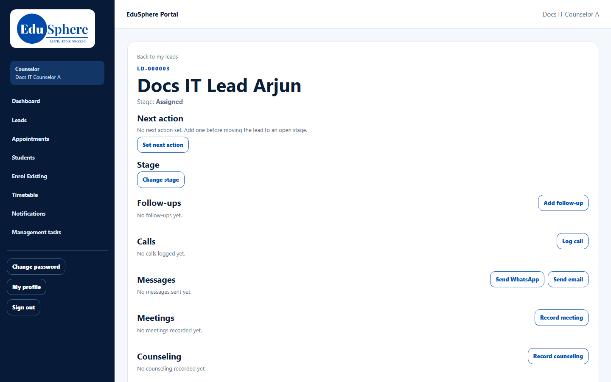
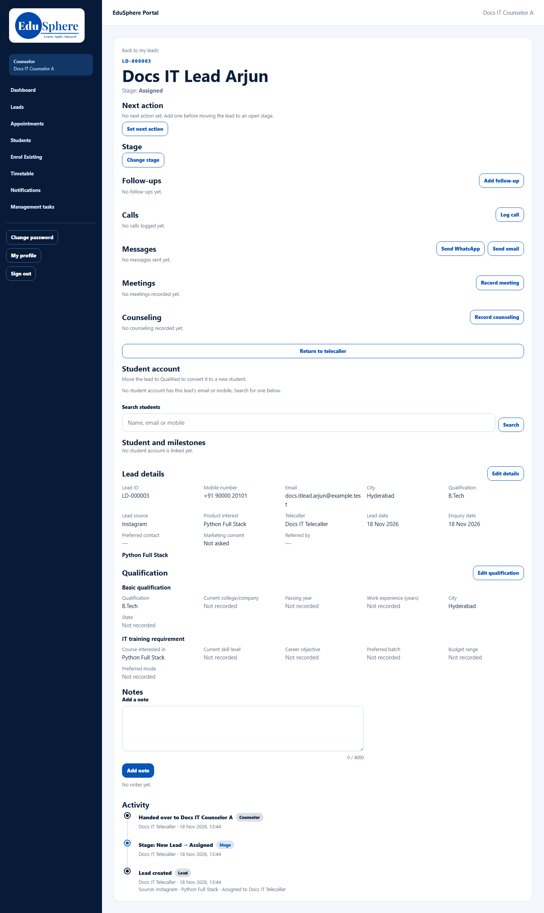

# Lead page layout
> Doc ID: DOC-ITC-LEAD-002 · Verified on 2026-11-18 against `main` @ `6b61546c` · Roles: IT Counselor

## Purpose
Know where everything is on a lead page before you work on the lead.

## Who Can Use This Feature
- **IT Counselor**, on leads handed to them.

## Prerequisites
- The lead is in your **My leads**.

## How to Access
**Leads** → select the **Lead ID**.

## Steps
### Step 1 — The header
The top shows **Back to my leads**, the **Lead ID** (for example **LD-000003**), the lead's name and **Stage**.

### Step 2 — The sections
The page is one long column. From top to bottom:

| Section | What you do there | Page |
|---|---|---|
| **Next action** | The one thing to do next, with a due date | [Set the next action](lead-004-next-action.md) |
| **Stage** | Move the lead through the pipeline | [Change a lead's stage](lead-005-change-stage.md) |
| **Follow-ups** | Dated reminders | [Follow-ups](lead-007-follow-ups.md) |
| **Calls** | Log calls | [Log calls](lead-008-calls.md) |
| **Messages** | WhatsApp and email | [WhatsApp](lead-009-whatsapp.md), [Email](lead-010-email.md) |
| **Meetings** | Record meetings | [Record a meeting](lead-011-meetings.md) |
| **Counseling** | Record counseling sessions | [Record counseling](lead-012-counseling.md) |
| **Return to telecaller** | Send the lead back | [Return a lead](lead-013-return-to-telecaller.md) |
| **Student account** | Convert or link a student | [Convert a lead](../conversion/conv-001-convert-new-student.md) |
| **Student and milestones** | The linked student's progress | [Student and milestones](lead-015-milestones.md) |
| **Lead details** | Contact and source details | [Lead details](lead-003-lead-details.md) |
| **Qualification** | Education and training needs | [Qualification](lead-006-qualification.md) |
| **Notes**, **Activity** | Notes and the timeline | [Notes and activity](lead-014-notes-activity.md) |

## Expected Result
You can find each part of the lead.

## Tips
- The IT counselor lead page has no **Actions** panel and no stage-specific shortcuts; use the section buttons.

## Related Features
- [My leads](lead-001-my-leads.md)
