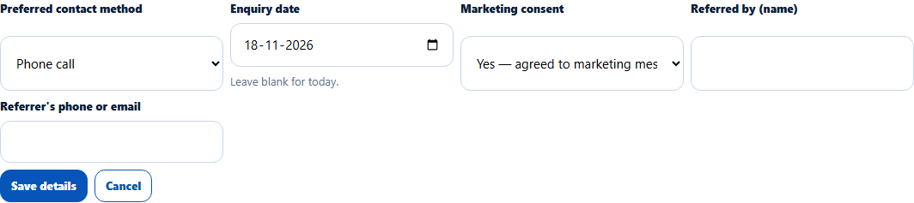
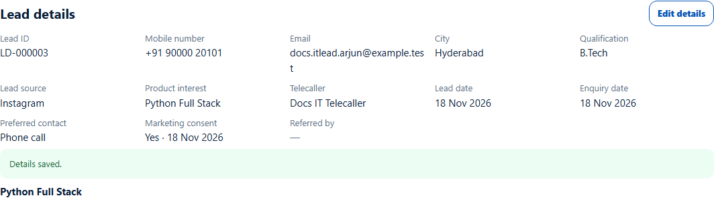

# View and edit lead details
> Doc ID: DOC-ITC-LEAD-003 · Verified on 2026-11-18 against `main` @ `6b61546c` · Roles: IT Counselor

## Purpose
Check how to reach the lead and record their contact preference, marketing consent and referrer.

## Who Can Use This Feature
- **IT Counselor**, on their own leads.

## Prerequisites
- The lead is in your **My leads**.

## How to Access
Lead page → **Lead details** → **Edit details**.

## Steps
### Step 1 — Read the details
**Lead details** shows **Lead ID**, **Mobile number**, **Email**, **City**, **Qualification**, **Lead source**, **Product interest**, **Telecaller**, **Lead date**, **Enquiry date**, **Preferred contact**, **Marketing consent** and **Referred by**.

### Step 2 — Edit
Select **Edit details**. You can change **Preferred contact method**, **Enquiry date**, **Marketing consent**, **Referred by (name)** and **Referrer's phone or email**.

### Step 3 — Save
Select **Save details**. The message **Details saved.** appears.

## Fields
| Field | Description | Required | Example |
|---|---|---|---|
| Preferred contact method | Not recorded, Phone call, WhatsApp, Email or SMS | No | Phone call |
| Enquiry date | When the lead first enquired | No | 18-11-2026 |
| Marketing consent | Not asked, Yes or No | No | Yes — agreed to marketing messages |
| Referred by (name) | Who referred the lead | No | — |
| Referrer's phone or email | How to reach the referrer | No | — |

## Expected Result
The new values show in **Lead details**.

## Validation Messages
| Message | When |
|---|---|
| Details saved. | Success |

## Tips
- Name, mobile number, email, source and product interest are not editable here; the telecaller entered them. Ask a Telecaller Manager to correct them.

## Related Features
- [Qualification](lead-006-qualification.md)
