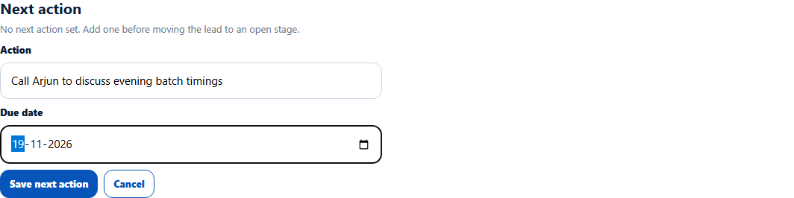

# Set the next action
> Doc ID: DOC-ITC-LEAD-004 · Verified on 2026-11-18 against `main` @ `6b61546c` · Roles: IT Counselor

## Purpose
Record the single next thing to do on a lead and when, so nothing is forgotten.

## Who Can Use This Feature
- **IT Counselor**, on their own leads.

## Prerequisites
- The lead is in your **My leads**.

## How to Access
Lead page → **Next action** → **Set next action** (or **Edit next action** when one exists).

## Steps
### Step 1 — Open the form
With no next action the section says "No next action set. Add one before moving the lead to an open stage." Select **Set next action**.

### Step 2 — Fill it in
Enter **Action** and **Due date**.

### Step 3 — Save
Select **Save next action**. The message **Next action saved.** appears under the lead's stage line at the top, and the action shows with its due date. The due date must be today or later.

## Fields
| Field | Description | Required | Example |
|---|---|---|---|
| Action | What to do next | Yes | Call Arjun to discuss evening batch timings |
| Due date | When it is due | Yes | 19-11-2026 |

## Expected Result
The next action shows on the lead with **due {date}**. Select **Edit next action** to change it.

## Validation Messages
| Message | When |
|---|---|
| Next action saved. | Success |
| Add the next action and its due date. | A field is empty (from code; not captured) |

## Tips
- Set a next action before you move a lead to an open stage.
- For several dated reminders use [Follow-ups](lead-007-follow-ups.md).

## Related Features
- [Change a lead's stage](lead-005-change-stage.md)
- [Follow-ups](lead-007-follow-ups.md)
