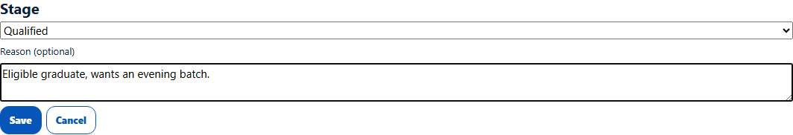
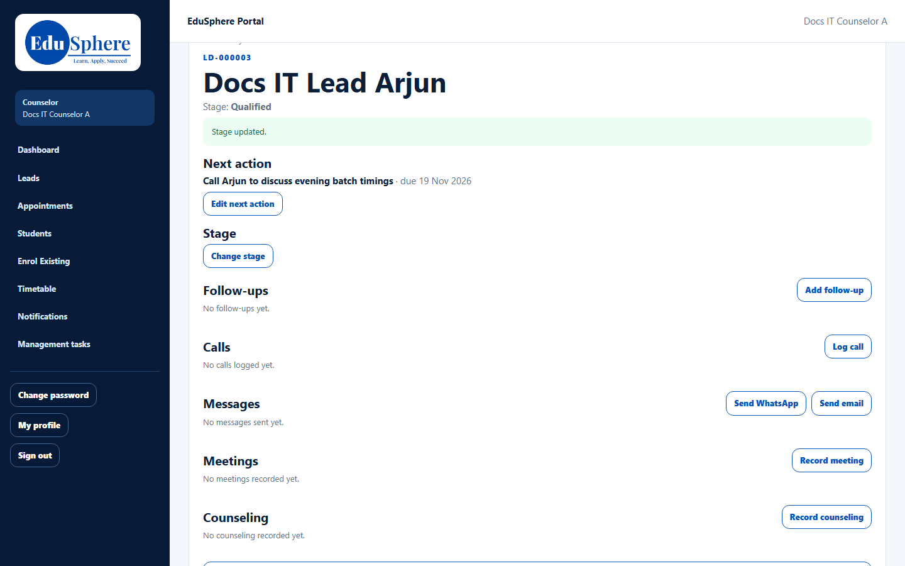

# Change a lead's stage
> Doc ID: DOC-ITC-LEAD-005 · Verified on 2026-11-18 against `main` @ `6b61546c` · Roles: IT Counselor

## Purpose
Move the lead through the pipeline, for example to **Qualified** so it can be converted, or close it.

## Who Can Use This Feature
- **IT Counselor**, on their own leads.

## Prerequisites
- A next action is set when you move to an open stage. See [Set the next action](lead-004-next-action.md).

## How to Access
Lead page → **Stage** → **Change stage**.

## Steps
### Step 1 — Choose the new stage
Select **Change stage** and choose a stage. The counselor can choose **Qualified**, **Follow-up**, **Counselling Scheduled**, **Counselling Completed**, **Not Interested**, **Not Eligible** or **Lost**.

### Step 2 — Add a reason
Optionally type a **Reason (optional)**.

### Step 3 — Save
Select **Save**. The message **Stage updated.** appears and the header shows the new stage.

## Fields
| Field | Description | Required | Example |
|---|---|---|---|
| New stage | The stage to move to | Yes | Qualified |
| Reason (optional) | Why | No | Eligible graduate, wants an evening batch. |

## Expected Result
- The lead shows the new stage everywhere, including **My leads**.
- From **Qualified** onwards, **Student account** offers **Convert to IT student**.

## Validation Messages
| Message | When |
|---|---|
| Stage updated. | Success |

## Tips
- **Converted** is set by the system when the lead's student enrols; you do not choose it.
- Stage names come from the IT Admin's **Status Labels**.

## Related Features
- [Convert a lead to a new IT student](../conversion/conv-001-convert-new-student.md)
- [Status labels](../../admin-manual/admin/adm-013-status-labels.md)
