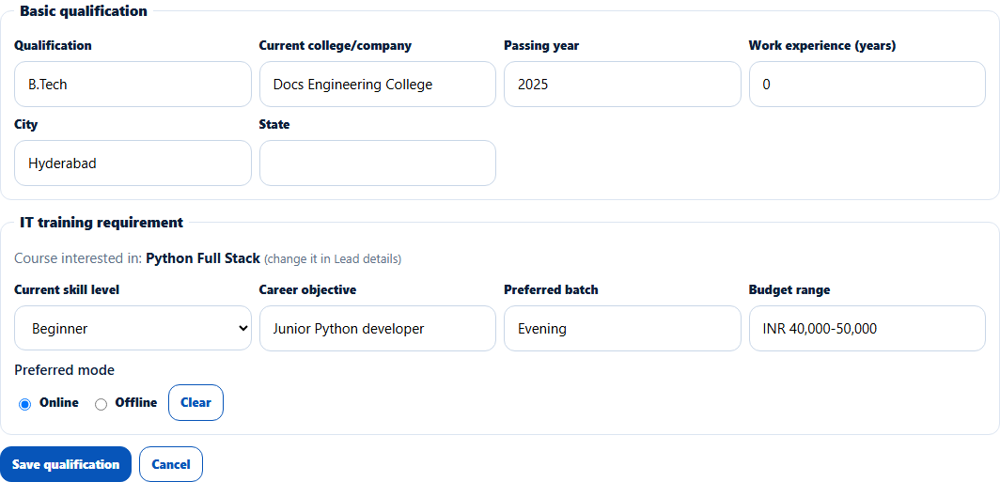
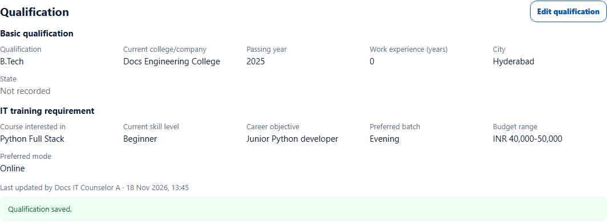

# Lead qualification
> Doc ID: DOC-ITC-LEAD-006 · Verified on 2026-11-18 against `main` @ `6b61546c` · Roles: IT Counselor

## Purpose
Record the lead's education, experience and training needs, so you can recommend the right course and batch.

## Who Can Use This Feature
- **IT Counselor**, on their own leads.

## Prerequisites
- The lead is in your **My leads**.

## How to Access
Lead page → **Qualification** → **Edit qualification**.

## Steps
### Step 1 — Open the form
Select **Edit qualification**.

### Step 2 — Fill in what you know
All fields are optional. **Preferred mode** is **Online** or **Offline** (select **Clear** to unset it).

### Step 3 — Save
Select **Save qualification**. The message **Qualification saved.** appears.

## Fields
| Field | Description | Required | Example |
|---|---|---|---|
| Qualification | Highest qualification | No | B.Tech |
| Current college/company | Where they study or work | No | Docs Engineering College |
| Passing year | Year of passing | No | 2025 |
| Work experience (years) | Years of work | No | 0 |
| City / State | Where they live | No | Hyderabad |
| Current skill level | Not recorded, Beginner, Intermediate, Advanced | No | Beginner |
| Career objective | Their goal | No | Junior Python developer |
| Preferred batch | Timing they want | No | Evening |
| Budget range | What they can pay | No | INR 40,000-50,000 |
| Preferred mode | Online or Offline | No | Online |

## Expected Result
The **Qualification** section shows **Basic qualification** and **IT training requirement** with your answers; empty answers show **Not recorded**.

## Validation Messages
| Message | When |
|---|---|
| Qualification saved. | Success |

## Related Features
- [Record counseling](lead-012-counseling.md)
- [Lead details](lead-003-lead-details.md)
