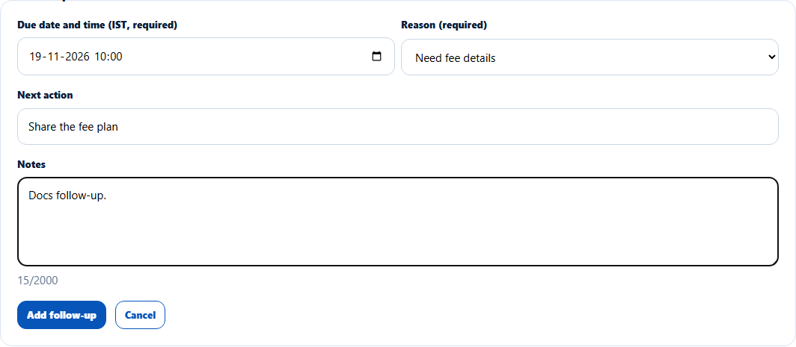
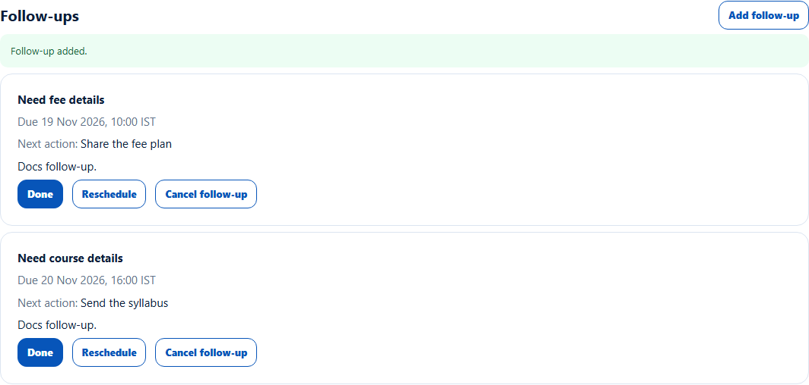
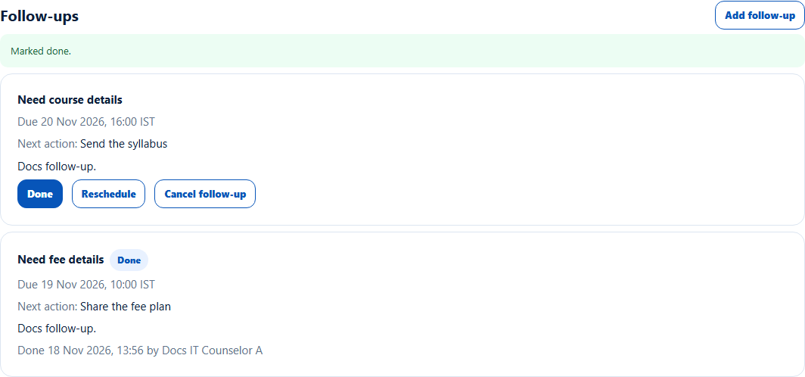

# Add and complete follow-ups
> Doc ID: DOC-ITC-LEAD-007 · Verified on 2026-11-18 against `main` @ `6b61546c` (add, list, done). Overdue and escalation: added in session S9 · Roles: IT Counselor

## Purpose
Plan dated reminders on a lead (for example "share the fee plan tomorrow at 10") and tick them off when done.

## Who Can Use This Feature
- **IT Counselor**, on their own leads.

## Prerequisites
- The lead is in your **My leads**.

## How to Access
Lead page → **Follow-ups** → **Add follow-up**.

## Steps
### Step 1 — Add a follow-up
Select **Add follow-up**. Enter **Due date and time (IST, required)**, choose **Reason (required)**, and optionally **Next action** and **Notes**. Select **Add follow-up**. The message **Follow-up added.** appears.

### Step 2 — See your follow-ups
Each follow-up shows its reason, **Due** time, **Next action** and notes, with **Done**, **Reschedule** and **Cancel follow-up**.

### Step 3 — Mark one done
Select **Done**. The message **Marked done.** appears, the follow-up gets a **Done** badge and shows "Done {date} by {you}".

### Step 4 — Overdue follow-ups
VERIFICATION REQUIRED — captured in session S9 (overdue list and escalation to the IT Admin).

## Fields
| Field | Description | Required | Example |
|---|---|---|---|
| Due date and time (IST, required) | When to act | Yes | 19-11-2026 10:00 |
| Reason (required) | Need to discuss with parents, Need course details, Need fee details, Waiting for salary, Waiting for documents, Comparing courses, Interested next month, Interested next intake, Waiting for university information, Requested counselor call | Yes | Need fee details |
| Next action | What you will do | No | Share the fee plan |
| Notes | Extra detail | No | — |

## Expected Result
Open follow-ups appear on the lead and on your **Dashboard** (**Follow-ups due today and overdue**).

## Validation Messages
| Message | When |
|---|---|
| Follow-up added. | Added |
| Marked done. | Done |

## Tips
- The IT counselor has no separate Tasks or Follow-ups page; use the lead page and the dashboard.
- **Done** does not ask for an outcome; log a call or add a note if you need a record of what happened.

## Related Features
- [Set the next action](lead-004-next-action.md)
- [Counselor dashboard](../dashboard/dash-001-dashboard.md)
- [Overdue follow-up escalation](../../admin-manual/admin/adm-014-escalation.md)
