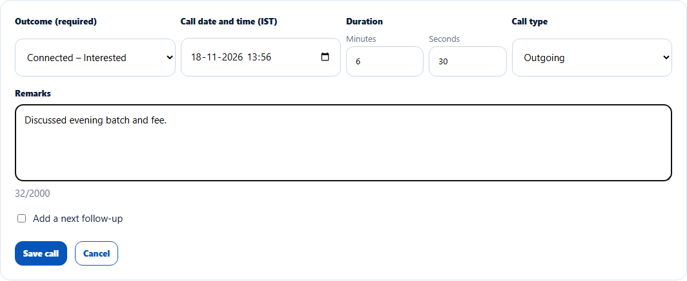
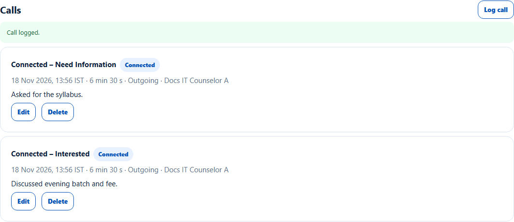
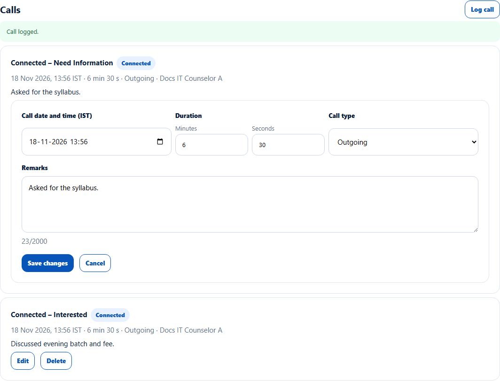
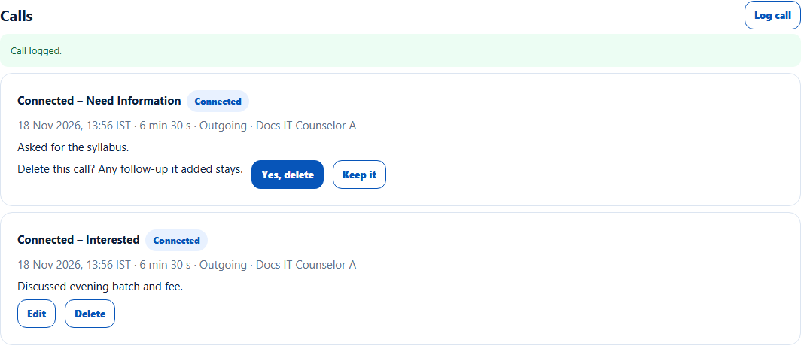

# Log, edit and delete calls
> Doc ID: DOC-ITC-LEAD-008 · Verified on 2026-11-18 against `main` @ `6b61546c` · Roles: IT Counselor

## Purpose
Keep a record of every call with the lead: outcome, length and what was said.

## Who Can Use This Feature
- **IT Counselor**, on their own leads.

## Prerequisites
- The lead is in your **My leads**. Calls are made from your own phone; EduSphere only records them.

## How to Access
Lead page → **Calls** → **Log call**.

## Steps
### Step 1 — Log a call
Select **Log call**. Choose **Outcome (required)**. **Call date and time (IST)** starts at now. Enter the **Duration** (**Minutes**, **Seconds**), **Call type** and **Remarks**. Select **Save call**. The message **Call logged.** appears.

### Step 2 — Read the call list
Each call shows the outcome, date, duration, call type, who logged it and the remarks, with **Edit** and **Delete**.

### Step 3 — Edit a call
Select **Edit**, change the fields and save. Select **Cancel** to leave it.

### Step 4 — Delete a call
Select **Delete**. The question "Delete this call? Any follow-up it added stays." appears. Select **Yes, delete** (or **Keep it**). The message **Call deleted.** appears.

## Fields
| Field | Description | Required | Example |
|---|---|---|---|
| Outcome (required) | Connected – Interested, Connected – Need Information, Connected – Follow-up Required, Connected – Appointment Fixed, Not Interested, Call Back Requested, Already Joined Elsewhere, Duplicate Lead, Not Eligible, Wrong Number, Busy, No Answer, Switched Off | Yes | Connected – Interested |
| Call date and time (IST) | When the call happened | No (defaults to now) | 18-11-2026 13:56 |
| Duration | Minutes and seconds | No | 6 min 30 s |
| Call type | Outgoing or Incoming | No | Outgoing |
| Remarks | What was discussed (up to 2000 characters) | No | Discussed evening batch and fee. |

## Expected Result
The call is listed on the lead and in **Activity**.

## Validation Messages
| Message | When |
|---|---|
| Call logged. | Saved |
| Call deleted. | Deleted |

## Related Features
- [Follow-ups](lead-007-follow-ups.md)
- [Notes and activity](lead-014-notes-activity.md)
