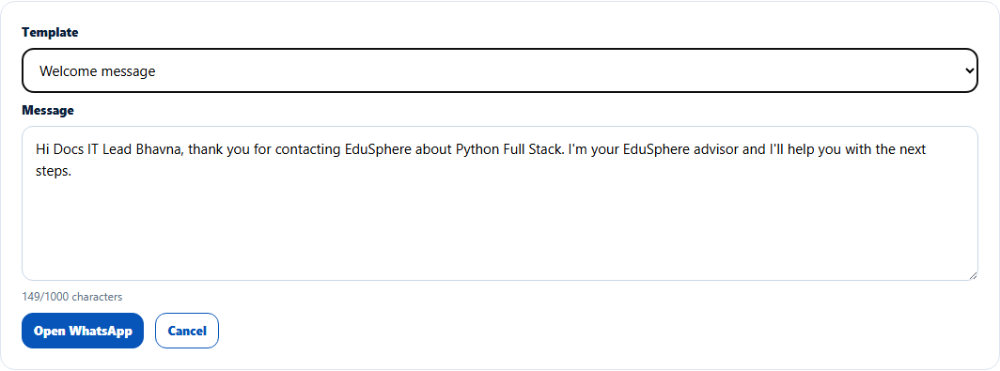
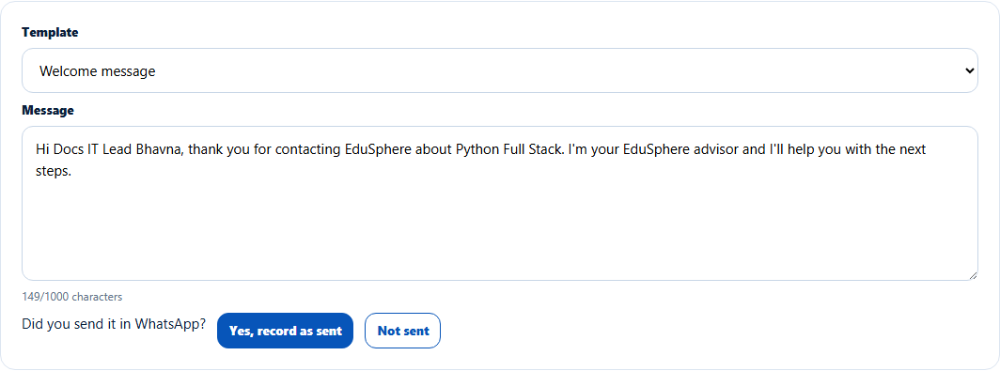

# Send a WhatsApp message
> Doc ID: DOC-ITC-LEAD-009 · Verified on 2026-11-18 against `main` @ `6b61546c` · Roles: IT Counselor

## Purpose
Send the lead a WhatsApp message from your own WhatsApp, starting from a ready-made template, and keep a record of it.

## Who Can Use This Feature
- **IT Counselor**, on their own leads.

## Prerequisites
- The lead has a mobile or WhatsApp number (otherwise **Send WhatsApp** is greyed out).
- WhatsApp on your computer or phone.

## How to Access
Lead page → **Messages** → **Send WhatsApp**.

## Steps
### Step 1 — Write the message
Select **Send WhatsApp**. Choose a **Template** (or **Custom message**) and edit the **Message** (up to 1000 characters). Templates fill in the lead's name and course.

### Step 2 — Open WhatsApp
Select **Open WhatsApp**. WhatsApp opens in a new tab with the message ready. Send it there.

### Step 3 — Record the send
Back in EduSphere the question **Did you send it in WhatsApp?** appears. Select **Yes, record as sent** (or **Not sent**). The message **WhatsApp send recorded.** appears.

## Fields
| Field | Description | Required | Example |
|---|---|---|---|
| Template | Custom message, Welcome message, Course details, Brochure, Fee details, Counselling appointment, Reminder, Follow-up, Overseas destination information, Document request | No | Welcome message |
| Message | The text to send | Yes | Hi Docs IT Lead Bhavna, … |

## Expected Result
The message is listed under **Messages** as **WhatsApp sent**, with the template and your name. See the screenshot in [Send an email](lead-010-email.md).

## Validation Messages
| Message | When |
|---|---|
| WhatsApp send recorded. | You confirmed the send |

## Common Errors
**Problem:** You selected **Yes, record as sent** by mistake. **Resolution:** Select **Delete** on the message in **Messages**.

## Tips
- EduSphere does not send WhatsApp messages itself; it only records what you sent.
- Template wording is maintained by the Telecaller Manager.

## Related Features
- [Send an email](lead-010-email.md)
