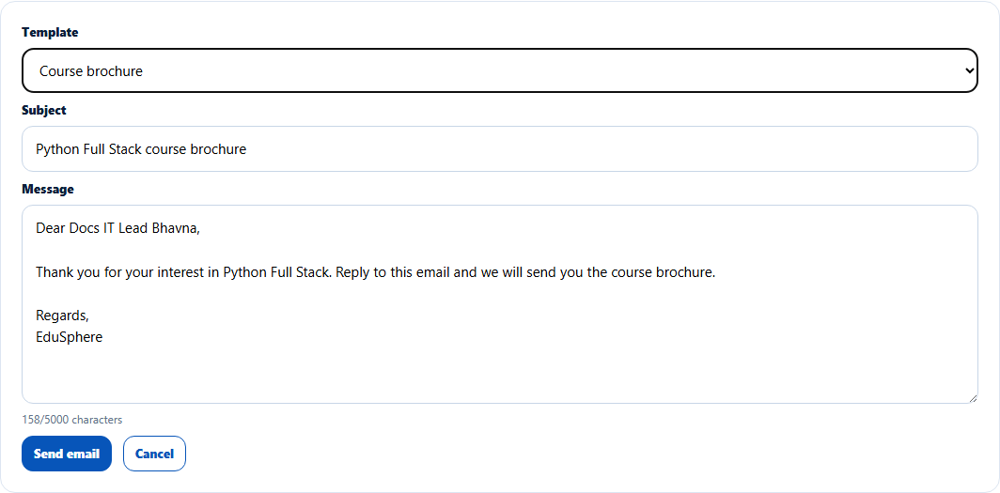
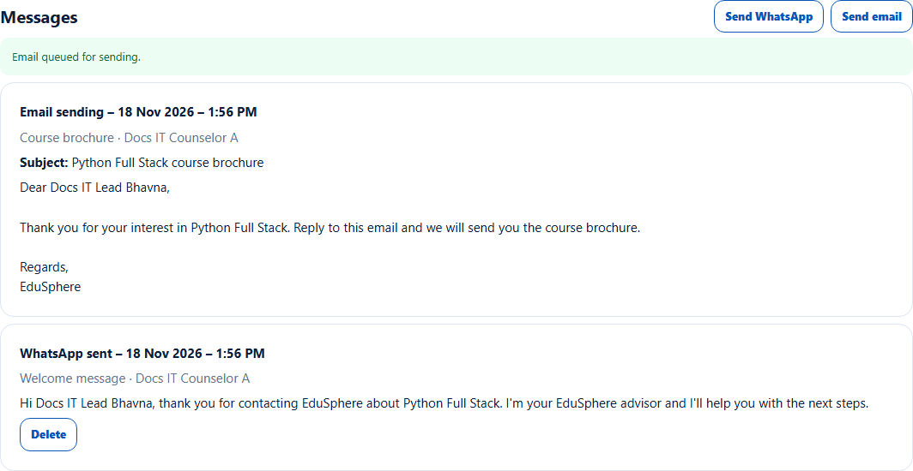

# Send an email to a lead
> Doc ID: DOC-ITC-LEAD-010 · Verified on 2026-11-18 against `main` @ `6b61546c` · Roles: IT Counselor

## Purpose
Email the lead from EduSphere, using a template such as the course brochure, and keep a copy on the lead.

## Who Can Use This Feature
- **IT Counselor**, on their own leads.

## Prerequisites
- The lead has an email address (otherwise **Send email** is greyed out).

## How to Access
Lead page → **Messages** → **Send email**.

## Steps
### Step 1 — Choose a template
Select **Send email**. Choose a **Template**: **Custom message**, **Course brochure**, **Fee proposal**, **Counselling confirmation**, **Overseas information**, **University information**, **Follow-up email** or **Appointment confirmation**. The **Subject** and **Message** fill in; edit them if needed.

### Step 2 — Send
Select **Send email**. The message **Email queued for sending.** appears.

### Step 3 — Check Messages
The email is listed under **Messages** with its subject and text. Its title shows the delivery state: **Email sending**, then **Email sent**; **Email delayed** while the system retries, **Email failed** if it gives up (from code).

## Fields
| Field | Description | Required | Example |
|---|---|---|---|
| Template | Ready-made email | No | Course brochure |
| Subject | Email subject | Yes | Python Full Stack course brochure |
| Message | Email text | Yes | Dear Docs IT Lead Bhavna, … |

## Expected Result
The lead receives the email from EduSphere's address; the copy stays on the lead.

## Validation Messages
| Message | When |
|---|---|
| Email queued for sending. | Accepted for sending |
| Email delayed / Email failed | Delivery problem (shown as the message title; from code, not captured) |

## Common Errors
**Problem:** The email stays at **Email sending**. **Cause:** The email service is not working. **Resolution:** Tell your IT Admin; the system retries automatically.

## Tips
- The **Course brochure** template asks the lead to reply for the brochure; it does not attach a file.

## Related Features
- [Send a WhatsApp message](lead-009-whatsapp.md)
