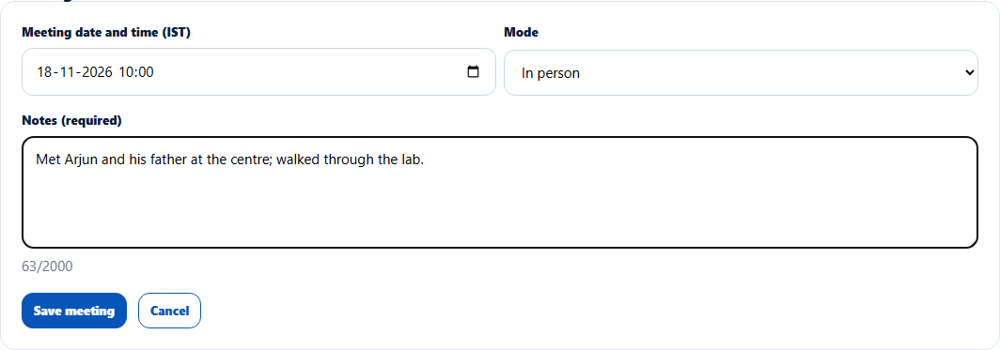
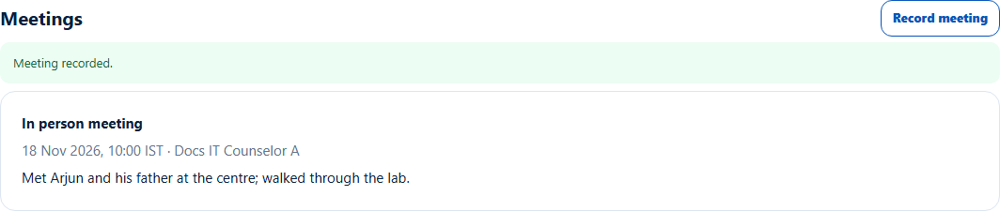

# Record a meeting
> Doc ID: DOC-ITC-LEAD-011 · Verified on 2026-11-18 against `main` @ `6b61546c` · Roles: IT Counselor

## Purpose
Keep a note of a meeting with the lead, in person, online or by phone.

## Who Can Use This Feature
- **IT Counselor**, on their own leads.

## Prerequisites
- The meeting has happened. (Booked counselling sessions are handled on **Appointments**.)

## How to Access
Lead page → **Meetings** → **Record meeting**.

## Steps
### Step 1 — Fill in the meeting
Select **Record meeting**. Enter **Meeting date and time (IST)**, choose **Mode** and write **Notes (required)**.

### Step 2 — Save
Select **Save meeting**. The message **Meeting recorded.** appears and the meeting is listed.

## Fields
| Field | Description | Required | Example |
|---|---|---|---|
| Meeting date and time (IST) | When it happened | Yes | 18-11-2026 10:00 |
| Mode | In person, Online or Phone | Yes | In person |
| Notes (required) | What was discussed | Yes | Met Arjun and his father at the centre… |

## Expected Result
The meeting shows under **Meetings** and in **Activity** at the meeting time.

## Validation Messages
| Message | When |
|---|---|
| Meeting recorded. | Saved |

## Related Features
- [Record counseling](lead-012-counseling.md)
- [Lead appointments](../appointments/appt-001-lead-appointments.md)
