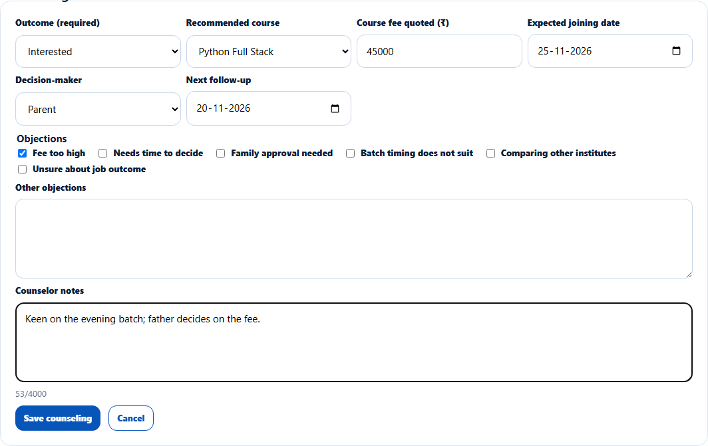
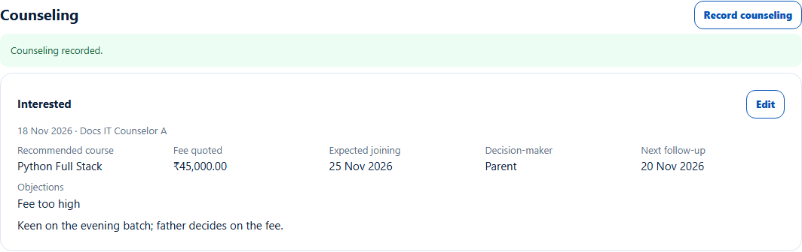

# Record a counseling session
> Doc ID: DOC-ITC-LEAD-012 · Verified on 2026-11-18 against `main` @ `6b61546c` · Roles: IT Counselor

## Purpose
Record the result of counseling: the course you recommended, the fee you quoted, who decides, objections and when you will follow up. The fee and course are reused when you convert the lead.

## Who Can Use This Feature
- **IT Counselor**, on their own leads. Telecallers see counseling records read only.

## Prerequisites
- You have counseled the lead.

## How to Access
Lead page → **Counseling** → **Record counseling**.

## Steps
### Step 1 — Fill in the counseling form
Select **Record counseling**. Choose **Outcome (required)**, then fill in what you know. Tick any **Objections** that apply.

### Step 2 — Save
Select **Save counseling**. The message **Counseling recorded.** appears. The record shows the outcome, date, your name and every answer, with **Edit**.

## Fields
| Field | Description | Required | Example |
|---|---|---|---|
| Outcome (required) | Interested, Needs time, Not interested, Enrolled | Yes | Interested |
| Recommended course | IT course you recommend | No | Python Full Stack |
| Course fee quoted (₹) | Fee you quoted | No | 45000 |
| Expected joining date | When they plan to join | No | 25-11-2026 |
| Decision-maker | Not known, Self, Parent, Spouse, Employer, Other | No | Parent |
| Next follow-up | Date to follow up | No | 20-11-2026 |
| Objections | Fee too high, Needs time to decide, Family approval needed, Batch timing does not suit, Comparing other institutes, Unsure about job outcome | No | Fee too high |
| Other objections | Free text | No | — |
| Counselor notes | Up to 4000 characters | No | Keen on the evening batch… |

## Expected Result
The record is on the lead and in **Activity** ("Counseling recorded: Interested").

## Validation Messages
| Message | When |
|---|---|
| Counseling recorded. | Saved |

## Tips
- The **Objections** list is maintained by the Telecaller Manager (**Counseling objections**).
- **Course fee quoted** prefills the fee when you convert the lead. See [Convert a lead to a new IT student](../conversion/conv-001-convert-new-student.md).

## Related Features
- [Lead qualification](lead-006-qualification.md)
- [Convert a lead to a new IT student](../conversion/conv-001-convert-new-student.md)
