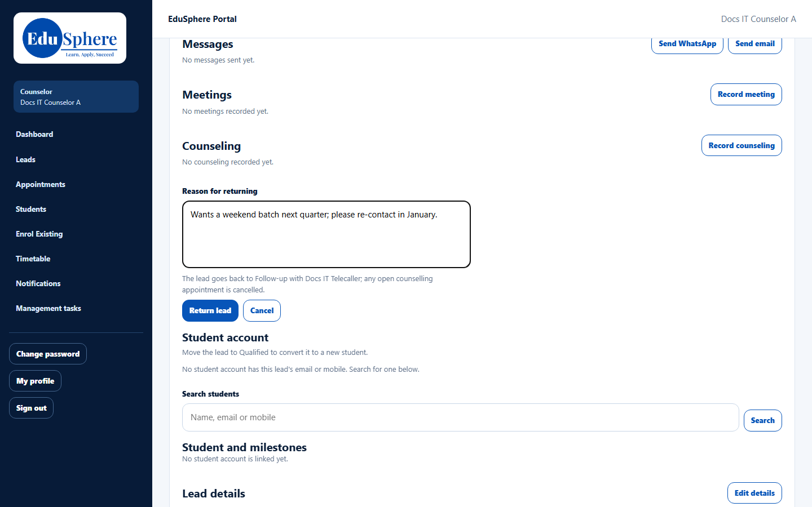
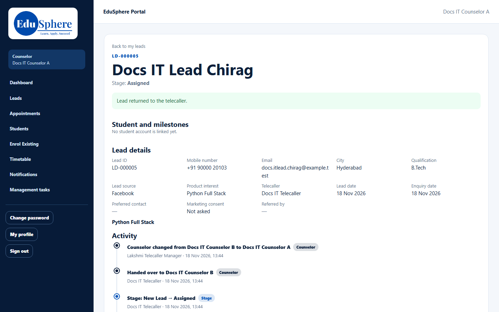

# Return a lead to the telecaller
> Doc ID: DOC-ITC-LEAD-013 · Verified on 2026-11-18 against `main` @ `6b61546c` · Roles: IT Counselor

## Purpose
Give a lead back to its telecaller when it is not ready for counseling, for example when the person wants to start much later.

## Who Can Use This Feature
- **IT Counselor**, on their own leads.

## Prerequisites
- The lead is in your **My leads** and is not converted.

## How to Access
Lead page → **Return to telecaller**.

## Steps
### Step 1 — Give a reason
Select **Return to telecaller** and write the **Reason for returning**.

### Step 2 — Return
Select **Return lead**. The message **Lead returned to the telecaller.** appears. The page now shows only **Student and milestones**, **Lead details** and **Activity**; you can no longer change the lead.

## Fields
| Field | Description | Required | Example |
|---|---|---|---|
| Reason for returning | Why the lead goes back (up to 500 characters; kept in the stage history) | Yes | Wants a weekend batch next quarter… |

## Expected Result
- The lead leaves your **My leads**.
- The telecaller can work it again.

## Validation Messages
| Message | When |
|---|---|
| Lead returned to the telecaller. | Success |
| Add a reason for returning the lead. | **Reason for returning** is empty (from code; not captured) |

## Tips
- To pass a lead to another counselor instead, ask the Telecaller Manager. See [Telecaller Manager changes the counselor](../../admin-manual/handoffs/ho-002-manager-change-counselor.md).

## Related Features
- [Telecaller hands a lead to an IT counselor](../../admin-manual/handoffs/ho-001-telecaller-handover.md)
