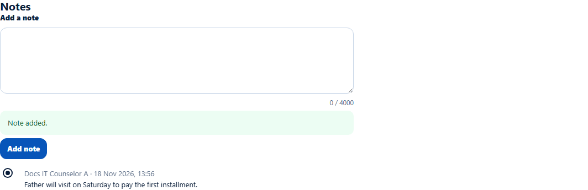
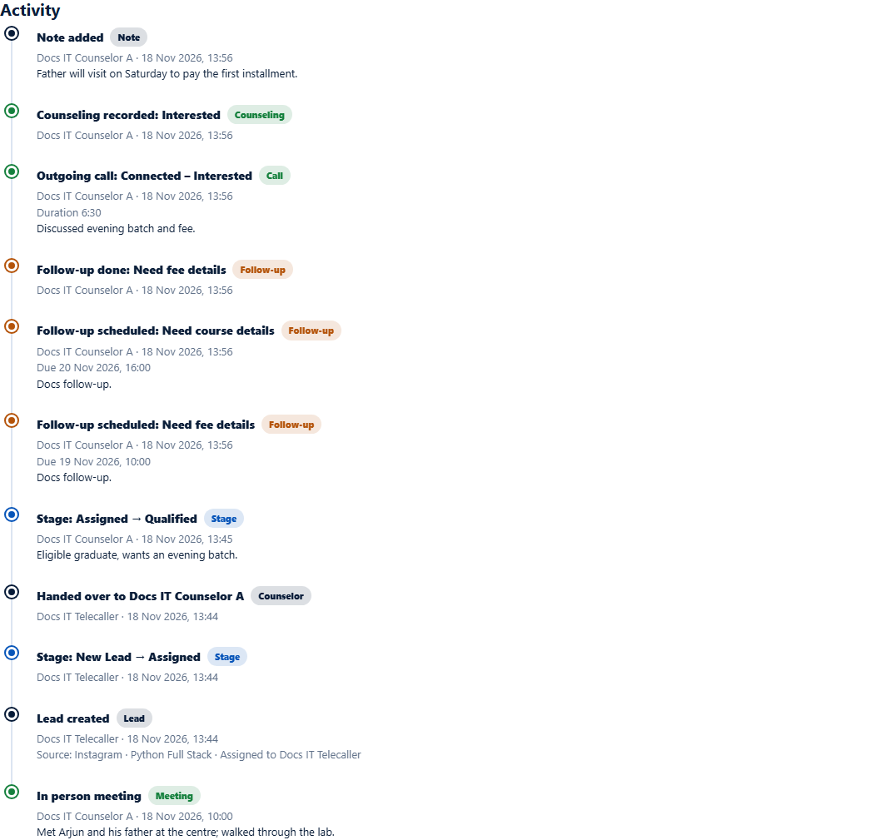

# Lead notes and activity timeline
> Doc ID: DOC-ITC-LEAD-014 · Verified on 2026-11-18 against `main` @ `6b61546c` · Roles: IT Counselor

## Purpose
Write short notes on a lead and see everything that has happened to it, in order.

## Who Can Use This Feature
- **IT Counselor**, on their own leads.

## Prerequisites
- None.

## How to Access
Lead page → **Notes** and **Activity** (bottom of the page).

## Steps
### Step 1 — Add a note
Type in **Add a note** (up to 4000 characters) and select **Add note**. The message **Note added.** appears and the note is listed with your name and the time.

### Step 2 — Read the activity timeline
**Activity** lists every event, newest first: lead created, stage changes, hand-overs, counselor changes, follow-ups, calls, counseling and notes. Each entry shows a tag (for example **Stage**, **Call**), who did it and when. Meetings are placed at the time the meeting happened.

## Expected Result
Your note is saved and appears in **Activity**.

## Validation Messages
| Message | When |
|---|---|
| Note added. | Saved |

## Tips
- Lead notes are internal. To share an update with an IT student, use student notes. See [Student notes](../notes/note-001-student-notes.md).

## Related Features
- [Log calls](lead-008-calls.md)
- [Student notes](../notes/note-001-student-notes.md)
