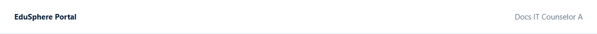
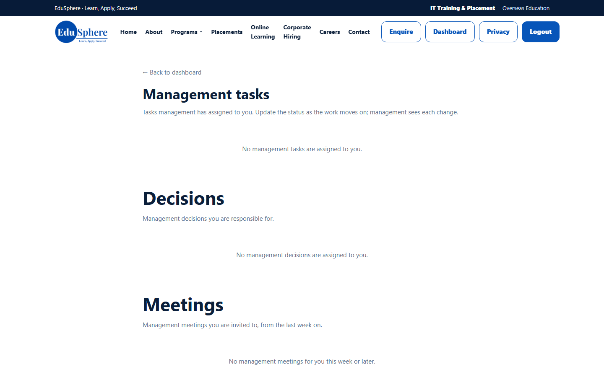
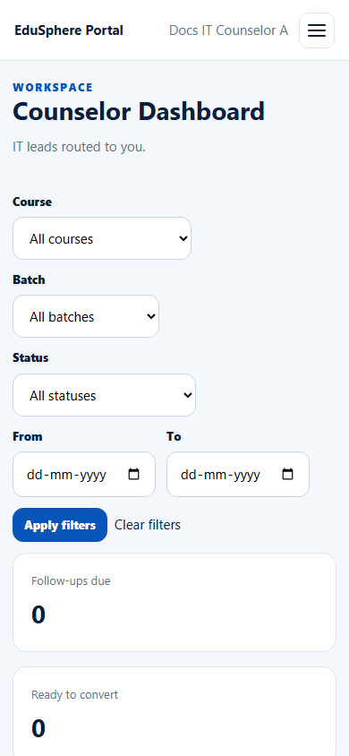
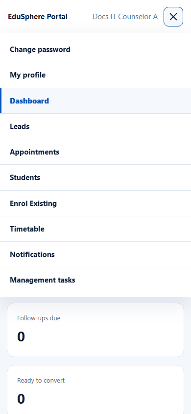

# Portal tour
> Doc ID: DOC-ITC-NAV-001 · Verified on 2026-11-18 against `main` @ `6b61546c` · Roles: IT Counselor

## Purpose
Find your way around the IT Counselor workspace: the sidebar, the top bar and the phone menu.

## Who Can Use This Feature
- **IT Counselor**.

## Prerequisites
- You are signed in. See [Sign in to the IT portal](../account-access/auth-001-sign-in.md).

## How to Access
Every IT Counselor page has the same sidebar on the left and the top bar above the page.

## Steps
### Step 1 — The sidebar
The top box shows your role (**Counselor**) and your name. Below it are eight menu items:

| Sidebar item | Page title | What it is for |
|---|---|---|
| **Dashboard** | Counselor Dashboard | Your numbers and lists at a glance |
| **Leads** | My leads | Leads routed to you by the telecaller |
| **Appointments** | Lead appointments | Appointments booked on your leads |
| **Students** | My Students | IT students linked to you |
| **Enrol Existing** | Enrol an existing Overseas student in IT | Add IT to a student who already studies with EduSphere Overseas |
| **Timetable** | Timetable | Class sessions of your students' batches |
| **Notifications** | Notifications | Batch and timetable changes and other notices |
| **Management tasks** | Management tasks | Tasks, decisions and meetings from management |

Below the menu are **Change password**, **My profile** and **Sign out**.

### Step 2 — The top bar
The top bar shows **EduSphere Portal** and your name.

### Step 3 — Management tasks
**Management tasks** opens with the public site header. It lists **Management tasks**, **Decisions** and **Meetings** from management. When nothing is assigned it says **No management tasks are assigned to you.** See [Management tasks](../tasks/task-001-management-tasks.md).

### Step 4 — On a phone
On a narrow screen the sidebar becomes a menu. Select **Open menu** to see the same items. The phone menu has **Change password** and **My profile** but no **Sign out**; to sign out, open **My profile** and use **Logout** in the site header.

## Expected Result
You can reach every IT Counselor page from the sidebar or the phone menu.

## Common Errors
**Problem:** You do not see Tasks, Documents, Applications, Visa, Calendar or Reports. **Cause:** Those are Overseas counselor pages. IT counselors keep follow-ups on each lead (see [Follow-ups](../leads/lead-007-follow-ups.md)).

## Tips
- **My profile** and **Management tasks** open with the public EduSphere header. Select **Dashboard** in that header to return.

## Related Features
- [Counselor dashboard](../dashboard/dash-001-dashboard.md)
- [Sign out](../account-access/auth-006-sign-out.md)
