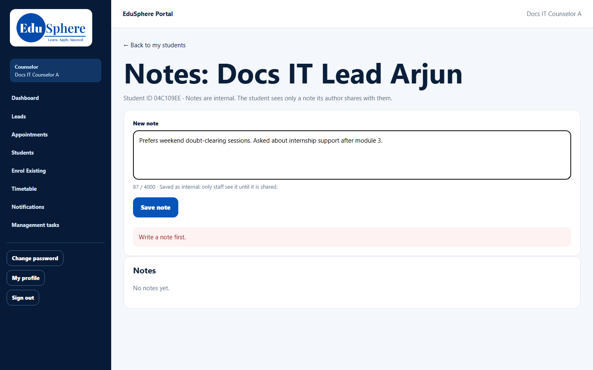
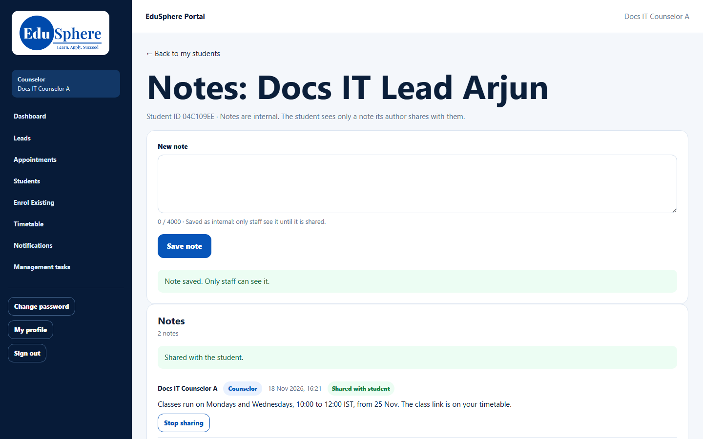
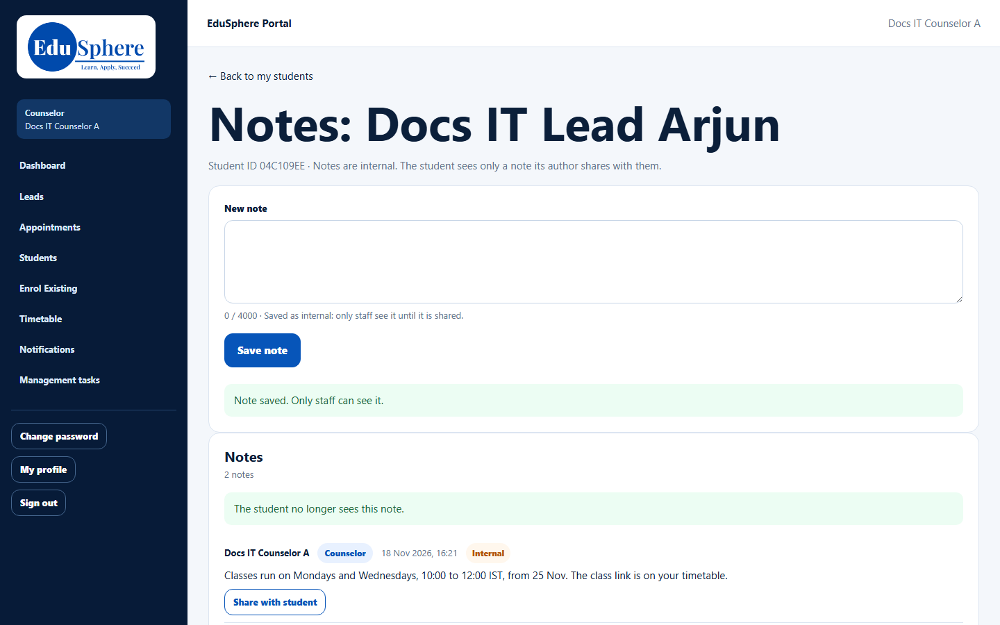

# Student notes: add, share with the student, stop sharing
> Doc ID: DOC-ITC-NOTE-001 · Verified on 2026-11-18 against `main` @ `6b61546c` · Roles: IT Counselor (also IT Admin, HR Team, Trainer)

## Purpose
Keep internal notes about a student, and share a note with the student when they should see it.

## Who Can Use This Feature
- **IT Counselor**: their own students.
- **IT Admin**, **HR Team** and **Trainer** have the same page in their own portals (from code; not captured).

## Prerequisites
- The student is assigned to you.

## How to Access
**Students** → **Notes** on the row (page title **Notes: {name}**).

## Steps
### Step 1 — Write a note
Type in **New note** (up to 4000 characters). Under the box: "Saved as internal: only staff see it until it is shared." Select **Save note**. The message **Note saved. Only staff can see it.** appears and the note is listed as **Internal**.

### Step 2 — Share a note with the student
On the note, select **Share with student**. Your browser asks **Share this note with {student}? They will see it in their Updates.** Select **OK**. The message **Shared with the student.** appears and the note is marked **Shared with student**.

### Step 3 — Stop sharing
Select **Stop sharing**. Your browser asks **Stop sharing this note? {student} will no longer see it.** Select **OK**. The message **The student no longer sees this note.** appears and the note is **Internal** again.

## Expected Result
- Notes are listed newest first with author, role, time and **Internal** or **Shared with student**.
- The student sees only shared notes, in their **Updates**.

## Validation Messages
| Message | When |
|---|---|
| Write a note first. | **Save note** with an empty box |
| Note saved. Only staff can see it. | Saved |
| Shared with the student. | Shared |
| The student no longer sees this note. | Sharing stopped |

## Tips
- A note's author shares it ("The student sees only a note its author shares with them.").
- **Load older notes** appears when there are more notes than fit on one page.

## Related Features
- [Student 360](../students/stu-002-student-360.md)
