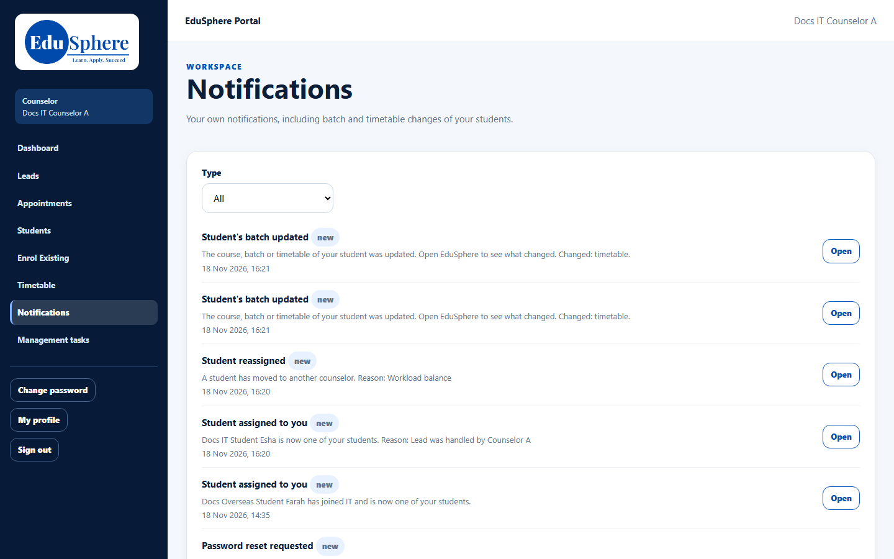
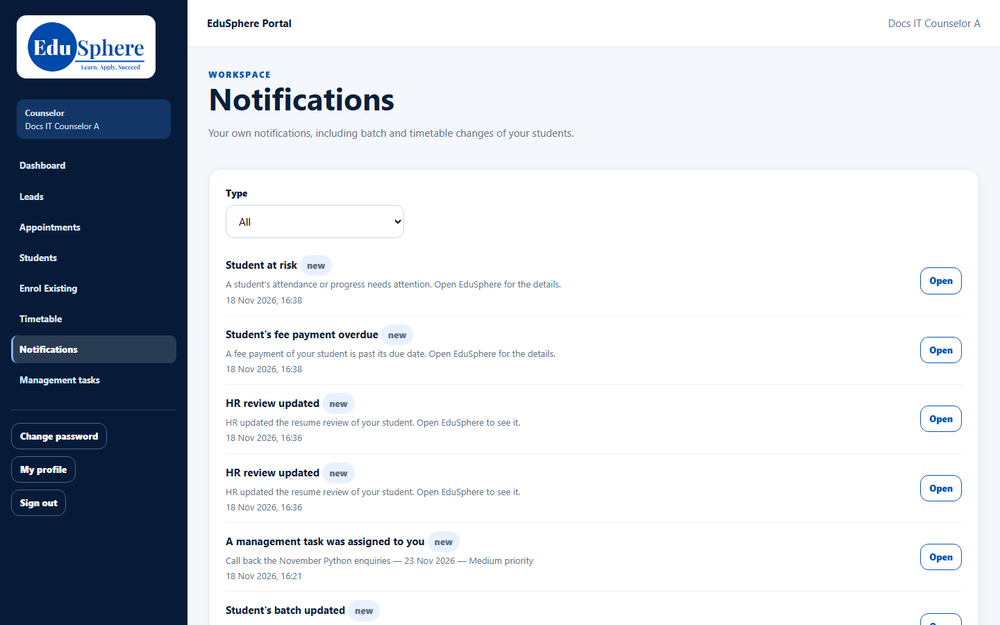

# Notifications
> Doc ID: DOC-ITC-NOTIF-001 · Verified on 2026-11-18 against `main` @ `6b61546c` · Roles: IT Counselor

## Purpose
See what EduSphere has told you: students assigned to you or moved away, batch and timetable changes of your students, and account messages.

## Who Can Use This Feature
- **IT Counselor**: their own notifications.

## Prerequisites
- None.

## How to Access
Sidebar **Notifications** ("Your own notifications, including batch and timetable changes of your students.").

## Steps
### Step 1 — Read the list
Newest first. Each item has a title, the message, the time, **new** if unread, and **Open** where there is a page to go to. **Type** filters by kind of notification.

### Step 2 — Open one
Select **Open** to go to the related page (for example **Students**).

## Notifications you can receive
| Title | When | Captured |
|---|---|---|
| Student assigned to you | You converted or enrolled a student, or the IT Admin assigned one to you. Shows the reason if one was given | Yes |
| Student reassigned | The IT Admin moved one of your students to another counselor. Shows the reason | Yes |
| Student's batch updated | The course, batch or timetable of one of your students with an **active** enrolment changed. Ends with "Changed: {what}." | Yes ("Changed: timetable.") |
| Password reset requested | A password reset was requested for your account | Yes |
| A management task was assigned to you | Management gave you a task | Yes |
| HR review updated | HR changed the resume review of one of your students | Yes |
| Student's fee payment overdue | A fee installment of your student is past its due date (daily check) | Yes |
| Student at risk | The daily at-risk check flagged your student | Yes |

Overdue follow-ups are escalated to the IT Admin, not to you; see [Overdue follow-up escalation](../../admin-manual/admin/adm-014-escalation.md).

## Expected Result
When you have none: "No notifications yet. Batch and timetable changes of your students appear here."

## Tips
- Batch notices only go out for students whose enrolment is active, not **Pending consent**.
- The event list is still provisional (finding P6).

## Related Features
- [My students](../students/stu-001-my-students.md)
- [Timetable](../timetable/tt-001-timetable.md)
