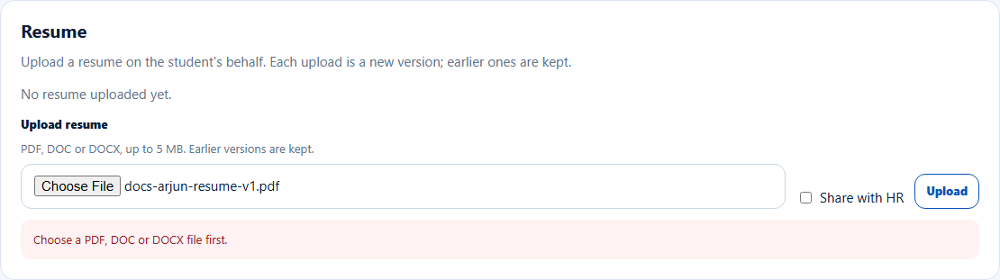
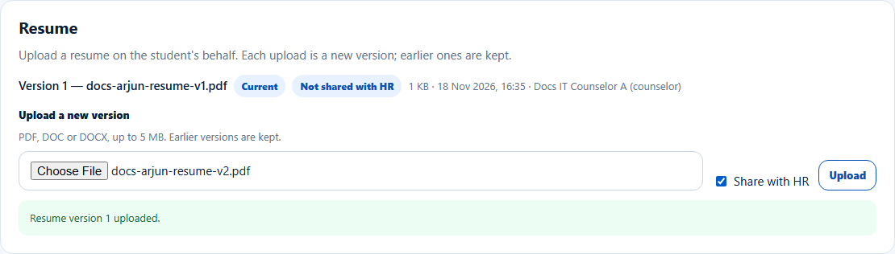
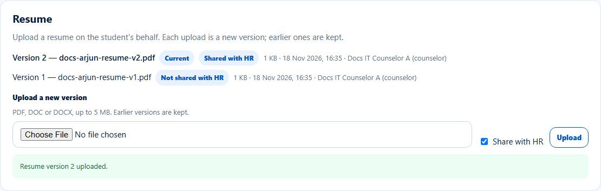

# Upload a resume and new versions
> Doc ID: DOC-ITC-RES-001 · Verified on 2026-11-18 against `main` @ `6b61546c` · Roles: IT Counselor (also the student and the IT Admin)

## Purpose
Upload a student's resume on their behalf, keep every version, and choose which version HR reviews.

## Who Can Use This Feature
- **IT Counselor**: their own students.
- The **student** (on their **Profile**) and the **IT Admin** can upload too.

## Prerequisites
- A PDF, DOC or DOCX file within the resume limit (5 MB by default; see [Resume upload limit](../../admin-manual/admin/adm-004-resume-limit.md)).

## How to Access
**Students** → **Profile** → card **Resume** ("Upload a resume on the student's behalf. Each upload is a new version; earlier ones are kept.").

## Steps
### Step 1 — Choose the file
Under **Upload resume** select the file. **Share with HR** is ticked by default; untick it to keep this version for the record only.

### Step 2 — Upload
Select **Upload**. The message **Resume version {n} uploaded.** appears. The field is now **Upload a new version**.

### Step 3 — Upload a new version and share it with HR
Choose the new file, leave **Share with HR** ticked and select **Upload**.

## Expected Result
The versions are listed newest first: **Version {n} — {file}**, **Current** on the newest, **Shared with HR** or **Not shared with HR**, size, time and who uploaded it. Sharing opens an HR review (see [HR review status](res-002-hr-review-status.md)).

## Validation Messages
| Message | When |
|---|---|
| Choose a PDF, DOC or DOCX file first. | **Upload** with no file |
| Resume version {n} uploaded. | Uploaded |
| The resume must be at most {limit}. | File too large (from code; not captured) |

## Tips
- Earlier versions are kept and can be downloaded from the list.
- Uploads are not virus-scanned in the demo stack (ClamAV is off there).

## Related Features
- [HR review status](res-002-hr-review-status.md)
- [HR works the resume review](../../admin-manual/handoffs/ho-004-hr-review.md)
