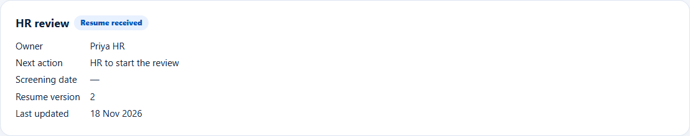
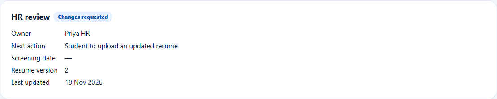

# HR review status
> Doc ID: DOC-ITC-RES-002 · Verified on 2026-11-18 against `main` @ `6b61546c` · Roles: IT Counselor

## Purpose
Follow where HR is with a student's resume, and what has to happen next.

## Who Can Use This Feature
- **IT Counselor**: their own students (read only).

## Prerequisites
- A resume version was shared with HR ([Upload a resume](res-001-upload-resume.md)). Until then the card says "No HR review yet. One opens when a resume version is shared with HR."

## How to Access
**Students** → **Profile** → card **HR review**. The Student 360 shows the same stage under **Resume and HR stage**.

## Steps
### Step 1 — Read the card
The heading shows the stage. The card shows **Owner** (the HR reviewer), **Next action**, **Screening date**, **Resume version** and **Last updated**.

### Step 2 — Act on the next action
When HR asks for changes, the stage is **Changes requested** and **Next action** reads **Student to upload an updated resume**. Help the student and upload the new version with **Share with HR** ticked.

## Stages
| Stage | Next action shown |
|---|---|
| Resume received | HR to start the review |
| Under review | HR is reviewing the resume |
| Changes requested | Student to upload an updated resume |
| Screening | HR screening call (from code) |
| Interview ready | Schedule interviews (from code) |
| Completed | No action: review complete (from code) |
| Withdrawn | No action: withdrawn from placement (from code) |

## Expected Result
Each HR change also sends you **HR review updated**, and **Changes requested** reviews count in **Pending HR actions** on your [Dashboard](../dashboard/dash-001-dashboard.md).

## Tips
- HR's skill-gap notes are internal to HR and never shown to you or the student.

## Related Features
- [HR works the resume review](../../admin-manual/handoffs/ho-004-hr-review.md)
- [HR review assignment rules](../../admin-manual/admin/adm-012-hr-review-rules.md)
